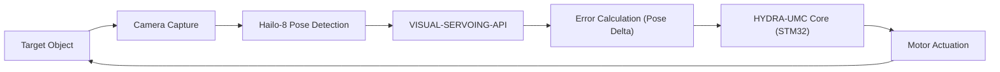

<!-- =============================================================================
HYDRA-UMC-VISUAL-SERVOING-API - Pose-correction law with zone-gated authorisation
Copyright (C) JuanenRac (Electro Hobby 3D) <electrohobby3d@gmail.com>
GPL-3.0-or-later - see LICENSE
============================================================================= -->

<p align="center">
  
</p>

# 🎯 HYDRA-UMC-VISUAL-SERVOING-API

<p align="center">🇺🇸 <b>English</b> | <a href="README_spa.md">🇪🇸 Español</a> | <a href="README_fra.md">🇫🇷 Français</a> | <a href="README_ita.md">🇮🇹 Italiano</a> | <a href="README_deu.md">🇩🇪 Deutsch</a> | <a href="README_zho.md">🇨🇳 简体中文</a> | <a href="README_jpn.md">🇯🇵 日本語</a> | <a href="README_por.md">🇵🇹 Português</a></p>

### 📐 Pose-Correction Law with Zone-Gated Authorisation (v0: no camera pose estimation yet)

<p align="center">
  
  
  
  
  
  
</p>

---

> **Safety and security status:** this ecosystem is not a certified safety system. There is no hardware E-STOP path, no firmware-enforced limits or interlocks and no verified motion command yet; firmware images are checked with CRC-32 and an Ed25519 signature, and a release build refuses the published development keys (the tool heads and expansion boards behind the relay still run URTC bootloaders, which take a shared-key HMAC-SHA256 instead of a signature); TLS and mutual TLS are optional and off by default; no custom board has been populated or tested yet. Read the [security baseline](https://github.com/JuanenRac/HYDRA-UMC-DOCS/blob/main/docs/SECURITY_BASELINE.md) and the [threat model](https://github.com/JuanenRac/HYDRA-UMC-DOCS/blob/main/docs/THREAT_MODEL.md) before relying on any statement here for the safety of a person.

---

## 📋 At a glance

| | |
|---|---|
| Version | `0.2.1` |
| Maturity | Functional |
| Tests | 208 (`python -m pytest -q tests`) |
| Stack | Python / 6-DOF pose estimation |
| Target | The Raspberry Pi CM5 of a HYDRA-UMC cell |
| On real hardware | Not yet: no run on real hardware is recorded for this version |

**Jump to:** [Overview](#-overview) · [Architecture](#-architecture) · [Quick start](#-quick-start) · [Testing](#-testing) · [Repository Structure](#-repository-structure) · [Related Projects](#-related-projects)

## 🚦 Project status

Each line is one part of this repository and the light says how far it is today. It is written from what the repository can show (tests, builds, runs), not from what is planned.

🟢 Done and verified · 🟡 Works, with known limits · 🟠 Partly done or not verified yet · 🔴 Not done or not working

| Area | State | What it means here |
|---|---|---|
| Software | 🟡 | Works for its main purpose; the honesty check above lists what is still missing |
| Tests | 🟢 | 208 automated tests, run on every change |
| Real hardware | 🔴 | Not yet: no run on real hardware is recorded for this version |
| Documentation | 🟢 | README in eight languages, checked against the manifest on every change |

## 🎯 Overview

**HYDRA-UMC-VISUAL-SERVOING-API** is meant to be the precision bridge between perception and motion. It calculates the error delta between a desired pose and the visual pose of an object it is given, and returns a gated correction; no camera feeds it yet and nothing sends corrections to the firmware.

It is designed to support both **Eye-in-Hand** (camera on tool) and **Eye-to-Hand** (fixed camera) configurations, as groundwork for Pick-and-Place, SMD alignment and dynamic trajectory adjustment (planned: no robot has been corrected with it).

### Key Features:
* 🔑 **Optional Bearer token:** on loopback the API needs no token; away from loopback it refuses to start without one (`--token-file` or `HYDRA_UMC_VISUAL_SERVOING_TOKEN`). With a token set, every request must send `Authorization: Bearer <token>` (constant-time comparison); only `GET /stats`, the health path of the manifest, stays open. *(implemented)*
* ✅ **Real v0 - PBVS correction law:** `pose.py` + `servo.py` compute the pose delta between a current and target 6-DOF pose (shortest-turn angle wrapping, no gimbal-lock-prone long way around) and turn it into a proportional velocity command, clamped without distorting its direction. Exposed via the `correct` subcommand below - no camera or NPU needed to run or test it.
* 🛡️ **Real v0 - Safety-gated authorization:** `authorization.py` refuses to turn perception into motion unless the upstream safety state is `READY` and the visual data is fresh/confident enough. Exposed via the new `request` subcommand below - no camera, NPU, or SAFETY-ZONES process needed to run or test it.
* 🌐 **JSON/HTTP API (v0):** the real `serve` subcommand exposes the same `correct`/`request` logic as `POST /correct`/`POST /request` (plus `GET /stats`), over the standard library's `http.server` with zero extra dependencies - reachable from a real caller instead of one-shot CLI args. See [`docs/CLI_REFERENCE.md`](docs/CLI_REFERENCE.md).
* 🔁 **Servoing sessions (the loop with memory):** `POST /sessions` opens a session with a nominal period, a gain, a filter on the measured pose, a dead band with hysteresis, acceleration limits and a vision timeout; `POST /sessions/<id>/correct` (or `/request`, which goes through the same safety gate as `POST /request`) steps it, `POST /sessions/<id>/vision-lost` reports a lost detection and `DELETE /sessions/<id>` closes it. A gain whose `K*T` is above 0.5 is refused when the session opens (the loop is an integrator: it needs `K*T` below 1 to converge without overshoot and below 2 to converge at all), a pause longer than the timeout or a command that is not authorised makes the next command start from rest, and a session can ask for less than the service's limits allow, never more. Tested against a simulated plant with delay and noise (`tests/test_session.py`); never against a real tool.
* 🛡️ **Safety state asked of the safety service (off by default):** `serve --safety-zones-url URL` (or `HYDRA_UMC_SAFETY_ZONES_URL`, token in `--safety-zones-token-file`) makes the service read the latest verdict of HYDRA-UMC-SAFETY-ZONES (`GET /state`) and ignore the `safety_state` a caller sends. A request must then carry `captured_at_utc`, and the service computes the age of the detection itself. No answer, an old verdict or an error means `INHIBITED`. Off by default, when the caller sends the SafetyState object with its time. Tested against a stand-in service, never on a real cell.
* 🔄 **Closed-Loop Control:** Continuous feedback loop bypassing the high-level orchestrator for low latency. *(architecture goal - the gRPC feed to the HYDRA-UMC core is still future work.)*
* 📐 **Pose Estimation:** 6-DOF object pose estimation from single or multi-camera views. *(future work - needs the real Hailo-8 NPU this repo doesn't have access to yet.)*
* ⚡ **Hardware Accelerated:** Uses Hailo-8 output for instant coordinate calculation. *(future work, same reason.)*
* 🔌 **HailoRT integration boundary, prepared ahead of the module:** `hailo_runtime.py` is written against the real, confirmed `hailo_platform` API (`VDevice`, `HEF`, `ConfigureParams`) - lazily imported so this repo installs/tests cleanly with no `hailort` package or Hailo-8 module present - and `hailo_output_to_pose()` adapts a real inference result straight into the `Pose6D` `compute_pose_error()` already consumes. *(implemented, integration boundary only - actually running inference still needs a real compiled pose-estimation `.hef` and a physical Hailo-8 module.)*
* 🔐 **Pose model from verified bytes:** the Hailo pose model can be built from the bytes `HYDRA-UMC-DETECTION-HEF` already read and checked, hashed again here, and the path is never reopened; empty or different bytes are refused. *(No model has run on a Hailo chip yet.)*

## 🧩 Role in HYDRA-UMC

**HYDRA-UMC-VISUAL-SERVOING-API** turns the difference between a current and a target 6-DOF pose into a bounded velocity command, inside a session that remembers the loop. A request is only answered when its data is fresh enough, its confidence high enough and the safety state allows motion; limits can be made stricter by a caller, never looser. No pose comes from a camera yet.

## 🏛️ Architecture

<p align="center">
  
</p>

<details>
<summary>Text version of the diagram (Mermaid)</summary>



</details>

### ARCHITECTURE & DESIGN DECISIONS

* **Why this API has no hardware/firmware of its own.** It runs entirely on the shared CM5 + Hailo-8 module owned by the integration parent, HYDRA-UMC-VISION-NODE - no board of its own to design, so `hardware/`/`firmware/`/`os/` were pruned rather than left empty.
* **Why it's a sibling, not a submodule, of HYDRA-UMC-VISION-NODE.** Pose correction runs as its own process/deployable so a crash or slow inference cycle here can't stall the parent's own detection pipeline, which HYDRA-UMC-SAFETY-ZONES depends on for E-STOP timing.
* **Why the correction law ships before pose estimation.** Turning a pose *pair* into a bounded velocity command is pure control-theory math - it needs no camera or NPU to write or test, so v0 lands that piece (`pose.py`, `servo.py`) first. Real 6-DOF pose *estimation* needs the Hailo-8 hardware this environment doesn't have, and lands later.
* **How this fits the rest of the ecosystem.** Sits downstream of perception (HYDRA-UMC-VISION-NODE) and upstream of motion (HYDRA-UMC firmware) - turns detected offsets into the kinematic corrections the robot arm's own jog/servo loop applies. Planned: the firmware has no such jog/servo loop yet.
* **Why `authorize_correction()` checks `safety_state` before confidence/freshness.** A safety fault must win over everything else, even a perfectly fresh and confident detection - so `INHIBITED` (safety_state != "READY") is checked first and short-circuits the rest of the policy. Only once the arm is confirmed safe to move does it matter whether the *data* is trustworthy enough to move it on (`REJECTED` for low confidence or stale data). This mirrors the `INHIBITED`-before-`DANGER`/`WARNING` precedence already used in HYDRA-UMC-SAFETY-ZONES.
* **Why `request` is a new subcommand instead of changing `correct`.** `correct` is the existing low-level pure-math utility (no safety awareness, no camera-freshness concept) with its own callers and tests; wrapping it in a safety gate in place would silently change its contract. `request` adds the gated, camera-facing entry point ecosystem code should actually call, while `correct` stays available unchanged for direct pose-math use.

## 🚀 Quick start

Requires Python 3.10 or newer.

```bash
./build.sh  # Linux, macOS (build.bat on Windows)
./run.sh correct --current 0.10,0.20,0.30,0.0,0.0,0.0 --target 0.15,0.20,0.25,0.0,0.0,0.10
./run.sh serve --port 8106
```

## 🧪 Testing

208 automated tests run with `python -m pytest -q tests`. They need no hardware and nothing outside this machine.

The CI runs `HYDRA_UMC_CI=1 python tools/ci_validate.py`, which checks the manifest, the documents, the eight READMEs and the pictures.

## 🏗️ Build & Release

Requires Python 3.10+.

```bash
# Linux / macOS
./build.sh   # creates .venv, installs the
             # package editable (with dev extras), compile-checks every
             # file under src/, and runs the real pytest suite
./run.sh     # runs the entry point from .venv, prints name + version + role
```

```bat
:: Windows
build.bat
run.bat
```

`build.sh`/`build.bat` never change the version (only `python tools/hydra_project_tool.py bump` raises it), then compile-check the source with
`python -m compileall`.

Real example - compute the correction from a current pose to a target one:

```bash
./run.sh correct --current "0,0,0.5,0,0,0" --target "0.02,-0.01,0.48,0,0,0.05" \
  --gain 0.8 --max-linear-speed 0.05
# pose error   : dx=0.020000 dy=-0.010000 dz=-0.020000  droll=0.000000 dpitch=0.000000 dyaw=0.050000
# error norm   : linear=0.030000 m  angular=0.050000 rad
# velocity cmd : vx=0.016000 vy=-0.008000 vz=-0.016000  wroll=0.000000 wpitch=0.000000 wyaw=0.040000
# converged    : False
```

Real example - request a safety-gated correction (accepted, inhibited, and rejected):

```bash
./run.sh request --current "0,0,0,0,0,0" --target "1,0,0,0,0,0" \
  --frame-id cam0-f42 --confidence 0.9 --data-age-ms 30 --safety-state READY
# outcome : ACCEPTED - frame 'cam0-f42' authorized (confidence=0.9, data_age_ms=30.0)
# pose error   : dx=1.000000 dy=0.000000 dz=0.000000  droll=0.000000 dpitch=0.000000 dyaw=0.000000
# velocity cmd : vx=0.250000 vy=0.000000 vz=0.000000  wroll=0.000000 wpitch=0.000000 wyaw=0.000000

./run.sh request --current "0,0,0,0,0,0" --target "1,0,0,0,0,0" \
  --frame-id cam0-f42 --confidence 0.9 --data-age-ms 30 --safety-state FAULT
# outcome : INHIBITED - safety_state is 'FAULT', not 'READY'   (exit code 2)

./run.sh request --current "0,0,0,0,0,0" --target "1,0,0,0,0,0" \
  --frame-id cam0-f42 --confidence 0.2 --data-age-ms 30 --safety-state READY
# outcome : REJECTED - confidence 0.2 is below the required minimum 0.6 for frame 'cam0-f42'   (exit code 1)
```

## 📂 Repository Structure

<p align="center">
  
</p>

<details>
<summary>Text version of the tree</summary>

```text
HYDRA-UMC-VISUAL-SERVOING-API/
├── tools/                           source code
│   ├── build_test.py                Non-versioning build/compile check (no version/CHANGELOG bump)
│   ├── ci_validate.py               Manifest/CHANGELOG/docs validation used by CI
│   ├── _doc_policy.py               Documentation rules shared by the family (a copy of HYDRA-UMC-SDK's, kept in sync)
│   ├── _readme_parity.py            Check that the eight READMEs share one structure (a copy of HYDRA-UMC-SDK's, kept in sync)
│   └── hydra_project_tool.py        The same commands in every repository: validate, test, ci, version, status, bump
├── src/                             Source code (hydra_umc_visual_servoing_api package)
├── tests/                           Real pytest suite (pose, servo, authorization, hailo_runtime, api, CLI)
├── docs/                            Documentation and kinematic theory
├── images/                          Media and diagrams
├── systemd/                         service unit
├── .github/                         CI workflow and issue templates
├── pyproject.toml                   package metadata
├── bump_version.py                  explicit version bump
├── bump_manifest_version.py         Syncs hydra-umc.project.json's version to the native one (--sync)
├── build.sh / build.bat             venv + editable install + compile-check + tests
├── build-test.sh / build-test.bat   Non-versioning build check (no CHANGELOG/version bump)
├── run.sh / run.bat                 Runs the entry point from the local venv
├── CHANGELOG.md                     what changed in each version
├── Dockerfile                       container image
├── hydra-umc.project.json           manifest: version, maturity, family
└── test.sh                          runs the tests
```

</details>

## 🗺️ Roadmap & Known limits

**Known limits today**

### Current Status & Next Steps

**Real today:** the PBVS pose-error and velocity-command correction law
(`pose.py`, `servo.py`) - the "Error Calculation (Pose Delta)" step in
the loop diagram above - with a real `correct` CLI command; the
safety-gated authorization policy (`authorization.py`) that refuses to
turn a visual detection into motion unless the upstream safety state is
`READY` and the data is confident/fresh enough, exposed via the `request`
CLI command; and a real HailoRT integration boundary (`hailo_runtime.py`)
ready for a real Hailo-8 pose estimator the moment it plugs in. 208 tests
total.

**Still ahead, and blocked on real hardware:** actually running 6-DOF
pose *estimation* through `hailo_runtime.py` needs a real compiled
pose-estimation `.hef` (no specific model chosen yet) and a physical
Hailo-8 NPU attached, and the low-latency gRPC feed of the resulting
velocity command to the HYDRA-UMC core is separate future work.

### ROADMAP

* **Phase 1:** Hand-eye calibration, so camera poses can be expressed in the robot frame.
* **Phase 2:** Image-based visual servoing (IBVS) alongside the existing position-based law.
* **Phase 3:** A rate limit on the velocity commands sent to the robot.
* **Phase 4:** A watchdog that stops the motion when detections go stale or disappear.

## 🌍 Languages

This README and the documents of the repository exist in eight languages: English, Spanish, German, French, Italian, Japanese, Chinese and Portuguese (Portugal). They are written together and checked in the CI so that the eight files have the same sections and the same links. This repository has no screen or message catalogue of its own, so there are no interface strings to translate.

## 🔗 Related Projects

This project is part of the HYDRA-UMC robotics ecosystem by the same author (JuanenRac / Electro Hobby 3D). Worth knowing about, since a request might actually be about one of these rather than this repository.

**Parent Project**
- **[HYDRA-UMC-VISION-NODE](https://github.com/JuanenRac/HYDRA-UMC-VISION-NODE)** — integration hub for the Hailo-8 vision pipeline, with a real per-stage hardware-readiness check; the parent this repo is one specific stage or consumer of, within its own perception pipeline.

**Sibling Projects** — the other stages/consumers of HYDRA-UMC-VISION-NODE's own Hailo-8 perception pipeline
- **[HYDRA-UMC-VISION-STREAMER](https://github.com/JuanenRac/HYDRA-UMC-VISION-STREAMER)** — real GStreamer pipeline + MediaMTX config generator with a real HailoRT integration boundary.
- **[HYDRA-UMC-DETECTION-HEF](https://github.com/JuanenRac/HYDRA-UMC-DETECTION-HEF)** — real compiled-model registry with Hailo-architecture/checksum safe-load verification.
- **[HYDRA-UMC-SAFETY-ZONES](https://github.com/JuanenRac/HYDRA-UMC-SAFETY-ZONES)** — v0 zone-breach, calibration-freshness and E-STOP-request logic that takes object positions from a file; no detector feeds it and no physical E-STOP is wired to it yet.

**Directly Related**
- **[HYDRA-UMC](https://github.com/JuanenRac/HYDRA-UMC)** — the robot-arm motherboard design: CM5 host + dual-core STM32H745, meant to orchestrate up to 8 tool arms over CAN-OTA/SPI-OTA (firmware at an early stage; no populated board yet); no firmware receives this API's kinematic pose corrections yet.

**Also Part of the Ecosystem**

*Core Hardware & Platform*
- **[HYDRA-UMC-OS](https://github.com/JuanenRac/HYDRA-UMC-OS)** — reproducible Raspberry Pi OS product layer for the CM5: read-only agent, validated config/profiles, WiFi first-contact provisioning.
- **[HYDRA-UMC-SDK](https://github.com/JuanenRac/HYDRA-UMC-SDK)** — the shared JSON-Schema contract and software job-gate boundary every bridge validates its commands against (not a certified safety function).
- **[HYDRA-UMC-CONNECTOR-HUB](https://github.com/JuanenRac/HYDRA-UMC-CONNECTOR-HUB)** — declarative adapter-manifest registry and validator for external-machine connectors; extends the SDK's own contract idea to external machines without replacing the industrial-gateway projects.

*Core Backend & Clients*
- **[HYDRA-UMC-SERVER](https://github.com/JuanenRac/HYDRA-UMC-SERVER)** — the real headless backend (REST/WebSocket) every control client actually talks to.
- **[HYDRA-UMC-STUDIO](https://github.com/JuanenRac/HYDRA-UMC-STUDIO)** — web control dashboard with real-time multi-robot 3D visualization.
- **[HYDRA-UMC-SUITE](https://github.com/JuanenRac/HYDRA-UMC-SUITE)** — desktop (PySide6) swarm command center for multiple servers at once, packaged as a standalone executable.
- **[HYDRA-UMC-ANDROID-CONTROL](https://github.com/JuanenRac/HYDRA-UMC-ANDROID-CONTROL)** — native Android control app with biometric login and a paired Wear OS companion.
- **[HYDRA-UMC-IOS-CONTROL](https://github.com/JuanenRac/HYDRA-UMC-IOS-CONTROL)** — iOS/iPadOS control app (Flutter) with real-time WebSocket sync.
- **[HYDRA-UMC-DSI](https://github.com/JuanenRac/HYDRA-UMC-DSI)** — native touch UI for the onboard 7" DSI touchscreen, embedded on the CM5 itself.
- **[HYDRA-UMC-EDITOR-URDF](https://github.com/JuanenRac/HYDRA-UMC-EDITOR-URDF)** — desktop graphical URDF creator/editor that pushes finished models into STUDIO's own catalog.
- **[HYDRA-UMC-EDITOR-STL](https://github.com/JuanenRac/HYDRA-UMC-EDITOR-STL)** — desktop STL model editor, transforming/replacing/removing/adding real parts in the same model catalog HYDRA-UMC-EDITOR-URDF also edits.
- **[HYDRA-UMC-BRIDGE-AMR](https://github.com/JuanenRac/HYDRA-UMC-BRIDGE-AMR)** — coordination boundary for AGV/AMR fleets via a VDA 5050 MQTT publisher (tested against an emulated fleet only).
- **[HYDRA-UMC-BRIDGE-CNC](https://github.com/JuanenRac/HYDRA-UMC-BRIDGE-CNC)** — high-level CNC-cell coordinator with GRBL status/control-byte access (tested against an emulator only).
- **[HYDRA-UMC-BRIDGE-DROIDS](https://github.com/JuanenRac/HYDRA-UMC-BRIDGE-DROIDS)** — coordination boundary for legged/humanoid droids, with a Boston Dynamics Spot command sender (tested against an emulator only).
- **[HYDRA-UMC-BRIDGE-LASER](https://github.com/JuanenRac/HYDRA-UMC-BRIDGE-LASER)** — laser-cell coordinator reading 3 key/enclosure/interlock GPIO signals (tested against a fake chip only; it cannot arm or fire a laser).
- **[HYDRA-UMC-BRIDGE-OPENPNP](https://github.com/JuanenRac/HYDRA-UMC-BRIDGE-OPENPNP)** — safe high-level board-flow coordinator for OpenPnP pick-and-place.
- **[HYDRA-UMC-BRIDGE-PRINTER3D](https://github.com/JuanenRac/HYDRA-UMC-BRIDGE-PRINTER3D)** — safe coordination boundary for Moonraker/Klipper 3D printers, with real gated job commands.
- **[HYDRA-UMC-BRIDGE-ROS2](https://github.com/JuanenRac/HYDRA-UMC-BRIDGE-ROS2)** — coordinator with a lazily imported rclpy ROS 2 transport (not yet run against a ROS 2 installation).
- **[HYDRA-UMC-BRIDGE-UAV](https://github.com/JuanenRac/HYDRA-UMC-BRIDGE-UAV)** — coordination boundary for camera-equipped UAVs, with a MAVLink command sender (tested against an emulator only).

*URTC Tool Platform*
- **[URTC](https://github.com/JuanenRac/URTC)** — firmware for the physical Universal Robot Tool Controller PCB, 25+ tool profiles over CAN bus.
- **[URTC-FLASHER](https://github.com/JuanenRac/URTC-FLASHER)** — desktop GUI flashing tool for URTC boards, CAN-OTA plus full-chip SWD/JTAG.
- **[URTC-TESTER](https://github.com/JuanenRac/URTC-TESTER)** — desktop live CAN-bus diagnostic tool for URTC boards, one panel per tool profile.
- **[URTC-WEB-STUDIO](https://github.com/JuanenRac/URTC-WEB-STUDIO)** — browser-based alternative to URTC-TESTER via the Web Serial API, no local install needed.
- **[URTC-GATEWAY](https://github.com/JuanenRac/URTC-GATEWAY)** — gateway in front of the URTC CAN bus: an allowed list of identifiers, a rate limit and a session key; software tested on a computer, not yet on a real bus.

*Cognitive AI Node (Hailo-10)*
- **[HYDRA-UMC-COGNITIVE-NODE](https://github.com/JuanenRac/HYDRA-UMC-COGNITIVE-NODE)** — integration hub for the Hailo-10 cognitive pipeline (LLM/VLA/voice orchestration).
- **[HYDRA-UMC-VLA-ENGINE](https://github.com/JuanenRac/HYDRA-UMC-VLA-ENGINE)** — real action-token encoding/decoding and trajectory generation for a Vision-Language-Action model.
- **[HYDRA-UMC-VOICE-UI](https://github.com/JuanenRac/HYDRA-UMC-VOICE-UI)** — real voice front-end (VAD + intent parser) with a bounded, confirmation-gated Watch relay.
- **[HYDRA-UMC-SEMANTIC-PLANNER](https://github.com/JuanenRac/HYDRA-UMC-SEMANTIC-PLANNER)** — real rule-based task decomposition and semantic error recovery over MCU error codes.
- **[HYDRA-UMC-DOCS-QA](https://github.com/JuanenRac/HYDRA-UMC-DOCS-QA)** — real stdlib-only TF-IDF document search over this ecosystem's own Markdown docs.
- **[HYDRA-UMC-LOCAL-TECHNICIAN](https://github.com/JuanenRac/HYDRA-UMC-LOCAL-TECHNICIAN)** — local, policy-gated AI maintenance technician for the ecosystem itself - observes, diagnoses and proposes fixes; the two highest risk levels are deliberately not implemented yet.

*Orchestration & Swarm*
- **[HYDRA-UMC-ORCHESTRATOR](https://github.com/JuanenRac/HYDRA-UMC-ORCHESTRATOR)** — integration hub with a real gRPC/Protobuf health-report contract and mission state machine.
- **[HYDRA-UMC-JOB-DISPATCHER](https://github.com/JuanenRac/HYDRA-UMC-JOB-DISPATCHER)** — real priority-based job queue with deduplication, over a real HTTP API.
- **[HYDRA-UMC-NODE-HEALING](https://github.com/JuanenRac/HYDRA-UMC-NODE-HEALING)** — real gRPC-based fleet health watchdog with retry/backoff and identity-mismatch detection.
- **[HYDRA-UMC-PATH-PLANNER-3D](https://github.com/JuanenRac/HYDRA-UMC-PATH-PLANNER-3D)** — real RRT-based 3D path planner with real obstacle/workspace collision validation.
- **[HYDRA-UMC-SWARM-SYNC](https://github.com/JuanenRac/HYDRA-UMC-SWARM-SYNC)** — real CRDT LWW-Element-Map state sync, property-tested for multi-cell convergence.

*Digital Twin & Simulation*
- **[HYDRA-UMC-TWIN](https://github.com/JuanenRac/HYDRA-UMC-TWIN)** — integration hub for the digital-twin engine, with a real version-compatibility sync contract.
- **[HYDRA-UMC-HIL-BRIDGE](https://github.com/JuanenRac/HYDRA-UMC-HIL-BRIDGE)** — hardware-in-the-loop router with a software collision interlock between simulation and real hardware (tested without real hardware).
- **[HYDRA-UMC-PHYSICS-REPLICA](https://github.com/JuanenRac/HYDRA-UMC-PHYSICS-REPLICA)** — real forward kinematics and joint-limit validation over a real URDF subset.
- **[HYDRA-UMC-SYNTHETIC-DATA-GEN](https://github.com/JuanenRac/HYDRA-UMC-SYNTHETIC-DATA-GEN)** — real procedural 2D scene generator with YOLO/COCO annotation export.

*Data & Analytics*
- **[HYDRA-UMC-DATALAKE](https://github.com/JuanenRac/HYDRA-UMC-DATALAKE)** — real sqlite3-backed time-series store with a real ingest/query HTTP API.
- **[HYDRA-UMC-ANOMALY-DETECTOR](https://github.com/JuanenRac/HYDRA-UMC-ANOMALY-DETECTOR)** — real FFT + statistical baseline anomaly detector with drift monitoring.
- **[HYDRA-UMC-PRODUCTION-REPORTS](https://github.com/JuanenRac/HYDRA-UMC-PRODUCTION-REPORTS)** — real OEE/availability calculation over DATALAKE history, with reproducible CSV export.
- **[HYDRA-UMC-TELEMETRY-COLLECTOR](https://github.com/JuanenRac/HYDRA-UMC-TELEMETRY-COLLECTOR)** — real CAN/WebSocket ingestion pipeline into DATALAKE, with sequence deduplication.

*Industrial Gateway*
- **[HYDRA-UMC-GATEWAY-INDUSTRIAL](https://github.com/JuanenRac/HYDRA-UMC-GATEWAY-INDUSTRIAL)** — integration hub relaying to industrial protocols, with a real command allowlist/backpressure layer.
- **[HYDRA-UMC-OPCUA-SERVER](https://github.com/JuanenRac/HYDRA-UMC-OPCUA-SERVER)** — real OPC-UA address space, verified with a real binary-protocol client session.
- **[HYDRA-UMC-MQTT-BROKER](https://github.com/JuanenRac/HYDRA-UMC-MQTT-BROKER)** — real MQTT broker with optional per-client authentication and topic ACLs.
- **[HYDRA-UMC-MTCONNECT-ADAPTER](https://github.com/JuanenRac/HYDRA-UMC-MTCONNECT-ADAPTER)** — real MTConnect `/probe` and `/current` XML endpoints with degraded-mode output.

*Complementary Tools & Ecosystem Operations*
- **[HYDRA-UMC-DASHBOARD-AI](https://github.com/JuanenRac/HYDRA-UMC-DASHBOARD-AI)** — Smart Summaries and Anomaly Highlighting panels over DATALAKE/ANOMALY-DETECTOR, with an honest statistical fallback.
- **[HYDRA-UMC-TOOL-CLI](https://github.com/JuanenRac/HYDRA-UMC-TOOL-CLI)** — fleet CLI with a real, stable exit-code contract, a genuine live client of HYDRA-UMC-SERVER's own API.
- **[HYDRA-UMC-WATCH](https://github.com/JuanenRac/HYDRA-UMC-WATCH)** — WearOS companion app with haptic alert patterns and a paired-phone voice relay (not yet run on a physical watch).
- **[URTC-SMART-RACK](https://github.com/JuanenRac/URTC-SMART-RACK)** — firmware for a board-mounting rack with real tool-ID decoding and Smart Idle pre-heating logic.
- **[URTC-VISION-TOOL](https://github.com/JuanenRac/URTC-VISION-TOOL)** — firmware plus a real Python vision companion for a thermal/RGB inspection tool head.
- **[HYDRA-UMC-UPDATER](https://github.com/JuanenRac/HYDRA-UMC-UPDATER)** — administrative desktop tool that discovers, clones and updates every repo in this ecosystem.
- **[HYDRA-UMC-OS-REBUILDER](https://github.com/JuanenRac/HYDRA-UMC-OS-REBUILDER)** — Windows/Linux desktop tool that builds a ready-to-flash CM5 image pre-loaded with the ecosystem's most current versions, with Raspberry-Pi-Imager-style first-boot Wi-Fi/user/SSH configuration.
- **[HYDRA-UMC-OPS-AGENT](https://github.com/JuanenRac/HYDRA-UMC-OPS-AGENT)** — maintenance-incident coordinator: a low-privilege edge role collects a sanitized inventory/health snapshot, a control-plane role renders it read-only and asks an AI provider to suggest a diagnosis - never applies a patch or deploys anything.
- **[HYDRA-UMC-DEV-SERVER](https://github.com/JuanenRac/HYDRA-UMC-DEV-SERVER)** — reproducible development host (Raspberry Pi 5 / CM5) that stores the ecosystem's source and runs bounded build/test tasks under a durable queue; a dedicated dev role, explicitly not an operational CM5.

## 📚 Documentation

Where to read more:

* **[docs/CLI_REFERENCE.md](docs/CLI_REFERENCE.md)** — every `correct`/`request`/`serve` invocation, real output captured from an installed CLI run, the exit-code table, and the `POST /correct`/`POST /request`/`GET /stats` HTTP JSON contract.
* [Security baseline of the ecosystem](https://github.com/JuanenRac/HYDRA-UMC-DOCS/blob/main/docs/SECURITY_BASELINE.md)
* [Threat model of the ecosystem](https://github.com/JuanenRac/HYDRA-UMC-DOCS/blob/main/docs/THREAT_MODEL.md)
* [Changelog of this repository](CHANGELOG.md)
* [License of this repository](LICENSE.md)

## 🤝 Contributing & Community

* Before a pull request run `HYDRA_UMC_CI=1 py -3 tools/ci_validate.py` (or `HYDRA_UMC_CI=1 python3 tools/ci_validate.py`): it must print `CI_VALIDATION=PASS`. Do not run `build.sh` or `build.bat` for this check; building is not a check.
* The eight READMEs are written from one source in HYDRA-UMC-DOCS; do not edit them by hand. Change the source and write them again with `tools/make_readmes.py`.
* Do not state in a README what has not run: say "simulated" or "not tried on hardware" where that is the truth.
* See [CONTRIBUTING.md](CONTRIBUTING.md), the [code of conduct](CODE_OF_CONDUCT.md), [SECURITY.md](SECURITY.md) and [SUPPORT.md](SUPPORT.md).

## 👤 AUTHOR

**JuanenRac (Electro Hobby 3D)** · electrohobby3d@gmail.com

## 📜 LICENSE

GPL-3.0-or-later - [LICENSE](LICENSE).
