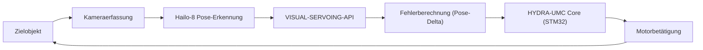

<!-- =============================================================================
HYDRA-UMC-VISUAL-SERVOING-API - Pose-correction law with zone-gated authorisation
Copyright (C) JuanenRac (Electro Hobby 3D) <electrohobby3d@gmail.com>
GPL-3.0-or-later - see LICENSE
============================================================================= -->

<p align="center">
  
</p>

# 🎯 HYDRA-UMC-VISUAL-SERVOING-API

<p align="center"><a href="README.md">🇺🇸 English</a> | <a href="README_spa.md">🇪🇸 Español</a> | <a href="README_fra.md">🇫🇷 Français</a> | <a href="README_ita.md">🇮🇹 Italiano</a> | 🇩🇪 <b>Deutsch</b> | <a href="README_zho.md">🇨🇳 简体中文</a> | <a href="README_jpn.md">🇯🇵 日本語</a> | <a href="README_por.md">🇵🇹 Português</a></p>

### 📐 Posenkorrekturgesetz mit zonenabhängiger Freigabe (v0: noch keine Posenschätzung per Kamera)

<p align="center">
  
  
  
  
  
  
</p>

---

> **Stand von Sicherheit (Safety) und Security:** Dieses Ökosystem ist kein zertifiziertes Sicherheitssystem. Es gibt noch keinen Hardware-E-STOP-Pfad, keine von der Firmware durchgesetzten Grenzen oder Verriegelungen und keinen verifizierten Bewegungsbefehl; Firmware-Images werden mit CRC-32 und einer Ed25519-Signatur geprüft, und ein Release-Build verweigert die veröffentlichten Entwicklungsschlüssel (die Werkzeugköpfe und Erweiterungsplatinen hinter dem Relais laufen noch mit URTC-Bootloadern, die statt einer Signatur ein HMAC-SHA256 mit gemeinsamem Schlüssel verwenden); TLS und gegenseitiges TLS sind optional und standardmäßig aus; noch keine eigene Platine wurde bestückt oder getestet. Lesen Sie die [Sicherheitsbasis](https://github.com/JuanenRac/HYDRA-UMC-DOCS/blob/main/docs/SECURITY_BASELINE.md) und das [Bedrohungsmodell](https://github.com/JuanenRac/HYDRA-UMC-DOCS/blob/main/docs/THREAT_MODEL.md), bevor Sie sich für die Sicherheit einer Person auf eine Aussage hier verlassen.

---

## 📋 Auf einen Blick

| | |
|---|---|
| Version | `0.2.1` |
| Reifegrad | Funktionsfähig |
| Tests | 208 (`python -m pytest -q tests`) |
| Technik | Python / 6-DOF pose estimation |
| Ziel | Der Raspberry Pi CM5 einer HYDRA-UMC-Zelle |
| Auf echter Hardware | Noch nicht: für diese Version ist kein Lauf auf echter Hardware vermerkt |

**Springe zu:** [Überblick](#-überblick) · [Architektur](#-architektur) · [Schnellstart](#-schnellstart) · [Tests](#-tests) · [Struktur des Repositorys](#-struktur-des-repositorys) · [Verwandte Projekte](#-verwandte-projekte)

## 🚦 Projektstatus

Jede Zeile ist ein Teil dieses Repositorys, und die Ampel sagt, wie weit er heute ist. Sie beruht auf dem, was das Repository zeigen kann (Tests, Builds, Läufe), nicht auf dem, was geplant ist.

🟢 Fertig und überprüft · 🟡 Funktioniert, mit bekannten Grenzen · 🟠 Teilweise fertig oder noch nicht überprüft · 🔴 Nicht gemacht oder funktioniert nicht

| Bereich | Stand | Was das hier bedeutet |
|---|---|---|
| Software | 🟡 | Funktioniert für seinen Hauptzweck; die Ehrlichkeitsprüfung oben nennt, was noch fehlt |
| Tests | 🟢 | 208 automatische Tests, bei jeder Änderung ausgeführt |
| Echte Hardware | 🔴 | Noch nicht: für diese Version ist kein Lauf auf echter Hardware vermerkt |
| Dokumentation | 🟢 | README in acht Sprachen, bei jeder Änderung gegen das Manifest geprüft |

## 🎯 Überblick

**HYDRA-UMC-VISUAL-SERVOING-API** soll die Präzisionsbrücke zwischen Wahrnehmung und Bewegung werden. Es berechnet das Fehlerdelta zwischen einer Soll-Pose und der visuellen Pose eines übergebenen Objekts und liefert eine freigabegesteuerte Korrektur; noch speist keine Kamera es, und nichts sendet Korrekturen an die Firmware.

Es ist dafür ausgelegt, sowohl **Eye-in-Hand**- (Kamera am Werkzeug) als auch **Eye-to-Hand**-Konfigurationen (feste Kamera) zu unterstützen, als Grundlage für Pick-and-Place, SMD-Ausrichtung und dynamische Bahnanpassung (geplant: mit ihm wurde noch kein Roboter korrigiert).

### Hauptmerkmale:
* 🔑 **Optionales Bearer-Token:** auf Loopback braucht die API kein Token; außerhalb von Loopback startet sie ohne eines nicht (`--token-file` oder `HYDRA_UMC_VISUAL_SERVOING_TOKEN`). Ist ein Token gesetzt, muss jede Anfrage `Authorization: Bearer <token>` senden (Vergleich in konstanter Zeit); nur `GET /stats`, der Health-Pfad des Manifests, bleibt offen. *(implementiert)*
* ✅ **Echtes v0 - PBVS-Korrekturgesetz:** `pose.py` + `servo.py` berechnen das Pose-Delta zwischen einer aktuellen und einer Ziel-Pose (Winkel werden über den kürzesten Weg gewickelt, nicht den langen, gimbal-lock-anfälligen Umweg) und wandeln es in einen proportionalen Geschwindigkeitsbefehl um, begrenzt ohne dessen Richtung zu verzerren. Über den unten stehenden Unterbefehl `correct` verfügbar - keine Kamera oder NPU nötig, um es auszuführen oder zu testen.
* 🛡️ **Echtes v0 - sicherheitsgesperrte Autorisierung:** `authorization.py` verweigert die Umwandlung von Wahrnehmung in Bewegung, es sei denn, der vorgelagerte Sicherheitszustand ist `READY` und die visuellen Daten sind frisch/vertrauenswürdig genug. Über den neuen Unterbefehl `request` verfügbar - keine Kamera, NPU oder SAFETY-ZONES-Prozess nötig, um es auszuführen oder zu testen.
* 🌐 **JSON/HTTP-API (v0):** der echte Unterbefehl `serve` stellt dieselbe `correct`/`request`-Logik als `POST /correct`/`POST /request` bereit (plus `GET /stats`), über das `http.server`-Modul der Standardbibliothek ohne zusätzliche Abhängigkeit - erreichbar von einem echten Aufrufer statt über einmalige CLI-Argumente. Siehe [`docs/CLI_REFERENCE.md`](docs/CLI_REFERENCE.md).
* 🔁 **Servo-Sitzungen (die Schleife mit Gedächtnis):** `POST /sessions` öffnet eine Sitzung mit nominaler Periode, Verstärkung, Filter auf der gemessenen Pose, Totzone mit Hysterese, Beschleunigungsgrenzen und Sichtzeitlimit; `POST /sessions/<id>/correct` (oder `/request`, das durch dasselbe Sicherheitstor wie `POST /request` geht) macht einen Schritt, `POST /sessions/<id>/vision-lost` meldet eine verlorene Erkennung und `DELETE /sessions/<id>` schließt sie. Eine Verstärkung, deren `K*T` über 0,5 liegt, wird beim Öffnen abgelehnt (die Schleife ist ein Integrator: sie braucht `K*T` unter 1, um ohne Überschwingen, und unter 2, um überhaupt zu konvergieren), eine Pause über dem Zeitlimit oder ein nicht autorisierter Befehl lässt den nächsten Befehl aus der Ruhe starten, und eine Sitzung darf weniger verlangen als die Grenzen des Dienstes erlauben, nie mehr. Gegen eine simulierte Strecke mit Verzögerung und Rauschen getestet (`tests/test_session.py`); nie mit einem echten Werkzeug.
* 🛡️ **Sicherheitszustand vom Sicherheitsdienst abgefragt (standardmäßig aus):** `serve --safety-zones-url URL` (oder `HYDRA_UMC_SAFETY_ZONES_URL`, Token in `--safety-zones-token-file`) lässt den Dienst das jüngste Urteil von HYDRA-UMC-SAFETY-ZONES lesen (`GET /state`) und das vom Aufrufer gesendete `safety_state` ignorieren. Eine Anfrage muss dann `captured_at_utc` enthalten, und der Dienst berechnet das Alter der Erkennung selbst. Keine Antwort, ein altes Urteil oder ein Fehler bedeutet `INHIBITED`. Standardmäßig aus; dann sendet der Aufrufer das SafetyState-Objekt mit Zeit. Gegen einen Ersatzdienst getestet, nie an einer echten Zelle.
* 🔄 **Closed-Loop-Steuerung:** Kontinuierliche Feedbackschleife, die den High-Level-Orchestrator für niedrige Latenz umgeht. *(Architekturziel - die gRPC-Übertragung an den HYDRA-UMC-Kern ist noch zukünftige Arbeit.)*
* 📐 **Pose-Schätzung:** 6-DOF-Objektpose-Schätzung aus Einzel- oder Multi-Kamera-Ansichten. *(zukünftige Arbeit - benötigt die echte Hailo-8-NPU, die diese Umgebung noch nicht hat.)*
* ⚡ **Hardware-beschleunigt:** Verwendet den Hailo-8-Ausgang für die sofortige Koordinatenberechnung. *(zukünftige Arbeit, gleicher Grund.)*
* 🔌 **HailoRT-Integrationsgrenze, dem Modul vorausgehend vorbereitet:** `hailo_runtime.py` ist gegen die echte, bestätigte `hailo_platform`-API (`VDevice`, `HEF`, `ConfigureParams`) geschrieben - lazy importiert, sodass dieses Repository ohne installiertes `hailort`-Paket oder vorhandenes Hailo-8-Modul sauber installiert/getestet wird - und `hailo_output_to_pose()` passt ein echtes Inferenzergebnis direkt in das `Pose6D` an, das `compute_pose_error()` bereits konsumiert. *(implementiert, nur Integrationsgrenze - tatsächliche Inferenz auszuführen braucht weiterhin ein echtes, kompiliertes Pose-Schätzungs-`.hef` und ein physisches Hailo-8-Modul.)*
* 🔐 **Posenmodell aus geprüften Bytes:** Das Hailo-Posenmodell kann aus den Bytes gebaut werden, die `HYDRA-UMC-DETECTION-HEF` schon gelesen und geprüft hat, hier erneut gehasht, und der Pfad wird nie wieder geöffnet; leere oder andere Bytes werden abgelehnt. *(Auf einem Hailo-Chip lief noch kein Modell.)*

## 🧩 Rolle in HYDRA-UMC

**HYDRA-UMC-VISUAL-SERVOING-API** macht aus der Differenz zwischen einer aktuellen und einer Zielpose mit 6 Freiheitsgraden einen begrenzten Geschwindigkeitsbefehl, innerhalb einer Sitzung, die die Regelschleife kennt. Eine Anfrage wird nur beantwortet, wenn ihre Daten frisch genug und ihre Konfidenz hoch genug sind und der Sicherheitszustand Bewegung erlaubt; ein Aufrufer kann Grenzen verschärfen, nie lockern. Noch kommt keine Pose von einer Kamera.

## 🏛️ Architektur

<p align="center">
  
</p>

<details>
<summary>Textversion des Diagramms (Mermaid)</summary>



</details>

### ARCHITEKTUR & DESIGNENTSCHEIDUNGEN

* **Warum diese API keine eigene Hardware/Firmware hat.** Sie läuft vollständig auf dem gemeinsam genutzten CM5 + Hailo-8-Modul des Integrations-Elternteils HYDRA-UMC-VISION-NODE - keine eigene Platine zu entwerfen, daher wurden `hardware/`/`firmware/`/`os/` entfernt statt leer gelassen.
* **Warum sie Geschwister, kein Submodul, von HYDRA-UMC-VISION-NODE ist.** Die Posenkorrektur läuft als eigener Prozess/eigenes Deployment, damit ein Absturz oder ein langsamer Inferenzzyklus hier nie die eigene Erkennungs-Pipeline des Elternteils blockieren kann, von der HYDRA-UMC-SAFETY-ZONES für das E-STOP-Timing abhängt.
* **Warum das Korrekturgesetz vor der Pose-Schätzung kommt.** Ein Pose-*Paar* in einen begrenzten Geschwindigkeitsbefehl umzuwandeln ist reine Regelungstheorie-Mathematik - dafür braucht es weder Kamera noch NPU zum Schreiben oder Testen, daher liefert v0 dieses Stück (`pose.py`, `servo.py`) zuerst. Die echte 6-Freiheitsgrad-Posenschätzung benötigt die Hailo-8-Hardware, die diese Umgebung nicht hat, und folgt später.
* **Wie sich das ins restliche Ökosystem einfügt.** Sitzt stromabwärts der Wahrnehmung (HYDRA-UMC-VISION-NODE) und stromaufwärts der Bewegung (HYDRA-UMC-Firmware) - verwandelt erkannte Abweichungen in kinematische Korrekturen, die die eigene Jog-/Servo-Schleife des Roboterarms anwendet. Geplant: die Firmware hat noch keine solche Jog-/Servo-Schleife.
* **Warum `authorize_correction()` `safety_state` vor Vertrauen/Aktualität prüft.** Ein Sicherheitsfehler muss über allem anderen stehen, selbst gegenüber einer perfekt frischen und vertrauenswürdigen Erkennung - daher wird `INHIBITED` (safety_state != "READY") zuerst geprüft und schneidet den Rest der Policy ab. Erst wenn bestätigt ist, dass sich der Arm sicher bewegen darf, zählt, ob die *Daten* vertrauenswürdig genug sind, ihn tatsächlich zu bewegen (`REJECTED` bei niedrigem Vertrauen oder veralteten Daten). Dies spiegelt dieselbe `INHIBITED`-vor-`DANGER`/`WARNING`-Priorität wider, die bereits in HYDRA-UMC-SAFETY-ZONES verwendet wird.
* **Warum `request` ein neuer Unterbefehl ist statt `correct` zu ändern.** `correct` ist das bestehende Low-Level-Dienstprogramm, reine Mathematik (ohne Sicherheitsbewusstsein oder Konzept der Kamera-Aktualität) mit eigenen Aufrufern und Tests; es vor Ort in eine Sicherheitssperre einzuhüllen würde seinen Vertrag stillschweigend ändern. `request` fügt den gesperrten, kameraorientierten Einstiegspunkt hinzu, den Ökosystem-Code tatsächlich aufrufen sollte, während `correct` unverändert für die direkte Verwendung der Posen-Mathematik verfügbar bleibt.

**Sicherheitsurteil standardmäßig in der ausgelieferten Unit.** Die systemd-Unit setzt `HYDRA_UMC_SAFETY_ZONES_URL=http://127.0.0.1:8108` und startet den Dienst mit `--safety-zones-url`, sodass eine ausgelieferte Instanz das Urteil von HYDRA-UMC-SAFETY-ZONES übernimmt und den `safety_state` des Aufrufers ignoriert; keine Antwort, ein Fehler oder ein altes Urteil ergibt `INHIBITED`. `/etc/hydra-umc/visual-servoing-api.env` kann die Adresse ändern oder `HYDRA_UMC_SAFETY_ZONES_TOKEN` ergänzen. Von Hand gestartet, bleibt die Option aus, solange sie nicht angegeben wird.

## 🚀 Schnellstart

Benötigt Python 3.10 oder neuer.

```bash
./build.sh  # Linux, macOS (build.bat on Windows)
./run.sh correct --current 0.10,0.20,0.30,0.0,0.0,0.0 --target 0.15,0.20,0.25,0.0,0.0,0.10
./run.sh serve --port 8106
```

## 🧪 Tests

208 automatische Tests laufen mit `python -m pytest -q tests`. Sie brauchen weder Hardware noch etwas außerhalb dieses Rechners.

Die CI führt `HYDRA_UMC_CI=1 python tools/ci_validate.py` aus; das prüft das Manifest, die Dokumente, die acht READMEs und die Bilder.

## 🏗️ Build und Veröffentlichung

Erfordert Python 3.10+.

```bash
# Linux / macOS
./build.sh   # erstellt .venv, installiert
             # das Paket editierbar (mit dev-Extras), Compile-Check für
             # alles unter src/, und führt die echte pytest-Suite aus
./run.sh     # führt den Einstiegspunkt aus .venv aus, gibt Name + Version + Rolle aus
```

```bat
:: Windows
build.bat
run.bat
```

`build.sh`/`build.bat` ändern die Version nie (nur `python tools/hydra_project_tool.py bump` erhöht sie) und führen
anschließend einen Compile-Check des Quellcodes mit `python -m compileall`
durch.

Echtes Beispiel - die Korrektur von einer aktuellen zu einer Ziel-Pose berechnen:

```bash
./run.sh correct --current "0,0,0.5,0,0,0" --target "0.02,-0.01,0.48,0,0,0.05" \
  --gain 0.8 --max-linear-speed 0.05
# pose error   : dx=0.020000 dy=-0.010000 dz=-0.020000  droll=0.000000 dpitch=0.000000 dyaw=0.050000
# error norm   : linear=0.030000 m  angular=0.050000 rad
# velocity cmd : vx=0.016000 vy=-0.008000 vz=-0.016000  wroll=0.000000 wpitch=0.000000 wyaw=0.040000
# converged    : False
```

Echtes Beispiel - eine sicherheitsgesperrte Korrektur anfordern (akzeptiert, gesperrt und abgelehnt):

```bash
./run.sh request --current "0,0,0,0,0,0" --target "1,0,0,0,0,0" \
  --frame-id cam0-f42 --confidence 0.9 --data-age-ms 30 --safety-state READY
# outcome : ACCEPTED - frame 'cam0-f42' authorized (confidence=0.9, data_age_ms=30.0)
# pose error   : dx=1.000000 dy=0.000000 dz=0.000000  droll=0.000000 dpitch=0.000000 dyaw=0.000000
# velocity cmd : vx=0.250000 vy=0.000000 vz=0.000000  wroll=0.000000 wpitch=0.000000 wyaw=0.000000

./run.sh request --current "0,0,0,0,0,0" --target "1,0,0,0,0,0" \
  --frame-id cam0-f42 --confidence 0.9 --data-age-ms 30 --safety-state FAULT
# outcome : INHIBITED - safety_state is 'FAULT', not 'READY'   (Exit-Code 2)

./run.sh request --current "0,0,0,0,0,0" --target "1,0,0,0,0,0" \
  --frame-id cam0-f42 --confidence 0.2 --data-age-ms 30 --safety-state READY
# outcome : REJECTED - confidence 0.2 is below the required minimum 0.6 for frame 'cam0-f42'   (Exit-Code 1)
```

## 📂 Struktur des Repositorys

<p align="center">
  
</p>

<details>
<summary>Textversion des Baums</summary>

```text
HYDRA-UMC-VISUAL-SERVOING-API/
├── tools/                           Quellcode
│   ├── build_test.py                Nicht-versionierender Build-Check
│   ├── ci_validate.py               Manifest/CHANGELOG/Docs-Validierung, von CI genutzt
│   ├── _doc_policy.py               Von der Familie geteilte Dokumentationsregeln (Kopie der von HYDRA-UMC-SDK, synchron gehalten)
│   ├── _readme_parity.py            Prüfung, dass die acht READMEs dieselbe Struktur haben (Kopie der von HYDRA-UMC-SDK, synchron gehalten)
│   └── hydra_project_tool.py        Dieselben Befehle in jedem Repository: validate, test, ci, version, status, bump
├── src/                             Quellcode (Paket hydra_umc_visual_servoing_api)
├── tests/                           Echte pytest-Suite (Pose, Servo, Authorization, hailo_runtime, api, CLI)
├── docs/                            Dokumentation und Kinematiktheorie
├── images/                          Medien und Diagramme
├── configs/                         Konfiguration des Orientierungsfehlers
├── systemd/                         Dienst-Unit
├── .github/                         CI-Workflow und Issue-Vorlagen
├── pyproject.toml                   Paketmetadaten
├── bump_version.py                  ausdrückliche Versionserhöhung
├── bump_manifest_version.py         Synchronisiert die Version von hydra-umc.project.json mit der nativen (--sync)
├── build.sh / build.bat             venv + editierbare Installation + Compile-Check + Tests
├── build-test.sh / build-test.bat   Nicht-versionierender Build-Check
├── run.sh / run.bat                 Führt den Einstiegspunkt aus dem lokalen venv aus
├── CHANGELOG.md                     was sich in jeder Version geändert hat
├── Dockerfile                       Container-Image
├── hydra-umc.project.json           Manifest: Version, Reifegrad, Familie
└── test.sh                          führt die Tests aus
```

</details>

## 🗺️ Roadmap und bekannte Grenzen

**Bekannte Grenzen heute**

### Aktueller Status und nächste Schritte

**Heute real:** das PBVS-Korrekturgesetz für Pose-Fehler und
Geschwindigkeitsbefehl (`pose.py`, `servo.py`) - der Schritt
"Fehlerberechnung (Pose-Delta)" im obigen Schleifendiagramm - mit einem
echten `correct`-CLI-Befehl; die sicherheitsgesperrte
Autorisierungs-Policy (`authorization.py`), die eine visuelle Erkennung
nur dann in Bewegung umwandelt, wenn der vorgelagerte Sicherheitszustand
`READY` ist und die Daten vertrauenswürdig/frisch genug sind, verfügbar
über den `request`-CLI-Befehl; sowie eine echte HailoRT-Integrationsgrenze
(`hailo_runtime.py`), bereit für einen echten Hailo-8-Pose-Schätzer, sobald
dieser angeschlossen wird. Insgesamt 208 Tests.

**Noch offen, blockiert durch echte Hardware:** die
6-Freiheitsgrad-Posen-*schätzung* tatsächlich über `hailo_runtime.py`
laufen zu lassen, braucht ein echtes, kompiliertes Pose-Schätzungs-`.hef`
(noch kein konkretes Modell gewählt) und eine angeschlossene physische
Hailo-8-NPU, und die gRPC-Übertragung des resultierenden
Geschwindigkeitsbefehls mit niedriger Latenz an den HYDRA-UMC-Kern ist
separate zukünftige Arbeit.

### FAHRPLAN

* **Phase 1:** Hand-Auge-Kalibrierung, damit Kameraposen im Roboterkoordinatensystem ausgedrückt werden können.
* **Phase 2:** Bildbasiertes Visual Servoing (IBVS) neben dem bestehenden positionsbasierten Regelgesetz.
* **Phase 3:** Eine Ratenbegrenzung für die an den Roboter gesendeten Geschwindigkeitsbefehle.
* **Phase 4:** Ein Watchdog, der die Bewegung stoppt, wenn Erkennungen veralten oder ausbleiben.

## 🌍 Sprachen

Diese README und die Dokumente des Repositorys gibt es in acht Sprachen: Englisch, Spanisch, Deutsch, Französisch, Italienisch, Japanisch, Chinesisch und Portugiesisch (Portugal). Sie entstehen gemeinsam, und die CI prüft, dass die acht Dateien dieselben Abschnitte und dieselben Links haben. Dieses Repository hat weder eine eigene Oberfläche noch einen eigenen Meldungskatalog, es gibt also keine Oberflächentexte zu übersetzen.

## 🔗 Verwandte Projekte

Dieses Projekt ist Teil des HYDRA-UMC-Robotik-Ökosystems desselben Autors (JuanenRac / Electro Hobby 3D). Gut zu wissen, da eine Anfrage eigentlich eines dieser Projekte betreffen könnte statt dieses Repositorys.

**Übergeordnetes Projekt**
- **[HYDRA-UMC-VISION-NODE](https://github.com/JuanenRac/HYDRA-UMC-VISION-NODE)** — Integrationsknoten für die Hailo-8-Vision-Pipeline, mit einer echten stufenweisen Hardware-Bereitschaftsprüfung; das übergeordnete Projekt, dessen spezifische Stufe bzw. Verbraucher dieses Repository innerhalb seiner eigenen Wahrnehmungs-Pipeline ist.

**Geschwisterprojekte** — die übrigen Stufen/Verbraucher der eigenen Hailo-8-Wahrnehmungs-Pipeline von HYDRA-UMC-VISION-NODE
- **[HYDRA-UMC-VISION-STREAMER](https://github.com/JuanenRac/HYDRA-UMC-VISION-STREAMER)** — echter GStreamer-Pipeline- + MediaMTX-Konfigurationsgenerator mit einer echten HailoRT-Integrationsschranke.
- **[HYDRA-UMC-DETECTION-HEF](https://github.com/JuanenRac/HYDRA-UMC-DETECTION-HEF)** — echte Registry für kompilierte Modelle mit Hailo-Architektur-/Prüfsummen-Safe-Load-Verifizierung.
- **[HYDRA-UMC-SAFETY-ZONES](https://github.com/JuanenRac/HYDRA-UMC-SAFETY-ZONES)** — v0-Logik für Zonenverletzung, Kalibrierungsaktualität und E-STOP-Anforderung, die Objektpositionen aus einer Datei nimmt; kein Detektor speist sie, und noch kein physischer E-STOP ist angeschlossen.

**Direkt verwandt**
- **[HYDRA-UMC](https://github.com/JuanenRac/HYDRA-UMC)** — der Entwurf des Motherboards des Roboterarms: CM5-Host + Dual-Core-STM32H745, gedacht zur Koordination von bis zu 8 Werkzeugarmen über CAN-OTA/SPI-OTA (Firmware in einer frühen Phase; noch keine bestückte Platine); keine Firmware empfängt bisher die kinematischen Posenkorrekturen dieser API.

**Ebenfalls Teil des Ökosystems**

*Kern-Hardware & Plattform*
- **[HYDRA-UMC-OS](https://github.com/JuanenRac/HYDRA-UMC-OS)** — reproduzierbare Raspberry-Pi-OS-Produktschicht für den CM5: schreibgeschützter Agent, validierte Konfiguration/Profile, WiFi-Ersteinrichtung.
- **[HYDRA-UMC-SDK](https://github.com/JuanenRac/HYDRA-UMC-SDK)** — der gemeinsame JSON-Schema-Vertrag und die Software-Auftragsschranke, gegen die jede Bridge ihre Befehle validiert (keine zertifizierte Sicherheitsfunktion).
- **[HYDRA-UMC-CONNECTOR-HUB](https://github.com/JuanenRac/HYDRA-UMC-CONNECTOR-HUB)** — deklaratives Adapter-Manifest-Register und Validator für Konnektoren externer Maschinen; erweitert die eigene Vertragsidee des SDK auf externe Maschinen, ohne die Industrie-Gateway-Projekte zu ersetzen.

*Kern-Backend & Clients*
- **[HYDRA-UMC-SERVER](https://github.com/JuanenRac/HYDRA-UMC-SERVER)** — das reale Headless-Backend (REST/WebSocket), mit dem jeder Steuerungsclient tatsächlich spricht.
- **[HYDRA-UMC-STUDIO](https://github.com/JuanenRac/HYDRA-UMC-STUDIO)** — Web-Steuerungs-Dashboard mit Echtzeit-3D-Visualisierung mehrerer Roboter.
- **[HYDRA-UMC-SUITE](https://github.com/JuanenRac/HYDRA-UMC-SUITE)** — Desktop-Schwarmleitstand (PySide6) für mehrere Server gleichzeitig, verpackt als eigenständige ausführbare Datei.
- **[HYDRA-UMC-ANDROID-CONTROL](https://github.com/JuanenRac/HYDRA-UMC-ANDROID-CONTROL)** — native Android-Steuerungs-App mit biometrischem Login und einer gekoppelten Wear-OS-Begleit-App.
- **[HYDRA-UMC-IOS-CONTROL](https://github.com/JuanenRac/HYDRA-UMC-IOS-CONTROL)** — iOS/iPadOS-Steuerungs-App (Flutter) mit Echtzeit-WebSocket-Synchronisierung.
- **[HYDRA-UMC-DSI](https://github.com/JuanenRac/HYDRA-UMC-DSI)** — native Touch-UI für das eingebaute 7"-DSI-Touchscreen, direkt auf dem CM5 eingebettet.
- **[HYDRA-UMC-EDITOR-URDF](https://github.com/JuanenRac/HYDRA-UMC-EDITOR-URDF)** — grafischer Desktop-URDF-Ersteller/-Editor, der fertige Modelle in STUDIOs eigenen Katalog überträgt.
- **[HYDRA-UMC-EDITOR-STL](https://github.com/JuanenRac/HYDRA-UMC-EDITOR-STL)** — Desktop-STL-Modelleditor, der echte Teile im selben Modellkatalog transformiert/ersetzt/entfernt/hinzufügt, den auch HYDRA-UMC-EDITOR-URDF bearbeitet.
- **[HYDRA-UMC-BRIDGE-AMR](https://github.com/JuanenRac/HYDRA-UMC-BRIDGE-AMR)** — Koordinationsschranke für AGV-/AMR-Flotten über einen VDA-5050-MQTT-Publisher (nur gegen eine emulierte Flotte getestet).
- **[HYDRA-UMC-BRIDGE-CNC](https://github.com/JuanenRac/HYDRA-UMC-BRIDGE-CNC)** — High-Level-Koordinator für CNC-Zellen mit GRBL-Status-/Steuerbyte-Zugriff (nur gegen einen Emulator getestet).
- **[HYDRA-UMC-BRIDGE-DROIDS](https://github.com/JuanenRac/HYDRA-UMC-BRIDGE-DROIDS)** — Koordinationsschranke für laufende/humanoide Droiden, mit einem Boston-Dynamics-Spot-Befehlssender (nur gegen einen Emulator getestet).
- **[HYDRA-UMC-BRIDGE-LASER](https://github.com/JuanenRac/HYDRA-UMC-BRIDGE-LASER)** — Koordinator für Laserzellen, liest 3 Schlüssel-/Gehäuse-/Verriegelungs-GPIO-Signale (nur gegen einen simulierten Chip getestet; kann keinen Laser scharfschalten oder auslösen).
- **[HYDRA-UMC-BRIDGE-OPENPNP](https://github.com/JuanenRac/HYDRA-UMC-BRIDGE-OPENPNP)** — sicherer High-Level-Koordinator für den Leiterplattenfluss von OpenPnP Pick-and-Place.
- **[HYDRA-UMC-BRIDGE-PRINTER3D](https://github.com/JuanenRac/HYDRA-UMC-BRIDGE-PRINTER3D)** — sichere Koordinationsschranke für Moonraker/Klipper-3D-Drucker, mit echten gesicherten Job-Befehlen.
- **[HYDRA-UMC-BRIDGE-ROS2](https://github.com/JuanenRac/HYDRA-UMC-BRIDGE-ROS2)** — Koordinator mit einem träge importierten rclpy-ROS-2-Transport (noch nicht gegen eine ROS-2-Installation ausgeführt).
- **[HYDRA-UMC-BRIDGE-UAV](https://github.com/JuanenRac/HYDRA-UMC-BRIDGE-UAV)** — Koordinationsschranke für kameraausgestattete UAVs, mit einem MAVLink-Befehlssender (nur gegen einen Emulator getestet).

*URTC-Werkzeugplattform*
- **[URTC](https://github.com/JuanenRac/URTC)** — Firmware für die physische Universal-Robot-Tool-Controller-Platine, 25+ Werkzeugprofile über CAN-Bus.
- **[URTC-FLASHER](https://github.com/JuanenRac/URTC-FLASHER)** — Desktop-GUI-Flash-Tool für URTC-Platinen, CAN-OTA plus Full-Chip-SWD/JTAG.
- **[URTC-TESTER](https://github.com/JuanenRac/URTC-TESTER)** — Desktop-Live-CAN-Bus-Diagnosetool für URTC-Platinen, ein Panel pro Werkzeugprofil.
- **[URTC-WEB-STUDIO](https://github.com/JuanenRac/URTC-WEB-STUDIO)** — browserbasierte Alternative zu URTC-TESTER über die Web-Serial-API, ohne lokale Installation.
- **[URTC-GATEWAY](https://github.com/JuanenRac/URTC-GATEWAY)** — Gateway vor dem CAN-Bus von URTC: Liste erlaubter Kennungen, Ratenbegrenzung und Sitzungsschlüssel; Software auf dem Computer getestet, noch nicht an einem echten Bus.

*Kognitiver KI-Knoten (Hailo-10)*
- **[HYDRA-UMC-COGNITIVE-NODE](https://github.com/JuanenRac/HYDRA-UMC-COGNITIVE-NODE)** — Integrationsknoten für die Hailo-10-Cognitive-Pipeline (LLM-/VLA-/Sprach-Orchestrierung).
- **[HYDRA-UMC-VLA-ENGINE](https://github.com/JuanenRac/HYDRA-UMC-VLA-ENGINE)** — echte Aktions-Token-Kodierung/-Dekodierung und Trajektoriengenerierung für ein Vision-Language-Action-Modell.
- **[HYDRA-UMC-VOICE-UI](https://github.com/JuanenRac/HYDRA-UMC-VOICE-UI)** — echtes Sprach-Frontend (VAD + Intent-Parser) mit einem begrenzten, bestätigungsgesicherten Watch-Relay.
- **[HYDRA-UMC-SEMANTIC-PLANNER](https://github.com/JuanenRac/HYDRA-UMC-SEMANTIC-PLANNER)** — echte regelbasierte Aufgabenzerlegung und semantische Fehlerbehebung über MCU-Fehlercodes.
- **[HYDRA-UMC-DOCS-QA](https://github.com/JuanenRac/HYDRA-UMC-DOCS-QA)** — echte, nur auf der Standardbibliothek basierende TF-IDF-Dokumentensuche über die eigenen Markdown-Dokumente dieses Ökosystems.
- **[HYDRA-UMC-LOCAL-TECHNICIAN](https://github.com/JuanenRac/HYDRA-UMC-LOCAL-TECHNICIAN)** — lokaler, richtlinien-gesteuerter KI-Wartungstechniker für das Ökosystem selbst - beobachtet, diagnostiziert und schlägt Korrekturen vor; die zwei höchsten Risikostufen sind absichtlich noch nicht implementiert.

*Orchestrierung & Schwarm*
- **[HYDRA-UMC-ORCHESTRATOR](https://github.com/JuanenRac/HYDRA-UMC-ORCHESTRATOR)** — Integrationsknoten mit einem echten gRPC/Protobuf-Health-Report-Vertrag und einer Missions-Zustandsmaschine.
- **[HYDRA-UMC-JOB-DISPATCHER](https://github.com/JuanenRac/HYDRA-UMC-JOB-DISPATCHER)** — echte prioritätsbasierte Job-Queue mit Deduplizierung, über eine echte HTTP-API.
- **[HYDRA-UMC-NODE-HEALING](https://github.com/JuanenRac/HYDRA-UMC-NODE-HEALING)** — echter gRPC-basierter Flotten-Health-Watchdog mit Retry/Backoff und Identitäts-Mismatch-Erkennung.
- **[HYDRA-UMC-PATH-PLANNER-3D](https://github.com/JuanenRac/HYDRA-UMC-PATH-PLANNER-3D)** — echter RRT-basierter 3D-Pfadplaner mit echter Hindernis-/Arbeitsraum-Kollisionsvalidierung.
- **[HYDRA-UMC-SWARM-SYNC](https://github.com/JuanenRac/HYDRA-UMC-SWARM-SYNC)** — echte CRDT-LWW-Element-Map-Zustandssynchronisation, eigenschaftsgetestet auf Multi-Zellen-Konvergenz.

*Digitaler Zwilling & Simulation*
- **[HYDRA-UMC-TWIN](https://github.com/JuanenRac/HYDRA-UMC-TWIN)** — Integrationsknoten für die Digital-Twin-Engine, mit einem echten Versionskompatibilitäts-Sync-Vertrag.
- **[HYDRA-UMC-HIL-BRIDGE](https://github.com/JuanenRac/HYDRA-UMC-HIL-BRIDGE)** — Hardware-in-the-Loop-Router mit einer Software-Kollisionsverriegelung zwischen Simulation und echter Hardware (ohne echte Hardware getestet).
- **[HYDRA-UMC-PHYSICS-REPLICA](https://github.com/JuanenRac/HYDRA-UMC-PHYSICS-REPLICA)** — echte Vorwärtskinematik und Gelenkgrenzenvalidierung über eine echte URDF-Teilmenge.
- **[HYDRA-UMC-SYNTHETIC-DATA-GEN](https://github.com/JuanenRac/HYDRA-UMC-SYNTHETIC-DATA-GEN)** — echter prozeduraler 2D-Szenengenerator mit YOLO/COCO-Annotationsexport.

*Daten & Analytik*
- **[HYDRA-UMC-DATALAKE](https://github.com/JuanenRac/HYDRA-UMC-DATALAKE)** — echter sqlite3-gestützter Zeitreihenspeicher mit einer echten Ingest-/Abfrage-HTTP-API.
- **[HYDRA-UMC-ANOMALY-DETECTOR](https://github.com/JuanenRac/HYDRA-UMC-ANOMALY-DETECTOR)** — echter FFT- + statistischer Basislinien-Anomaliedetektor mit Drift-Überwachung.
- **[HYDRA-UMC-PRODUCTION-REPORTS](https://github.com/JuanenRac/HYDRA-UMC-PRODUCTION-REPORTS)** — echte OEE-/Verfügbarkeitsberechnung über den DATALAKE-Verlauf, mit reproduzierbarem CSV-Export.
- **[HYDRA-UMC-TELEMETRY-COLLECTOR](https://github.com/JuanenRac/HYDRA-UMC-TELEMETRY-COLLECTOR)** — echte CAN/WebSocket-Ingestion-Pipeline in DATALAKE, mit Sequenz-Deduplizierung.

*Industrie-Gateway*
- **[HYDRA-UMC-GATEWAY-INDUSTRIAL](https://github.com/JuanenRac/HYDRA-UMC-GATEWAY-INDUSTRIAL)** — Integrationsknoten, der zu Industrieprotokollen weiterleitet, mit einer echten Befehls-Allowlist-/Backpressure-Schicht.
- **[HYDRA-UMC-OPCUA-SERVER](https://github.com/JuanenRac/HYDRA-UMC-OPCUA-SERVER)** — echter OPC-UA-Adressraum, verifiziert mit einer echten Binärprotokoll-Client-Session.
- **[HYDRA-UMC-MQTT-BROKER](https://github.com/JuanenRac/HYDRA-UMC-MQTT-BROKER)** — echter MQTT-Broker mit optionaler Pro-Client-Authentifizierung und Topic-ACLs.
- **[HYDRA-UMC-MTCONNECT-ADAPTER](https://github.com/JuanenRac/HYDRA-UMC-MTCONNECT-ADAPTER)** — echte MTConnect-`/probe`- und `/current`-XML-Endpunkte mit Degraded-Mode-Ausgabe.

*Ergänzende Tools & Ökosystembetrieb*
- **[HYDRA-UMC-DASHBOARD-AI](https://github.com/JuanenRac/HYDRA-UMC-DASHBOARD-AI)** — Smart-Summaries- und Anomaly-Highlighting-Panels über DATALAKE/ANOMALY-DETECTOR, mit einem ehrlichen statistischen Fallback.
- **[HYDRA-UMC-TOOL-CLI](https://github.com/JuanenRac/HYDRA-UMC-TOOL-CLI)** — Flotten-CLI mit einem echten, stabilen Exit-Code-Vertrag, ein echter Live-Client der eigenen API von HYDRA-UMC-SERVER.
- **[HYDRA-UMC-WATCH](https://github.com/JuanenRac/HYDRA-UMC-WATCH)** — WearOS-Begleit-App mit haptischen Alarmmustern und einem Sprach-Relay zum gekoppelten Telefon (noch nicht auf einer physischen Uhr ausgeführt).
- **[URTC-SMART-RACK](https://github.com/JuanenRac/URTC-SMART-RACK)** — Firmware für ein Platinenmontagegestell mit echter Werkzeug-ID-Dekodierung und Smart-Idle-Vorheizlogik.
- **[URTC-VISION-TOOL](https://github.com/JuanenRac/URTC-VISION-TOOL)** — Firmware plus ein echter Python-Vision-Begleiter für einen Thermal-/RGB-Inspektionswerkzeugkopf.
- **[HYDRA-UMC-UPDATER](https://github.com/JuanenRac/HYDRA-UMC-UPDATER)** — administratives Desktop-Tool, das jedes Repository in diesem Ökosystem entdeckt, klont und aktualisiert.
- **[HYDRA-UMC-OS-REBUILDER](https://github.com/JuanenRac/HYDRA-UMC-OS-REBUILDER)** — Windows/Linux-Desktop-Tool, das ein flashbereites CM5-Image baut, vorgeladen mit den aktuellsten Versionen des Ökosystems, mit Ersteinrichtungs-Konfiguration für WLAN/Benutzer/SSH im Stil von Raspberry Pi Imager.
- **[HYDRA-UMC-OPS-AGENT](https://github.com/JuanenRac/HYDRA-UMC-OPS-AGENT)** — Wartungsvorfall-Koordinator: eine Edge-Rolle mit niedrigem Privileg sammelt einen bereinigten Inventar-/Gesundheits-Snapshot, eine Control-Plane-Rolle rendert ihn schreibgeschützt und bittet einen KI-Anbieter um einen Diagnosevorschlag - wendet nie einen Patch an und stellt nie etwas bereit.
- **[HYDRA-UMC-DEV-SERVER](https://github.com/JuanenRac/HYDRA-UMC-DEV-SERVER)** — reproduzierbarer Entwicklungshost (Raspberry Pi 5 / CM5), der den Quellcode des Ökosystems vorhält und begrenzte Build-/Test-Aufgaben über eine dauerhafte Warteschlange ausführt; eine dedizierte Entwicklerrolle, ausdrücklich kein operativer CM5.

## 📚 Dokumentation

Hier steht mehr:

* **[docs/CLI_REFERENCE.md](docs/CLI_REFERENCE.md)** — jeder `correct`/`request`/`serve`-Aufruf, echte Ausgabe aus einer installierten CLI, die Exit-Code-Tabelle, und der `POST /correct`/`POST /request`/`GET /stats` HTTP-JSON-Vertrag.
* [Sicherheitsgrundlage des Ökosystems](https://github.com/JuanenRac/HYDRA-UMC-DOCS/blob/main/docs/SECURITY_BASELINE.md)
* [Bedrohungsmodell des Ökosystems](https://github.com/JuanenRac/HYDRA-UMC-DOCS/blob/main/docs/THREAT_MODEL.md)
* [Änderungsprotokoll dieses Repositorys](CHANGELOG.md)
* [Lizenz dieses Repositorys](LICENSE.md)

## 🤝 Mitwirken und Community

* Führe vor einem Pull Request `HYDRA_UMC_CI=1 py -3 tools/ci_validate.py` (oder `HYDRA_UMC_CI=1 python3 tools/ci_validate.py`) aus: Es muss `CI_VALIDATION=PASS` ausgeben. Führe dafür nicht `build.sh` oder `build.bat` aus; Bauen ist keine Prüfung.
* Die acht READMEs entstehen aus einer einzigen Quelle in HYDRA-UMC-DOCS; bearbeite sie nicht von Hand. Ändere die Quelle und schreibe sie mit `tools/make_readmes.py` neu.
* Behaupte in einer README nichts, was nicht gelaufen ist: Schreibe „simuliert“ oder „nicht auf Hardware erprobt“, wo das stimmt.
* Siehe [CONTRIBUTING.md](CONTRIBUTING.md), den [Verhaltenskodex](CODE_OF_CONDUCT.md), [SECURITY.md](SECURITY.md) und [SUPPORT.md](SUPPORT.md).

## 👤 AUTOR

**JuanenRac (Electro Hobby 3D)** · electrohobby3d@gmail.com

## 📜 LIZENZ

GPL-3.0-or-later - [LICENSE](LICENSE).
