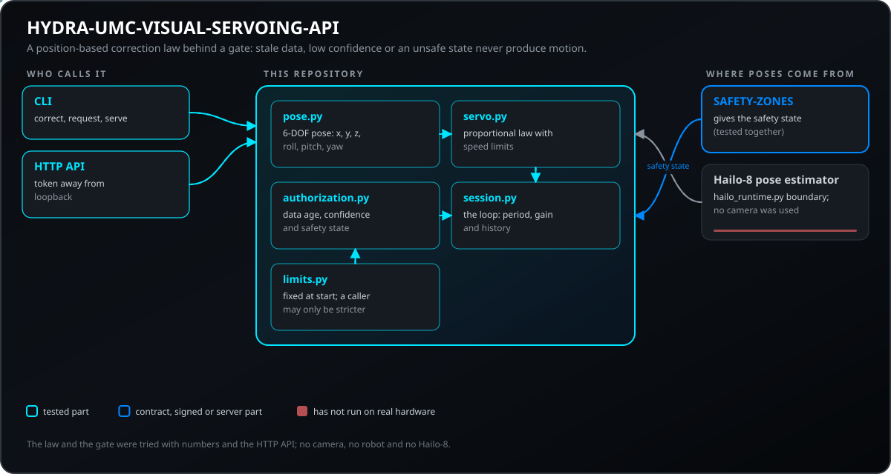
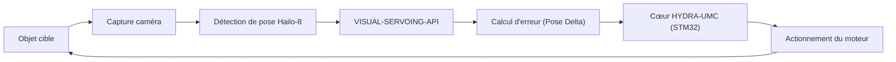
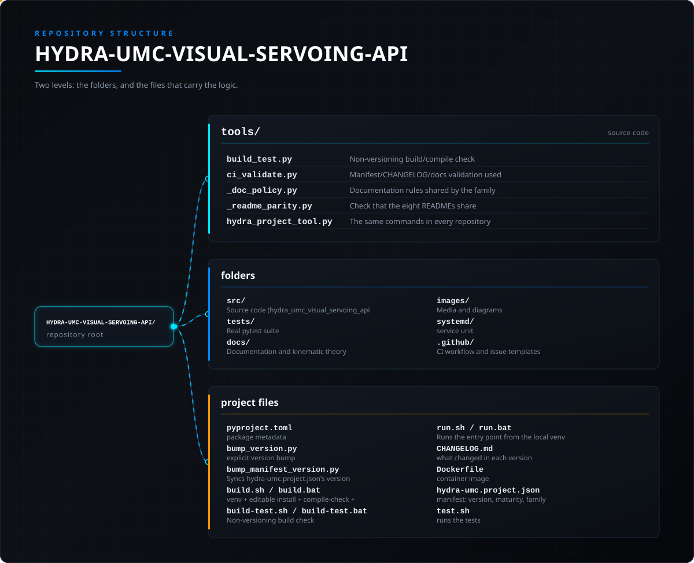

<!-- =============================================================================
HYDRA-UMC-VISUAL-SERVOING-API - Pose-correction law with zone-gated authorisation
Copyright (C) JuanenRac (Electro Hobby 3D) <electrohobby3d@gmail.com>
GPL-3.0-or-later - see LICENSE
============================================================================= -->

<p align="center">
  
</p>

# 🎯 HYDRA-UMC-VISUAL-SERVOING-API

<p align="center"><a href="README.md">🇺🇸 English</a> | <a href="README_spa.md">🇪🇸 Español</a> | 🇫🇷 <b>Français</b> | <a href="README_ita.md">🇮🇹 Italiano</a> | <a href="README_deu.md">🇩🇪 Deutsch</a> | <a href="README_zho.md">🇨🇳 简体中文</a> | <a href="README_jpn.md">🇯🇵 日本語</a> | <a href="README_por.md">🇵🇹 Português</a></p>

### 📐 Loi de correction de pose avec autorisation conditionnée aux zones (v0 : pas encore d'estimation de pose par caméra)

<p align="center">
  
  
  
  
  
  
</p>

---

> **État de la sûreté et de la cybersécurité :** cet écosystème n'est pas un système de sécurité certifié. Il n'existe pas encore de chaîne d'E-STOP matérielle, ni de limites ou de verrouillages imposés par le firmware, ni de commande de mouvement vérifiée ; les images de firmware sont contrôlées par CRC-32 et une signature Ed25519, et une compilation de version refuse les clés de développement publiées (les têtes d'outil et les cartes d'extension derrière le relais utilisent encore les chargeurs d'URTC, qui prennent un HMAC-SHA256 à clé partagée au lieu d'une signature) ; TLS et TLS mutuel sont optionnels et désactivés par défaut ; aucune carte propre n'a encore été assemblée ni testée. Lisez la [base de sécurité](https://github.com/JuanenRac/HYDRA-UMC-DOCS/blob/main/docs/SECURITY_BASELINE.md) et le [modèle de menaces](https://github.com/JuanenRac/HYDRA-UMC-DOCS/blob/main/docs/THREAT_MODEL.md) avant de vous fier à une affirmation d'ici pour la sécurité d'une personne.

---

## 📋 En un coup d'œil

| | |
|---|---|
| Version | `0.2.1` |
| Maturité | Fonctionnel |
| Tests | 208 (`python -m pytest -q tests`) |
| Technologie | Python / 6-DOF pose estimation |
| Cible | Le Raspberry Pi CM5 d'une cellule HYDRA-UMC |
| Sur matériel réel | Pas encore : aucune exécution sur du matériel réel n'est consignée pour cette version |

**Aller à :** [Présentation](#-présentation) · [Architecture](#-architecture) · [Démarrage rapide](#-démarrage-rapide) · [Tests](#-tests) · [Structure du dépôt](#-structure-du-dépôt) · [Projets liés](#-projets-liés)

## 🚦 État du projet

Chaque ligne est une partie de ce dépôt et le feu dit où elle en est aujourd'hui. Elle est écrite d'après ce que le dépôt peut montrer (tests, compilations, exécutions), pas d'après ce qui est prévu.

🟢 Fait et vérifié · 🟡 Fonctionne, avec des limites connues · 🟠 À moitié fait ou pas encore vérifié · 🔴 Pas fait ou ne fonctionne pas

| Domaine | État | Ce que cela veut dire ici |
|---|---|---|
| Logiciel | 🟡 | Fonctionne pour son usage principal ; la vérification d'honnêteté ci-dessus liste ce qui manque encore |
| Tests | 🟢 | 208 tests automatiques, exécutés à chaque modification |
| Matériel réel | 🔴 | Pas encore : aucune exécution sur du matériel réel n'est consignée pour cette version |
| Documentation | 🟢 | README en huit langues, vérifié par rapport au manifeste à chaque modification |

## 🎯 Présentation

**HYDRA-UMC-VISUAL-SERVOING-API** est destiné à devenir le pont de précision entre perception et mouvement. Il calcule l'écart entre une pose souhaitée et la pose visuelle d'un objet qui lui est fournie, et renvoie une correction soumise à autorisation ; aucune caméra ne l'alimente encore et rien n'envoie de corrections au firmware.

Il est conçu pour prendre en charge les configurations **Eye-in-Hand** (caméra sur l'outil) comme **Eye-to-Hand** (caméra fixe), comme base pour le Pick-and-Place, l'alignement CMS et l'ajustement dynamique de trajectoire (prévu : aucun robot n'a été corrigé avec lui).

### Caractéristiques principales :
* 🔑 **Jeton Bearer optionnel :** sur loopback l'API n'a pas besoin de jeton ; hors loopback elle refuse de démarrer sans (`--token-file` ou `HYDRA_UMC_VISUAL_SERVOING_TOKEN`). Avec un jeton configuré, chaque requête doit envoyer `Authorization: Bearer <token>` (comparaison en temps constant) ; seul `GET /stats`, le chemin de santé du manifeste, reste ouvert. *(implémenté)*
* ✅ **Réel v0 - loi de correction PBVS :** `pose.py` + `servo.py` calculent le delta de pose entre une pose actuelle et une pose cible (enroulement angulaire par le plus court chemin, sans le long détour propice au blocage de cardan) et le transforment en commande de vitesse proportionnelle, plafonnée sans en déformer la direction. Exposé via la sous-commande `correct` ci-dessous - aucune caméra ni NPU nécessaire pour l'exécuter ou la tester.
* 🛡️ **Réel v0 - autorisation à verrou de sécurité :** `authorization.py` refuse de transformer la perception en mouvement à moins que l'état de sécurité en amont soit `READY` et que les données visuelles soient assez fraîches/fiables. Exposé via la nouvelle sous-commande `request` ci-dessous - aucune caméra, NPU ou processus SAFETY-ZONES nécessaire pour l'exécuter ou la tester.
* 🌐 **API JSON/HTTP (v0) :** la vraie sous-commande `serve` expose la même logique `correct`/`request` en tant que `POST /correct`/`POST /request` (plus `GET /stats`), via le `http.server` de la bibliothèque standard sans dépendance supplémentaire - accessible depuis un vrai appelant plutôt que via des arguments CLI ponctuels. Voir [`docs/CLI_REFERENCE.md`](docs/CLI_REFERENCE.md).
* 🔁 **Sessions d'asservissement (la boucle avec mémoire) :** `POST /sessions` ouvre une session avec une période nominale, un gain, un filtre sur la pose mesurée, une bande morte avec hystérésis, des limites d'accélération et un délai de perte de vision ; `POST /sessions/<id>/correct` (ou `/request`, qui passe par la même porte de sécurité que `POST /request`) la fait avancer d'un pas, `POST /sessions/<id>/vision-lost` signale une détection perdue et `DELETE /sessions/<id>` la ferme. Un gain dont le `K*T` dépasse 0,5 est refusé à l'ouverture (la boucle est un intégrateur : il lui faut `K*T` sous 1 pour converger sans dépassement et sous 2 pour converger), une pause plus longue que le délai ou une commande non autorisée fait repartir la commande suivante du repos, et une session peut demander moins que ce que permettent les limites du service, jamais plus. Testé contre un procédé simulé avec retard et bruit (`tests/test_session.py`) ; jamais avec un vrai outil.
* 🛡️ **État de sécurité demandé au service de sécurité  (désactivé par défaut):** `serve --safety-zones-url URL` (ou `HYDRA_UMC_SAFETY_ZONES_URL`, jeton dans `--safety-zones-token-file`) fait lire au service le dernier verdict de HYDRA-UMC-SAFETY-ZONES (`GET /state`) et ignorer le `safety_state` envoyé par l'appelant. Une requête doit alors porter `captured_at_utc`, et le service calcule lui-même l'âge de la détection. Pas de réponse, un verdict ancien ou une erreur donne `INHIBITED`. Désactivé par défaut ; l'appelant envoie alors l'objet SafetyState avec son heure. Testé contre un service de substitution, jamais sur une cellule réelle.
* 🔄 **Contrôle en boucle fermée :** Boucle de rétroaction continue contournant l'orchestrateur de haut niveau pour une faible latence. *(objectif d'architecture - l'envoi gRPC vers le cœur HYDRA-UMC reste un travail futur.)*
* 📐 **Estimation de la pose :** Estimation de la pose d'objet 6-DOF à partir de vues à caméra unique ou multiple. *(travail futur - nécessite la NPU Hailo-8 réelle que cet environnement n'a pas encore.)*
* ⚡ **Accélération matérielle :** Utilise la sortie Hailo-8 pour le calcul instantané des coordonnées. *(travail futur, même raison.)*
* 🔌 **Limite d'intégration HailoRT, préparée en amont du module :** `hailo_runtime.py` est écrit contre l'API réelle et confirmée `hailo_platform` (`VDevice`, `HEF`, `ConfigureParams`) - importée paresseusement afin que ce dépôt s'installe/se teste proprement sans le paquet `hailort` ni module Hailo-8 présent - et `hailo_output_to_pose()` adapte un résultat d'inférence réel directement vers le `Pose6D` que `compute_pose_error()` consomme déjà. *(implémenté, limite d'intégration seulement - exécuter réellement l'inférence nécessite encore un `.hef` d'estimation de pose réellement compilé et un module Hailo-8 physique.)*
* 🔐 **Modèle de pose depuis des octets vérifiés :** le modèle de pose Hailo peut être construit à partir des octets que `HYDRA-UMC-DETECTION-HEF` a déjà lus et vérifiés, hachés à nouveau ici, et le chemin n'est jamais rouvert ; des octets vides ou différents sont refusés. *(Aucun modèle n'a encore tourné sur une puce Hailo.)*

## 🧩 Rôle dans HYDRA-UMC

**HYDRA-UMC-VISUAL-SERVOING-API** transforme l'écart entre une pose courante et une pose cible à 6 degrés de liberté en une commande de vitesse bornée, dans une session qui se souvient de la boucle. Une requête n'est traitée que si ses données sont assez fraîches, sa confiance assez haute et l'état de sécurité autorise le mouvement ; un appelant peut durcir les limites, jamais les assouplir. Aucune pose ne vient encore d'une caméra.

## 🏛️ Architecture

<p align="center">
  
</p>

<details>
<summary>Version texte du diagramme (Mermaid)</summary>



</details>

### ARCHITECTURE & DÉCISIONS DE CONCEPTION

* **Pourquoi cette API n'a pas de matériel/firmware propre.** Elle tourne entièrement sur le module CM5 + Hailo-8 partagé que possède le parent d'intégration, HYDRA-UMC-VISION-NODE - aucune carte propre à concevoir ici, donc `hardware/`/`firmware/`/`os/` ont été supprimés plutôt que laissés vides.
* **Pourquoi c'est une sœur, pas un sous-module, de HYDRA-UMC-VISION-NODE.** La correction de pose tourne comme son propre processus/déploiement pour qu'un plantage ou un cycle d'inférence lent ici ne puisse pas bloquer le propre pipeline de détection du parent, dont dépend HYDRA-UMC-SAFETY-ZONES pour le timing de l'E-STOP.
* **Pourquoi la loi de correction arrive avant l'estimation de pose.** Transformer une paire de poses en une commande de vitesse plafonnée est de la pure mathématique de théorie du contrôle - inutile d'avoir une caméra ou un NPU pour l'écrire ou la tester, donc v0 livre cette pièce (`pose.py`, `servo.py`) en premier. La vraie estimation de pose à 6 degrés de liberté nécessite le matériel Hailo-8 que cet environnement n'a pas, et arrivera plus tard.
* **Comment cela s'intègre dans le reste de l'écosystème.** Se situe en aval de la perception (HYDRA-UMC-VISION-NODE) et en amont du mouvement (firmware HYDRA-UMC) - transforme les décalages détectés en corrections cinématiques que la propre boucle jog/servo du bras robotique applique. Prévu : le firmware n'a pas encore de boucle jog/servo de ce type.
* **Pourquoi `authorize_correction()` vérifie `safety_state` avant la confiance/fraîcheur.** Une défaillance de sécurité doit primer sur tout le reste, même face à une détection parfaitement fraîche et fiable - donc `INHIBITED` (safety_state != "READY") est vérifié en premier et court-circuite le reste de la politique. Ce n'est qu'une fois le bras confirmé sûr à déplacer que la fiabilité des *données* compte pour décider de le déplacer (`REJECTED` pour confiance faible ou données obsolètes). Cela reflète la même précédence `INHIBITED`-avant-`DANGER`/`WARNING` déjà utilisée dans HYDRA-UMC-SAFETY-ZONES.
* **Pourquoi `request` est une nouvelle sous-commande plutôt qu'une modification de `correct`.** `correct` est l'utilitaire de bas niveau existant, mathématique pur (sans conscience de sécurité ni notion de fraîcheur caméra) avec ses propres appelants et tests ; l'envelopper sur place dans un verrou de sécurité changerait silencieusement son contrat. `request` ajoute le point d'entrée verrouillé, orienté caméra, que le code de l'écosystème devrait réellement appeler, tandis que `correct` reste disponible sans changement pour un usage direct des mathématiques de pose.

**Verdict de sécurité par défaut dans l'unité déployée.** L'unité systemd définit `HYDRA_UMC_SAFETY_ZONES_URL=http://127.0.0.1:8108` et démarre le service avec `--safety-zones-url`, de sorte qu'une instance déployée prend le verdict de HYDRA-UMC-SAFETY-ZONES et ignore le `safety_state` de l'appelant ; pas de réponse, une erreur ou un vieux verdict donne `INHIBITED`. `/etc/hydra-umc/visual-servoing-api.env` peut changer l'adresse ou ajouter `HYDRA_UMC_SAFETY_ZONES_TOKEN`. Lancée à la main, l'option reste désactivée tant qu'elle n'est pas donnée.

## 🚀 Démarrage rapide

Nécessite Python 3.10 ou plus récent.

```bash
./build.sh  # Linux, macOS (build.bat on Windows)
./run.sh correct --current 0.10,0.20,0.30,0.0,0.0,0.0 --target 0.15,0.20,0.25,0.0,0.0,0.10
./run.sh serve --port 8106
```

## 🧪 Tests

208 tests automatiques s'exécutent avec `python -m pytest -q tests`. Ils n'ont besoin ni de matériel ni de rien en dehors de cette machine.

La CI exécute `HYDRA_UMC_CI=1 python tools/ci_validate.py`, qui vérifie le manifeste, les documents, les huit README et les images.

## 🏗️ Compilation et publication

Nécessite Python 3.10+.

```bash
# Linux / macOS
./build.sh   # crée .venv, installe le
             # paquet en mode éditable (avec les extras dev), compile-check
             # tout src/, et exécute la suite pytest réelle
./run.sh     # exécute le point d'entrée depuis .venv, affiche nom + version + rôle
```

```bat
:: Windows
build.bat
run.bat
```

`build.sh`/`build.bat` incrémentent la version du `pyproject.toml` de ce
projet selon la règle "compteur kilométrique" de l'écosystème (PATCH+1,
avec report sur MINOR au-delà de 9) avant chaque build réel, puis
effectuent un compile-check du code source avec `python -m compileall`.

Exemple réel - calculer la correction d'une pose actuelle vers une pose cible :

```bash
./run.sh correct --current "0,0,0.5,0,0,0" --target "0.02,-0.01,0.48,0,0,0.05" \
  --gain 0.8 --max-linear-speed 0.05
# pose error   : dx=0.020000 dy=-0.010000 dz=-0.020000  droll=0.000000 dpitch=0.000000 dyaw=0.050000
# error norm   : linear=0.030000 m  angular=0.050000 rad
# velocity cmd : vx=0.016000 vy=-0.008000 vz=-0.016000  wroll=0.000000 wpitch=0.000000 wyaw=0.040000
# converged    : False
```

Exemple réel - demander une correction à verrou de sécurité (acceptée, inhibée et rejetée) :

```bash
./run.sh request --current "0,0,0,0,0,0" --target "1,0,0,0,0,0" \
  --frame-id cam0-f42 --confidence 0.9 --data-age-ms 30 --safety-state READY
# outcome : ACCEPTED - frame 'cam0-f42' authorized (confidence=0.9, data_age_ms=30.0)
# pose error   : dx=1.000000 dy=0.000000 dz=0.000000  droll=0.000000 dpitch=0.000000 dyaw=0.000000
# velocity cmd : vx=0.250000 vy=0.000000 vz=0.000000  wroll=0.000000 wpitch=0.000000 wyaw=0.000000

./run.sh request --current "0,0,0,0,0,0" --target "1,0,0,0,0,0" \
  --frame-id cam0-f42 --confidence 0.9 --data-age-ms 30 --safety-state FAULT
# outcome : INHIBITED - safety_state is 'FAULT', not 'READY'   (code de sortie 2)

./run.sh request --current "0,0,0,0,0,0" --target "1,0,0,0,0,0" \
  --frame-id cam0-f42 --confidence 0.2 --data-age-ms 30 --safety-state READY
# outcome : REJECTED - confidence 0.2 is below the required minimum 0.6 for frame 'cam0-f42'   (code de sortie 1)
```

## 📂 Structure du dépôt

<p align="center">
  
</p>

<details>
<summary>Version texte de l'arborescence</summary>

```text
HYDRA-UMC-VISUAL-SERVOING-API/
├── tools/                           code source
│   ├── build_test.py                Vérification de build sans versionnage
│   ├── ci_validate.py               Validation manifeste/CHANGELOG/docs utilisée par CI
│   ├── _doc_policy.py               Règles de documentation partagées par la famille (copie de celle de HYDRA-UMC-SDK, tenue synchronisée)
│   ├── _readme_parity.py            Contrôle que les huit README partagent la même structure (copie de celui de HYDRA-UMC-SDK, tenue synchronisée)
│   └── hydra_project_tool.py        Les mêmes commandes dans chaque dépôt : validate, test, ci, version, status, bump
├── src/                             Code source (paquet hydra_umc_visual_servoing_api)
├── tests/                           Suite pytest réelle (pose, servo, authorization, hailo_runtime, api, CLI)
├── docs/                            Documentation et théorie cinématique
├── images/                          Médias et diagrammes
├── configs/                         configuration de l'erreur d'orientation
├── systemd/                         unité de service
├── .github/                         workflow de CI et modèles de tickets
├── pyproject.toml                   Métadonnées du paquet, dépendances, version compteur
├── bump_version.py                  Incrément de version type compteur kilométrique (exécuté seulement par la commande `bump` explicite)
├── bump_manifest_version.py         Synchronise la version de hydra-umc.project.json avec la version native (--sync)
├── build.sh / build.bat             venv + installation éditable + compile-check + tests
├── build-test.sh / build-test.bat   Vérification de build sans versionnage
├── run.sh / run.bat                 Exécute le point d'entrée depuis le venv local
├── CHANGELOG.md                     ce qui a changé à chaque version
├── Dockerfile                       image de conteneur
├── hydra-umc.project.json           manifeste : version, maturité, famille
└── test.sh                          lance les tests
```

</details>

## 🗺️ Feuille de route et limites connues

**Limites connues aujourd'hui**

### État Actuel et Prochaines Étapes

**Réel aujourd'hui :** la loi de correction PBVS d'erreur de pose et de
commande de vitesse (`pose.py`, `servo.py`) - l'étape « Calcul d'erreur
(Pose Delta) » du diagramme de boucle ci-dessus - avec une vraie commande
CLI `correct` ; la politique d'autorisation à verrou de sécurité
(`authorization.py`) qui refuse de transformer une détection visuelle en
mouvement à moins que l'état de sécurité en amont soit `READY` et que les
données soient assez fiables/fraîches, exposée via la commande CLI
`request` ; et une véritable limite d'intégration HailoRT (`hailo_runtime.py`)
prête pour un véritable estimateur de pose Hailo-8 dès qu'il sera branché. 208 tests au total.

**Encore à venir, et bloqué par du matériel réel :** exécuter réellement
l'*estimation* de pose à 6 degrés de liberté via `hailo_runtime.py`
nécessite un `.hef` d'estimation de pose réellement compilé (aucun modèle
spécifique choisi pour l'instant) et une NPU Hailo-8 physique branchée, et
l'envoi gRPC à faible latence de la commande de vitesse résultante vers le
cœur HYDRA-UMC est un travail futur séparé.

### FEUILLE DE ROUTE

* **Phase 1 :** Calibration main-œil, pour exprimer les poses de la caméra dans le repère du robot.
* **Phase 2 :** Asservissement visuel basé sur l'image (IBVS) en complément de la loi actuelle basée sur la position.
* **Phase 3 :** Une limite de cadence pour les commandes de vitesse envoyées au robot.
* **Phase 4 :** Un watchdog qui arrête le mouvement lorsque les détections deviennent périmées ou disparaissent.

## 🌍 Langues

Ce README et les documents du dépôt existent en huit langues : anglais, espagnol, allemand, français, italien, japonais, chinois et portugais (Portugal). Ils sont écrits ensemble et la CI vérifie que les huit fichiers ont les mêmes sections et les mêmes liens. Ce dépôt n'a ni écran ni catalogue de messages propre, il n'y a donc aucune chaîne d'interface à traduire.

## 🔗 Projets liés

Ce projet fait partie de l'écosystème robotique HYDRA-UMC du même auteur (JuanenRac / Electro Hobby 3D). Bon à savoir, car une demande pourrait en réalité concerner l'un de ceux-ci plutôt que ce dépôt.

**Projet Parent**
- **[HYDRA-UMC-VISION-NODE](https://github.com/JuanenRac/HYDRA-UMC-VISION-NODE)** — hub d'intégration pour le pipeline de vision Hailo-8, avec une vraie vérification de disponibilité matérielle par étape ; le parent dont ce dépôt est une étape ou un consommateur spécifique, au sein de son propre pipeline de perception.

**Projets Frères** — les autres étapes/consommateurs du propre pipeline de perception Hailo-8 de HYDRA-UMC-VISION-NODE
- **[HYDRA-UMC-VISION-STREAMER](https://github.com/JuanenRac/HYDRA-UMC-VISION-STREAMER)** — générateur réel de pipeline GStreamer + config MediaMTX, avec une vraie frontière d'intégration HailoRT.
- **[HYDRA-UMC-DETECTION-HEF](https://github.com/JuanenRac/HYDRA-UMC-DETECTION-HEF)** — registre réel de modèles compilés avec vérification de chargement sécurisé par architecture Hailo/checksum.
- **[HYDRA-UMC-SAFETY-ZONES](https://github.com/JuanenRac/HYDRA-UMC-SAFETY-ZONES)** — logique v0 de violation de zone, de fraîcheur de calibration et de demande d'E-STOP qui lit les positions d'objets dans un fichier ; aucun détecteur ne l'alimente et aucun E-STOP physique n'y est encore relié.

**Directement Liés**
- **[HYDRA-UMC](https://github.com/JuanenRac/HYDRA-UMC)** — la conception de la carte mère du bras robotique : hôte CM5 + coprocesseur STM32H745 double cœur, destinée à coordonner jusqu'à 8 bras-outils via CAN-OTA/SPI-OTA (firmware à un stade précoce ; aucune carte assemblée pour l'instant); aucun firmware ne reçoit encore les corrections cinématiques de pose de cette API.

**Fait Également Partie de l'Écosystème**

*Matériel & Plateforme de Base*
- **[HYDRA-UMC-OS](https://github.com/JuanenRac/HYDRA-UMC-OS)** — couche produit reproductible sur Raspberry Pi OS pour le CM5 : agent en lecture seule, config/profils validés, provisionnement WiFi de premier contact.
- **[HYDRA-UMC-SDK](https://github.com/JuanenRac/HYDRA-UMC-SDK)** — le contrat JSON-Schema partagé et la barrière logicielle de contrôle des jobs contre laquelle chaque bridge valide ses commandes (pas une fonction de sécurité certifiée).
- **[HYDRA-UMC-CONNECTOR-HUB](https://github.com/JuanenRac/HYDRA-UMC-CONNECTOR-HUB)** — registre déclaratif et validateur de manifestes d'adaptateur pour les connecteurs de machines externes ; étend la propre idée de contrat du SDK aux machines externes sans remplacer les projets de passerelle industrielle.

*Backend Central & Clients*
- **[HYDRA-UMC-SERVER](https://github.com/JuanenRac/HYDRA-UMC-SERVER)** — le vrai backend headless (REST/WebSocket) auquel parle réellement chaque client de contrôle.
- **[HYDRA-UMC-STUDIO](https://github.com/JuanenRac/HYDRA-UMC-STUDIO)** — tableau de bord de contrôle web avec visualisation 3D multi-robot en temps réel.
- **[HYDRA-UMC-SUITE](https://github.com/JuanenRac/HYDRA-UMC-SUITE)** — centre de commande d'essaim de bureau (PySide6) pour plusieurs serveurs à la fois, empaqueté en exécutable autonome.
- **[HYDRA-UMC-ANDROID-CONTROL](https://github.com/JuanenRac/HYDRA-UMC-ANDROID-CONTROL)** — application de contrôle Android native avec connexion biométrique et un compagnon Wear OS jumelé.
- **[HYDRA-UMC-IOS-CONTROL](https://github.com/JuanenRac/HYDRA-UMC-IOS-CONTROL)** — application de contrôle iOS/iPadOS (Flutter) avec synchronisation WebSocket en temps réel.
- **[HYDRA-UMC-DSI](https://github.com/JuanenRac/HYDRA-UMC-DSI)** — interface tactile native pour l'écran tactile DSI 7" embarqué, intégrée directement sur le CM5.
- **[HYDRA-UMC-EDITOR-URDF](https://github.com/JuanenRac/HYDRA-UMC-EDITOR-URDF)** — créateur/éditeur graphique de bureau pour URDF qui envoie les modèles terminés vers le propre catalogue de STUDIO.
- **[HYDRA-UMC-EDITOR-STL](https://github.com/JuanenRac/HYDRA-UMC-EDITOR-STL)** — éditeur de bureau de modèles STL, transformant/remplaçant/retirant/ajoutant de vraies pièces dans le même catalogue de modèles qu'édite aussi HYDRA-UMC-EDITOR-URDF.
- **[HYDRA-UMC-BRIDGE-AMR](https://github.com/JuanenRac/HYDRA-UMC-BRIDGE-AMR)** — frontière de coordination pour les flottes AGV/AMR via un éditeur MQTT VDA 5050 (testé uniquement contre une flotte émulée).
- **[HYDRA-UMC-BRIDGE-CNC](https://github.com/JuanenRac/HYDRA-UMC-BRIDGE-CNC)** — coordinateur haut niveau pour cellules CNC avec accès au statut/octets de contrôle GRBL (testé uniquement contre un émulateur).
- **[HYDRA-UMC-BRIDGE-DROIDS](https://github.com/JuanenRac/HYDRA-UMC-BRIDGE-DROIDS)** — frontière de coordination pour droïdes à pattes/humanoïdes, avec un émetteur de commandes Boston Dynamics Spot (testé uniquement contre un émulateur).
- **[HYDRA-UMC-BRIDGE-LASER](https://github.com/JuanenRac/HYDRA-UMC-BRIDGE-LASER)** — coordinateur de cellules laser lisant 3 signaux GPIO de clé/enceinte/verrouillage (testé uniquement contre une puce simulée ; il ne peut ni armer ni tirer un laser).
- **[HYDRA-UMC-BRIDGE-OPENPNP](https://github.com/JuanenRac/HYDRA-UMC-BRIDGE-OPENPNP)** — coordinateur haut niveau sûr pour le flux de cartes du pick-and-place OpenPnP.
- **[HYDRA-UMC-BRIDGE-PRINTER3D](https://github.com/JuanenRac/HYDRA-UMC-BRIDGE-PRINTER3D)** — frontière de coordination sûre pour imprimantes 3D Moonraker/Klipper, avec de vraies commandes de tâche contrôlées.
- **[HYDRA-UMC-BRIDGE-ROS2](https://github.com/JuanenRac/HYDRA-UMC-BRIDGE-ROS2)** — coordinateur avec un transport ROS 2 rclpy à importation paresseuse (pas encore exécuté contre une installation ROS 2).
- **[HYDRA-UMC-BRIDGE-UAV](https://github.com/JuanenRac/HYDRA-UMC-BRIDGE-UAV)** — frontière de coordination pour UAV équipés de caméra, avec un émetteur de commandes MAVLink (testé uniquement contre un émulateur).

*Plateforme d'Outils URTC*
- **[URTC](https://github.com/JuanenRac/URTC)** — firmware pour la carte physique Universal Robot Tool Controller, plus de 25 profils d'outil sur bus CAN.
- **[URTC-FLASHER](https://github.com/JuanenRac/URTC-FLASHER)** — outil de bureau à interface graphique pour flasher les cartes URTC, CAN-OTA plus SWD/JTAG puce complète.
- **[URTC-TESTER](https://github.com/JuanenRac/URTC-TESTER)** — outil de bureau de diagnostic CAN-bus en direct pour cartes URTC, un panneau par profil d'outil.
- **[URTC-WEB-STUDIO](https://github.com/JuanenRac/URTC-WEB-STUDIO)** — alternative basée navigateur à URTC-TESTER via la Web Serial API, sans installation locale.
- **[URTC-GATEWAY](https://github.com/JuanenRac/URTC-GATEWAY)** — passerelle devant le bus CAN d'URTC : liste d'identifiants autorisés, limite de débit et clé de session ; logiciel testé sur ordinateur, pas encore sur un bus réel.

*Nœud IA Cognitif (Hailo-10)*
- **[HYDRA-UMC-COGNITIVE-NODE](https://github.com/JuanenRac/HYDRA-UMC-COGNITIVE-NODE)** — hub d'intégration pour le pipeline cognitif Hailo-10 (orchestration LLM/VLA/voix).
- **[HYDRA-UMC-VLA-ENGINE](https://github.com/JuanenRac/HYDRA-UMC-VLA-ENGINE)** — vrai encodage/décodage de jetons d'action et génération de trajectoire pour un modèle Vision-Language-Action.
- **[HYDRA-UMC-VOICE-UI](https://github.com/JuanenRac/HYDRA-UMC-VOICE-UI)** — vrai front-end vocal (VAD + analyseur d'intention) avec un relais Watch borné et soumis à confirmation.
- **[HYDRA-UMC-SEMANTIC-PLANNER](https://github.com/JuanenRac/HYDRA-UMC-SEMANTIC-PLANNER)** — vraie décomposition de tâches basée sur des règles et récupération sémantique d'erreurs sur les codes d'erreur MCU.
- **[HYDRA-UMC-DOCS-QA](https://github.com/JuanenRac/HYDRA-UMC-DOCS-QA)** — vraie recherche documentaire TF-IDF (bibliothèque standard uniquement) sur les propres documents Markdown de cet écosystème.
- **[HYDRA-UMC-LOCAL-TECHNICIAN](https://github.com/JuanenRac/HYDRA-UMC-LOCAL-TECHNICIAN)** — technicien de maintenance IA local et à portes de politique pour l'écosystème lui-même - observe, diagnostique et propose des corrections ; les deux niveaux de risque les plus élevés ne sont délibérément pas encore implémentés.

*Orchestration & Essaim*
- **[HYDRA-UMC-ORCHESTRATOR](https://github.com/JuanenRac/HYDRA-UMC-ORCHESTRATOR)** — hub d'intégration avec un vrai contrat de rapport de santé gRPC/Protobuf et une machine à états de mission.
- **[HYDRA-UMC-JOB-DISPATCHER](https://github.com/JuanenRac/HYDRA-UMC-JOB-DISPATCHER)** — vraie file de tâches basée sur la priorité avec déduplication, via une vraie API HTTP.
- **[HYDRA-UMC-NODE-HEALING](https://github.com/JuanenRac/HYDRA-UMC-NODE-HEALING)** — vrai chien de garde de santé de flotte basé sur gRPC, avec retry/backoff et détection d'incohérence d'identité.
- **[HYDRA-UMC-PATH-PLANNER-3D](https://github.com/JuanenRac/HYDRA-UMC-PATH-PLANNER-3D)** — vrai planificateur de trajectoire 3D basé sur RRT, avec vraie validation des collisions obstacle/espace de travail.
- **[HYDRA-UMC-SWARM-SYNC](https://github.com/JuanenRac/HYDRA-UMC-SWARM-SYNC)** — vraie synchronisation d'état CRDT LWW-Element-Map, testée par propriétés pour la convergence multi-cellule.

*Jumeau Numérique & Simulation*
- **[HYDRA-UMC-TWIN](https://github.com/JuanenRac/HYDRA-UMC-TWIN)** — hub d'intégration pour le moteur de jumeau numérique, avec un vrai contrat de synchronisation par compatibilité de version.
- **[HYDRA-UMC-HIL-BRIDGE](https://github.com/JuanenRac/HYDRA-UMC-HIL-BRIDGE)** — routeur hardware-in-the-loop avec un verrouillage logiciel de collision entre simulation et matériel réel (testé sans matériel réel).
- **[HYDRA-UMC-PHYSICS-REPLICA](https://github.com/JuanenRac/HYDRA-UMC-PHYSICS-REPLICA)** — vraie cinématique directe et validation des limites articulaires sur un vrai sous-ensemble URDF.
- **[HYDRA-UMC-SYNTHETIC-DATA-GEN](https://github.com/JuanenRac/HYDRA-UMC-SYNTHETIC-DATA-GEN)** — vrai générateur procédural de scènes 2D avec export d'annotations YOLO/COCO.

*Données & Analytique*
- **[HYDRA-UMC-DATALAKE](https://github.com/JuanenRac/HYDRA-UMC-DATALAKE)** — vrai magasin de séries temporelles basé sur sqlite3, avec une vraie API HTTP d'ingestion/requête.
- **[HYDRA-UMC-ANOMALY-DETECTOR](https://github.com/JuanenRac/HYDRA-UMC-ANOMALY-DETECTOR)** — vrai détecteur d'anomalies FFT + ligne de base statistique, avec surveillance de dérive.
- **[HYDRA-UMC-PRODUCTION-REPORTS](https://github.com/JuanenRac/HYDRA-UMC-PRODUCTION-REPORTS)** — vrai calcul OEE/disponibilité sur l'historique de DATALAKE, avec export CSV reproductible.
- **[HYDRA-UMC-TELEMETRY-COLLECTOR](https://github.com/JuanenRac/HYDRA-UMC-TELEMETRY-COLLECTOR)** — vrai pipeline d'ingestion CAN/WebSocket vers DATALAKE, avec déduplication par séquence.

*Passerelle Industrielle*
- **[HYDRA-UMC-GATEWAY-INDUSTRIAL](https://github.com/JuanenRac/HYDRA-UMC-GATEWAY-INDUSTRIAL)** — hub d'intégration relayant vers les protocoles industriels, avec une vraie couche de liste blanche de commandes/contre-pression.
- **[HYDRA-UMC-OPCUA-SERVER](https://github.com/JuanenRac/HYDRA-UMC-OPCUA-SERVER)** — vrai espace d'adressage OPC-UA, vérifié avec une vraie session client du protocole binaire.
- **[HYDRA-UMC-MQTT-BROKER](https://github.com/JuanenRac/HYDRA-UMC-MQTT-BROKER)** — vrai broker MQTT avec authentification par client optionnelle et ACL de sujets.
- **[HYDRA-UMC-MTCONNECT-ADAPTER](https://github.com/JuanenRac/HYDRA-UMC-MTCONNECT-ADAPTER)** — vrais points de terminaison XML MTConnect `/probe` et `/current`, avec sortie en mode dégradé.

*Outils Complémentaires & Opérations de l'Écosystème*
- **[HYDRA-UMC-DASHBOARD-AI](https://github.com/JuanenRac/HYDRA-UMC-DASHBOARD-AI)** — panneaux Smart Summaries et Anomaly Highlighting sur DATALAKE/ANOMALY-DETECTOR, avec un repli statistique honnête.
- **[HYDRA-UMC-TOOL-CLI](https://github.com/JuanenRac/HYDRA-UMC-TOOL-CLI)** — CLI de flotte avec un vrai contrat de codes de sortie stable, un vrai client en direct de la propre API de HYDRA-UMC-SERVER.
- **[HYDRA-UMC-WATCH](https://github.com/JuanenRac/HYDRA-UMC-WATCH)** — application compagnon WearOS avec des motifs d'alerte haptique et un relais vocal vers le téléphone jumelé (pas encore exécutée sur une montre physique).
- **[URTC-SMART-RACK](https://github.com/JuanenRac/URTC-SMART-RACK)** — firmware pour un rack de montage de cartes avec décodage réel d'ID d'outil et logique de préchauffage Smart Idle.
- **[URTC-VISION-TOOL](https://github.com/JuanenRac/URTC-VISION-TOOL)** — firmware plus un vrai compagnon de vision Python pour une tête d'outil d'inspection thermique/RGB.
- **[HYDRA-UMC-UPDATER](https://github.com/JuanenRac/HYDRA-UMC-UPDATER)** — outil administratif de bureau qui découvre, clone et met à jour chaque dépôt de cet écosystème.
- **[HYDRA-UMC-OS-REBUILDER](https://github.com/JuanenRac/HYDRA-UMC-OS-REBUILDER)** — outil de bureau Windows/Linux qui construit une image de la CM5 prête à graver, préchargée avec les versions les plus actuelles de l'écosystème, avec une configuration de premier démarrage Wi-Fi/utilisateur/SSH façon Raspberry Pi Imager.
- **[HYDRA-UMC-OPS-AGENT](https://github.com/JuanenRac/HYDRA-UMC-OPS-AGENT)** — coordinateur d'incidents de maintenance : un rôle edge à faible privilège collecte un instantané d'inventaire/santé assaini, un rôle control-plane le rend en lecture seule et demande à un fournisseur d'IA de suggérer un diagnostic - n'applique jamais de correctif ni ne déploie rien.
- **[HYDRA-UMC-DEV-SERVER](https://github.com/JuanenRac/HYDRA-UMC-DEV-SERVER)** — hôte de développement reproductible (Raspberry Pi 5 / CM5) qui héberge le code source de l'écosystème et exécute des tâches de compilation/test délimitées via une file d'attente durable ; un rôle de développement dédié, explicitement distinct d'un CM5 opérationnel.

## 📚 Documentation

Où lire la suite :

* **[docs/CLI_REFERENCE.md](docs/CLI_REFERENCE.md)** — chaque invocation de `correct`/`request`/`serve`, sortie réelle capturée depuis une CLI installée, la table des codes de sortie, et le contrat HTTP JSON `POST /correct`/`POST /request`/`GET /stats`.
* [Base de sécurité de l'écosystème](https://github.com/JuanenRac/HYDRA-UMC-DOCS/blob/main/docs/SECURITY_BASELINE.md)
* [Modèle de menaces de l'écosystème](https://github.com/JuanenRac/HYDRA-UMC-DOCS/blob/main/docs/THREAT_MODEL.md)
* [Journal des modifications de ce dépôt](CHANGELOG.md)
* [Licence de ce dépôt](LICENSE.md)

## 🤝 Contribuer et communauté

* Avant une pull request, exécutez `HYDRA_UMC_CI=1 py -3 tools/ci_validate.py` (ou `HYDRA_UMC_CI=1 python3 tools/ci_validate.py`) : il doit afficher `CI_VALIDATION=PASS`. N'exécutez pas `build.sh` ni `build.bat` pour cette vérification ; compiler n'est pas vérifier.
* Les huit README sont écrits à partir d'une source unique dans HYDRA-UMC-DOCS ; ne les modifiez pas à la main. Changez la source et réécrivez-les avec `tools/make_readmes.py`.
* N'affirmez pas dans un README ce qui n'a pas tourné : écrivez « simulé » ou « non essayé sur matériel » quand c'est la vérité.
* Voir [CONTRIBUTING.md](CONTRIBUTING.md), le [code de conduite](CODE_OF_CONDUCT.md), [SECURITY.md](SECURITY.md) et [SUPPORT.md](SUPPORT.md).

## 👤 AUTEUR

**JuanenRac (Electro Hobby 3D)** · electrohobby3d@gmail.com

## 📜 LICENCE

GPL-3.0-or-later - [LICENSE](LICENSE).
