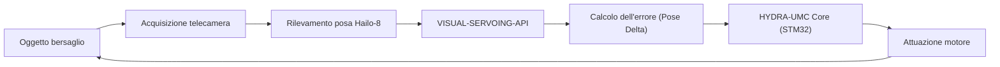

<!-- =============================================================================
HYDRA-UMC-VISUAL-SERVOING-API - Pose-correction law with zone-gated authorisation
Copyright (C) JuanenRac (Electro Hobby 3D) <electrohobby3d@gmail.com>
GPL-3.0-or-later - see LICENSE
============================================================================= -->

<p align="center">
  
</p>

# 🎯 HYDRA-UMC-VISUAL-SERVOING-API

<p align="center"><a href="README.md">🇺🇸 English</a> | <a href="README_spa.md">🇪🇸 Español</a> | <a href="README_fra.md">🇫🇷 Français</a> | 🇮🇹 <b>Italiano</b> | <a href="README_deu.md">🇩🇪 Deutsch</a> | <a href="README_zho.md">🇨🇳 简体中文</a> | <a href="README_jpn.md">🇯🇵 日本語</a> | <a href="README_por.md">🇵🇹 Português</a></p>

### 📐 Legge di correzione di posa con autorizzazione condizionata alle zone (v0: ancora nessuna stima di posa da telecamera)

<p align="center">
  
  
  
  
  
  
</p>

---

> **Stato di sicurezza (safety e security):** questo ecosistema non è un sistema di sicurezza certificato. Non esiste ancora un percorso E-STOP hardware, né limiti o interblocchi imposti dal firmware, né un comando di movimento verificato; le immagini firmware sono controllate con CRC-32 e una firma Ed25519, e una compilazione di rilascio rifiuta le chiavi di sviluppo pubblicate (le teste utensile e le schede di espansione dietro il relè usano ancora i bootloader di URTC, che accettano un HMAC-SHA256 a chiave condivisa invece di una firma); TLS e TLS reciproco sono opzionali e disattivati per impostazione predefinita; nessuna scheda propria è stata ancora assemblata o provata. Leggi la [base di sicurezza](https://github.com/JuanenRac/HYDRA-UMC-DOCS/blob/main/docs/SECURITY_BASELINE.md) e il [modello delle minacce](https://github.com/JuanenRac/HYDRA-UMC-DOCS/blob/main/docs/THREAT_MODEL.md) prima di fidarti di qualsiasi affermazione qui per la sicurezza di una persona.

---

## 📋 In breve

| | |
|---|---|
| Versione | `0.2.1` |
| Maturità | Funzionale |
| Test | 240 (`python -m pytest -q tests`) |
| Tecnologia | Python / 6-DOF pose estimation |
| Destinazione | Il Raspberry Pi CM5 di una cella HYDRA-UMC |
| Su hardware reale | Non ancora: per questa versione non risulta alcuna esecuzione su hardware reale |

**Vai a:** [Panoramica](#-panoramica) · [Architettura](#-architettura) · [Avvio rapido](#-avvio-rapido) · [Test](#-test) · [Struttura del repository](#-struttura-del-repository) · [Progetti correlati](#-progetti-correlati)

## 🚦 Stato del progetto

Ogni riga è una parte di questo repository e il semaforo dice a che punto è oggi. È scritta in base a ciò che il repository può mostrare (test, compilazioni, esecuzioni), non a ciò che è previsto.

🟢 Fatto e verificato · 🟡 Funziona, con limiti noti · 🟠 Fatto a metà o non ancora verificato · 🔴 Non fatto o non funzionante

| Area | Stato | Cosa significa qui |
|---|---|---|
| Software | 🟡 | Funziona per il suo scopo principale; la verifica di onestà qui sopra elenca ciò che manca ancora |
| Test | 🟢 | 240 test automatici, eseguiti a ogni modifica |
| Hardware reale | 🔴 | Non ancora: per questa versione non risulta alcuna esecuzione su hardware reale |
| Documentazione | 🟢 | README in otto lingue, verificato rispetto al manifesto a ogni modifica |

## 🎯 Panoramica

**HYDRA-UMC-VISUAL-SERVOING-API** è pensato per diventare il ponte di precisione tra percezione e movimento. Calcola il delta di errore tra una posa desiderata e la posa visiva di un oggetto che gli viene fornita, e restituisce una correzione subordinata ad autorizzazione; nessuna telecamera lo alimenta ancora e nulla invia correzioni al firmware.

È progettato per supportare sia le configurazioni **Eye-in-Hand** (telecamera sull'utensile) sia **Eye-to-Hand** (telecamera fissa), come base per Pick-and-Place, allineamento SMD e regolazione dinamica della traiettoria (previsto: nessun robot è stato corretto con esso).

### Caratteristiche principali:
* 🔑 **Token Bearer opzionale:** su loopback l'API non richiede token; fuori dal loopback rifiuta di avviarsi senza (`--token-file` o `HYDRA_UMC_VISUAL_SERVOING_TOKEN`). Con un token impostato, ogni richiesta deve inviare `Authorization: Bearer <token>` (confronto a tempo costante); solo `GET /stats`, il percorso di salute del manifesto, resta aperto. *(implementato)*
* ✅ **Reale v0 - legge di correzione PBVS:** `pose.py` + `servo.py` calcolano il delta di posa tra una posa attuale e una obiettivo (con avvolgimento angolare per il giro più breve, senza il lungo giro che favorisce il blocco cardanico) e lo trasformano in un comando di velocità proporzionale, limitato senza distorcerne la direzione. Esposto tramite il sottocomando `correct` più sotto - non serve telecamera né NPU per eseguirlo o testarlo.
* 🛡️ **Reale v0 - autorizzazione con blocco di sicurezza:** `authorization.py` si rifiuta di trasformare la percezione in movimento a meno che lo stato di sicurezza a monte non sia `READY` e i dati visivi non siano abbastanza freschi/affidabili. Esposto tramite il nuovo sottocomando `request` più sotto - non servono telecamera, NPU o il processo SAFETY-ZONES per eseguirlo o testarlo.
* 🌐 **API JSON/HTTP (v0):** il vero sottocomando `serve` espone la stessa logica `correct`/`request` come `POST /correct`/`POST /request` (più `GET /stats`), tramite l'`http.server` della libreria standard senza dipendenze extra - raggiungibile da un vero chiamante invece che da argomenti CLI singoli. Vedi [`docs/CLI_REFERENCE.md`](docs/CLI_REFERENCE.md).
* 🔁 **Sessioni di asservimento (il ciclo con memoria):** `POST /sessions` apre una sessione con un periodo nominale, un guadagno, un filtro sulla posa misurata, una banda morta con isteresi, limiti di accelerazione e un tempo massimo senza visione; `POST /sessions/<id>/correct` (o `/request`, che passa dalla stessa porta di sicurezza di `POST /request`) la fa avanzare di un passo, `POST /sessions/<id>/vision-lost` segnala una rilevazione persa e `DELETE /sessions/<id>` la chiude. Un guadagno il cui `K*T` supera 0,5 è rifiutato all'apertura (il ciclo è un integratore: serve `K*T` sotto 1 per convergere senza sovraelongazione e sotto 2 per convergere), una pausa più lunga del tempo massimo o un comando non autorizzato fa ripartire dal riposo il comando successivo, e una sessione può chiedere meno di quanto permettono i limiti del servizio, mai di più. Provato contro un impianto simulato con ritardo e rumore (`tests/test_session.py`); mai con un utensile reale.
* 🛡️ **Stato di sicurezza chiesto al servizio di sicurezza (disattivato per impostazione predefinita):** `serve --safety-zones-url URL` (o `HYDRA_UMC_SAFETY_ZONES_URL`, token in `--safety-zones-token-file`) fa leggere al servizio l'ultimo verdetto di HYDRA-UMC-SAFETY-ZONES (`GET /state`) e ignorare il `safety_state` inviato dal chiamante. Una richiesta deve allora portare `captured_at_utc` e il servizio calcola da sé l'età del rilevamento. Nessuna risposta, un verdetto vecchio o un errore danno `INHIBITED`. Disattivato di default; il chiamante invia allora l'oggetto SafetyState con la sua ora. Provato contro un servizio sostitutivo, mai su una cella reale.
* 🔄 **Controllo a circuito chiuso:** Feedback continuo che bypassa l'orchestratore di alto livello per una bassa latenza. *(obiettivo architetturale - l'invio gRPC al core HYDRA-UMC resta lavoro futuro.)*
* 📐 **Stima della posa:** Stima della posa dell'oggetto 6-DOF da viste a telecamera singola o multipla. *(lavoro futuro - richiede la vera NPU Hailo-8 che questo ambiente non ha ancora.)*
* ⚡ **Accelerazione hardware:** Utilizza l'output di Hailo-8 per il calcolo istantaneo delle coordinate. *(lavoro futuro, stesso motivo.)*
* 🔌 **Limite di integrazione HailoRT, preparato in anticipo sul modulo:** `hailo_runtime.py` è scritto contro l'API reale e confermata `hailo_platform` (`VDevice`, `HEF`, `ConfigureParams`) - importata in modo lazy così che questo repository si installi/testi in modo pulito senza il pacchetto `hailort` né un modulo Hailo-8 presente - e `hailo_output_to_pose()` adatta un risultato di inferenza reale direttamente nel `Pose6D` che `compute_pose_error()` già consuma. *(implementato, solo limite di integrazione - eseguire davvero l'inferenza richiede ancora un `.hef` di stima della posa realmente compilato e un modulo Hailo-8 fisico.)*
* 🔐 **Modello di posa da byte verificati:** il modello di posa Hailo può essere costruito dai byte che `HYDRA-UMC-DETECTION-HEF` ha già letto e controllato, sottoposti di nuovo a hash qui, e il percorso non viene mai riaperto; byte vuoti o diversi vengono rifiutati. *(Nessun modello è ancora stato eseguito su un chip Hailo.)*

## 🧩 Ruolo in HYDRA-UMC

**HYDRA-UMC-VISUAL-SERVOING-API** trasforma la differenza tra una posa corrente e una posa obiettivo a 6 gradi di libertà in un comando di velocità limitato, dentro una sessione che ricorda il ciclo. Una richiesta riceve risposta solo se i suoi dati sono abbastanza freschi, la confidenza abbastanza alta e lo stato di sicurezza consente il movimento; un chiamante può irrigidire i limiti, mai allentarli. Nessuna posa arriva ancora da una telecamera.

## 🏛️ Architettura

<p align="center">
  
</p>

<details>
<summary>Versione testuale del diagramma (Mermaid)</summary>



</details>

### ARCHITETTURA E DECISIONI DI PROGETTAZIONE

* **Perché questa API non ha hardware/firmware propri.** Gira interamente sul modulo condiviso CM5 + Hailo-8 posseduto dal genitore di integrazione, HYDRA-UMC-VISION-NODE - nessuna scheda propria da progettare qui, quindi `hardware/`/`firmware/`/`os/` sono state rimosse invece di lasciarle vuote.
* **Perché è sorella, non un sottomodulo, di HYDRA-UMC-VISION-NODE.** La correzione di posa gira come proprio processo/deployment così che un crash o un ciclo di inferenza lento qui non possa bloccare la pipeline di rilevamento del genitore, da cui dipende HYDRA-UMC-SAFETY-ZONES per il timing dell'E-STOP.
* **Perché la legge di correzione arriva prima della stima della posa.** Trasformare una coppia di pose in un comando di velocità limitato è pura matematica di teoria del controllo - non serve telecamera né NPU per scriverla o testarla, quindi v0 consegna prima questo pezzo (`pose.py`, `servo.py`). La vera stima di posa a 6 gradi di libertà richiede l'hardware Hailo-8 che questo ambiente non ha, e arriverà più avanti.
* **Come si inserisce nel resto dell'ecosistema.** Si colloca a valle della percezione (HYDRA-UMC-VISION-NODE) e a monte del movimento (firmware HYDRA-UMC) - trasforma gli scostamenti rilevati nelle correzioni cinematiche che il ciclo jog/servo del braccio robotico applica. Previsto: il firmware non ha ancora un ciclo jog/servo di questo tipo.
* **Perché `authorize_correction()` controlla `safety_state` prima di confidenza/freschezza.** Un guasto di sicurezza deve prevalere su tutto il resto, anche di fronte a una rilevazione perfettamente fresca e affidabile - quindi `INHIBITED` (safety_state != "READY") viene controllato per primo e interrompe il resto della policy. Solo una volta confermato che il braccio può muoversi in sicurezza conta se i *dati* sono abbastanza affidabili da muoverlo (`REJECTED` per confidenza bassa o dati obsoleti). Questo rispecchia la stessa precedenza `INHIBITED`-prima-di-`DANGER`/`WARNING` già usata in HYDRA-UMC-SAFETY-ZONES.
* **Perché `request` è un nuovo sottocomando invece di modificare `correct`.** `correct` è l'utility di basso livello esistente, matematica pura (senza consapevolezza di sicurezza né concetto di freschezza della telecamera) con i propri chiamanti e test; avvolgerla sul posto in un blocco di sicurezza ne cambierebbe silenziosamente il contratto. `request` aggiunge il punto di ingresso con blocco, orientato alla telecamera, che il codice dell'ecosistema dovrebbe effettivamente chiamare, mentre `correct` resta disponibile invariato per l'uso diretto della matematica di posa.

**Verdetto di sicurezza predefinito nell'unità distribuita (non ancora distribuita).** L'unità systemd imposta `HYDRA_UMC_SAFETY_ZONES_URL=http://127.0.0.1:8108` e avvia il servizio con `--safety-zones-url`, così un'istanza distribuita prende il verdetto da HYDRA-UMC-SAFETY-ZONES e ignora il `safety_state` del chiamante; nessuna risposta, un errore o un verdetto vecchio dà `INHIBITED`. `/etc/hydra-umc/visual-servoing-api.env` può cambiare l'indirizzo o aggiungere `HYDRA_UMC_SAFETY_ZONES_TOKEN`. Avviato a mano, l'opzione resta disattivata se non viene indicata.

## 🚀 Avvio rapido

Richiede Python 3.10 o successivo.

```bash
./build.sh  # Linux, macOS (build.bat on Windows)
./run.sh correct --current 0.10,0.20,0.30,0.0,0.0,0.0 --target 0.15,0.20,0.25,0.0,0.0,0.10
./run.sh serve --port 8106
```

## 🧪 Test

240 test automatici si eseguono con `python -m pytest -q tests`. Non richiedono hardware né nulla al di fuori di questa macchina.

La CI esegue `HYDRA_UMC_CI=1 python tools/ci_validate.py`, che controlla il manifesto, i documenti, gli otto README e le immagini.

## 🏗️ Compilazione e rilascio

Richiede Python 3.10+.

```bash
# Linux / macOS
./build.sh   # crea .venv, installa
             # il pacchetto in modo editabile (con extra dev), compile-check
             # di tutto src/, ed esegue la suite pytest reale
./run.sh     # esegue l'entry point dal .venv, stampa nome + versione + ruolo
```

```bat
:: Windows
build.bat
run.bat
```

`build.sh`/`build.bat` incrementano la versione nel `pyproject.toml` di
questo progetto seguendo la regola "a contachilometri" dell'ecosistema
(PATCH+1, con riporto su MINOR oltre il 9) prima di ogni build reale, poi
eseguono il compile-check del codice sorgente con `python -m compileall`.

Esempio reale - calcolare la correzione da una posa attuale a una obiettivo:

```bash
./run.sh correct --current "0,0,0.5,0,0,0" --target "0.02,-0.01,0.48,0,0,0.05" \
  --gain 0.8 --max-linear-speed 0.05
# pose error   : dx=0.020000 dy=-0.010000 dz=-0.020000  droll=0.000000 dpitch=0.000000 dyaw=0.050000
# error norm   : linear=0.030000 m  angular=0.050000 rad
# velocity cmd : vx=0.016000 vy=-0.008000 vz=-0.016000  wroll=0.000000 wpitch=0.000000 wyaw=0.040000
# converged    : False
```

Esempio reale - richiedere una correzione con blocco di sicurezza (accettata, inibita e rifiutata):

```bash
./run.sh request --current "0,0,0,0,0,0" --target "1,0,0,0,0,0" \
  --frame-id cam0-f42 --confidence 0.9 --data-age-ms 30 --safety-state READY
# outcome : ACCEPTED - frame 'cam0-f42' authorized (confidence=0.9, data_age_ms=30.0)
# pose error   : dx=1.000000 dy=0.000000 dz=0.000000  droll=0.000000 dpitch=0.000000 dyaw=0.000000
# velocity cmd : vx=0.250000 vy=0.000000 vz=0.000000  wroll=0.000000 wpitch=0.000000 wyaw=0.000000

./run.sh request --current "0,0,0,0,0,0" --target "1,0,0,0,0,0" \
  --frame-id cam0-f42 --confidence 0.9 --data-age-ms 30 --safety-state FAULT
# outcome : INHIBITED - safety_state is 'FAULT', not 'READY'   (codice di uscita 2)

./run.sh request --current "0,0,0,0,0,0" --target "1,0,0,0,0,0" \
  --frame-id cam0-f42 --confidence 0.2 --data-age-ms 30 --safety-state READY
# outcome : REJECTED - confidence 0.2 is below the required minimum 0.6 for frame 'cam0-f42'   (codice di uscita 1)
```

## 📂 Struttura del repository

<p align="center">
  
</p>

<details>
<summary>Versione testuale dell'albero</summary>

```text
HYDRA-UMC-VISUAL-SERVOING-API/
├── tools/                           codice sorgente
│   ├── build_test.py                Controllo build senza versionamento
│   ├── ci_validate.py               Validazione manifest/CHANGELOG/docs usata dalla CI
│   ├── _doc_policy.py               Regole di documentazione condivise dalla famiglia (copia di quella di HYDRA-UMC-SDK, mantenuta sincronizzata)
│   ├── _readme_parity.py            Verifica che gli otto README abbiano la stessa struttura (copia di quella di HYDRA-UMC-SDK, mantenuta sincronizzata)
│   └── hydra_project_tool.py        Gli stessi comandi in ogni repository: validate, test, ci, version, status, bump
├── src/                             Codice sorgente (pacchetto hydra_umc_visual_servoing_api)
├── tests/                           Suite pytest reale (pose, servo, authorization, hailo_runtime, api, CLI)
├── docs/                            Documentazione e teoria cinematica
├── images/                          Media e diagrammi
├── configs/                         configurazione dell'errore di orientamento
├── systemd/                         unità di servizio
├── .github/                         workflow di CI e modelli di segnalazione
├── pyproject.toml                   Metadati del pacchetto, dipendenze, versione a contachilometri
├── bump_version.py                  Incremento di versione stile contachilometri (eseguito solo dal comando `bump` esplicito)
├── bump_manifest_version.py         Sincronizza la versione di hydra-umc.project.json con quella nativa (--sync)
├── build.sh / build.bat             venv + installazione editabile + compile-check + test
├── build-test.sh / build-test.bat   Controllo build senza versionamento
├── run.sh / run.bat                 Esegue l'entry point dal venv locale
├── CHANGELOG.md                     cosa è cambiato in ogni versione
├── Dockerfile                       immagine del container
├── hydra-umc.project.json           manifesto: versione, maturità, famiglia
└── test.sh                          esegue i test
```

</details>

## 🗺️ Roadmap e limiti noti

**Limiti noti oggi**

### Stato Attuale e Prossimi Passi

**Reale oggi:** la legge di correzione PBVS di errore di posa e comando
di velocità (`pose.py`, `servo.py`) - il passaggio "Calcolo dell'errore
(Pose Delta)" del diagramma del loop qui sopra - con un comando CLI
`correct` reale; la policy di autorizzazione con blocco di sicurezza
(`authorization.py`) che si rifiuta di trasformare una rilevazione
visiva in movimento a meno che lo stato di sicurezza a monte non sia
`READY` e i dati non siano abbastanza affidabili/freschi, esposta
tramite il comando CLI `request`; e un vero limite di integrazione
HailoRT (`hailo_runtime.py`) pronto per un vero stimatore di posa Hailo-8
non appena viene collegato. 240 test in totale.

**Ancora da fare, bloccato da hardware reale:** eseguire davvero la
*stima* di posa a 6 gradi di libertà tramite `hailo_runtime.py` richiede
un `.hef` di stima della posa realmente compilato (nessun modello
specifico ancora scelto) e una NPU Hailo-8 fisica collegata, e l'invio
gRPC a bassa latenza del comando di velocità risultante al core
HYDRA-UMC è un lavoro futuro separato.

### TABELLA DI MARCIA

* **Fase 1:** Calibrazione mano-occhio, per esprimere le pose della telecamera nel sistema di riferimento del robot.
* **Fase 2:** Servo visivo basato sull'immagine (IBVS) accanto alla legge attuale basata sulla posizione.
* **Fase 3:** Un limite di frequenza per i comandi di velocità inviati al robot.
* **Fase 4:** Un watchdog che ferma il movimento quando le rilevazioni diventano obsolete o scompaiono.

## 🌍 Lingue

Questo README e i documenti del repository esistono in otto lingue: inglese, spagnolo, tedesco, francese, italiano, giapponese, cinese e portoghese (Portogallo). Sono scritti insieme e la CI verifica che gli otto file abbiano le stesse sezioni e gli stessi link. Questo repository non ha uno schermo né un catalogo di messaggi propri, quindi non ci sono stringhe di interfaccia da tradurre.

## 🔗 Progetti correlati

Questo progetto fa parte dell'ecosistema robotico HYDRA-UMC dello stesso autore (JuanenRac / Electro Hobby 3D). Vale la pena conoscerlo, poiché una richiesta potrebbe in realtà riguardare uno di questi invece di questo repository.

**Progetto Padre**
- **[HYDRA-UMC-VISION-NODE](https://github.com/JuanenRac/HYDRA-UMC-VISION-NODE)** — hub di integrazione per la pipeline di visione Hailo-8, con un vero controllo di prontezza hardware per fase; il genitore di cui questo repository è una fase o un consumatore specifico, all'interno della propria pipeline di percezione.

**Progetti Fratelli** — le altre fasi/consumatori della pipeline di percezione Hailo-8 propria di HYDRA-UMC-VISION-NODE
- **[HYDRA-UMC-VISION-STREAMER](https://github.com/JuanenRac/HYDRA-UMC-VISION-STREAMER)** — generatore reale di pipeline GStreamer + config MediaMTX, con una vera barriera di integrazione HailoRT.
- **[HYDRA-UMC-DETECTION-HEF](https://github.com/JuanenRac/HYDRA-UMC-DETECTION-HEF)** — registro reale di modelli compilati con verifica di caricamento sicuro per architettura Hailo/checksum.
- **[HYDRA-UMC-SAFETY-ZONES](https://github.com/JuanenRac/HYDRA-UMC-SAFETY-ZONES)** — logica v0 di violazione zona, freschezza di calibrazione e richiesta E-STOP che legge le posizioni degli oggetti da un file; nessun rilevatore la alimenta e nessun E-STOP fisico è ancora collegato.

**Direttamente Correlati**
- **[HYDRA-UMC](https://github.com/JuanenRac/HYDRA-UMC)** — il progetto della scheda madre del braccio robotico: host CM5 + coprocessore STM32H745 dual-core, pensato per coordinare fino a 8 bracci utensile via CAN-OTA/SPI-OTA (firmware in fase iniziale; nessuna scheda assemblata per ora); nessun firmware riceve ancora le correzioni cinematiche di posa di questa API.

**Fa Anche Parte dell'Ecosistema**

*Hardware e Piattaforma di Base*
- **[HYDRA-UMC-OS](https://github.com/JuanenRac/HYDRA-UMC-OS)** — livello prodotto riproducibile su Raspberry Pi OS per il CM5: agente in sola lettura, config/profili validati, provisioning WiFi al primo contatto.
- **[HYDRA-UMC-SDK](https://github.com/JuanenRac/HYDRA-UMC-SDK)** — il contratto JSON-Schema condiviso e la barriera software di controllo dei job contro cui ogni bridge valida i propri comandi (non è una funzione di sicurezza certificata).
- **[HYDRA-UMC-CONNECTOR-HUB](https://github.com/JuanenRac/HYDRA-UMC-CONNECTOR-HUB)** — registro dichiarativo e validatore di manifesti adattatore per connettori di macchine esterne; estende la propria idea di contratto dell'SDK alle macchine esterne senza sostituire i progetti di gateway industriale.

*Backend Centrale e Client*
- **[HYDRA-UMC-SERVER](https://github.com/JuanenRac/HYDRA-UMC-SERVER)** — il vero backend headless (REST/WebSocket) con cui parla davvero ogni client di controllo.
- **[HYDRA-UMC-STUDIO](https://github.com/JuanenRac/HYDRA-UMC-STUDIO)** — dashboard di controllo web con visualizzazione 3D multi-robot in tempo reale.
- **[HYDRA-UMC-SUITE](https://github.com/JuanenRac/HYDRA-UMC-SUITE)** — centro di comando sciame desktop (PySide6) per più server contemporaneamente, pacchettizzato come eseguibile standalone.
- **[HYDRA-UMC-ANDROID-CONTROL](https://github.com/JuanenRac/HYDRA-UMC-ANDROID-CONTROL)** — app di controllo nativa per Android con login biometrico e un companion Wear OS abbinato.
- **[HYDRA-UMC-IOS-CONTROL](https://github.com/JuanenRac/HYDRA-UMC-IOS-CONTROL)** — app di controllo per iOS/iPadOS (Flutter) con sincronizzazione WebSocket in tempo reale.
- **[HYDRA-UMC-DSI](https://github.com/JuanenRac/HYDRA-UMC-DSI)** — interfaccia touch nativa per il touchscreen DSI da 7" a bordo, incorporata direttamente nel CM5.
- **[HYDRA-UMC-EDITOR-URDF](https://github.com/JuanenRac/HYDRA-UMC-EDITOR-URDF)** — creatore/editor grafico desktop di URDF che invia i modelli finiti al catalogo di STUDIO.
- **[HYDRA-UMC-EDITOR-STL](https://github.com/JuanenRac/HYDRA-UMC-EDITOR-STL)** — editor desktop di modelli STL, che trasforma/sostituisce/rimuove/aggiunge veri pezzi nello stesso catalogo di modelli modificato anche da HYDRA-UMC-EDITOR-URDF.
- **[HYDRA-UMC-BRIDGE-AMR](https://github.com/JuanenRac/HYDRA-UMC-BRIDGE-AMR)** — barriera di coordinamento per flotte AGV/AMR tramite un publisher MQTT VDA 5050 (testato solo contro una flotta emulata).
- **[HYDRA-UMC-BRIDGE-CNC](https://github.com/JuanenRac/HYDRA-UMC-BRIDGE-CNC)** — coordinatore ad alto livello per celle CNC con accesso a stato/byte di controllo GRBL (testato solo contro un emulatore).
- **[HYDRA-UMC-BRIDGE-DROIDS](https://github.com/JuanenRac/HYDRA-UMC-BRIDGE-DROIDS)** — barriera di coordinamento per droidi con zampe/umanoidi, con un mittente di comandi per Boston Dynamics Spot (testato solo contro un emulatore).
- **[HYDRA-UMC-BRIDGE-LASER](https://github.com/JuanenRac/HYDRA-UMC-BRIDGE-LASER)** — coordinatore per celle laser che legge 3 segnali GPIO di chiave/involucro/interblocco (testato solo contro un chip simulato; non può armare né far partire un laser).
- **[HYDRA-UMC-BRIDGE-OPENPNP](https://github.com/JuanenRac/HYDRA-UMC-BRIDGE-OPENPNP)** — coordinatore ad alto livello sicuro per il flusso schede del pick-and-place OpenPnP.
- **[HYDRA-UMC-BRIDGE-PRINTER3D](https://github.com/JuanenRac/HYDRA-UMC-BRIDGE-PRINTER3D)** — barriera di coordinamento sicura per stampanti 3D Moonraker/Klipper, con comandi di lavoro reali e controllati.
- **[HYDRA-UMC-BRIDGE-ROS2](https://github.com/JuanenRac/HYDRA-UMC-BRIDGE-ROS2)** — coordinatore con un trasporto ROS 2 rclpy importato in modo lazy (non ancora eseguito contro un'installazione ROS 2).
- **[HYDRA-UMC-BRIDGE-UAV](https://github.com/JuanenRac/HYDRA-UMC-BRIDGE-UAV)** — barriera di coordinamento per UAV dotati di fotocamera, con un mittente di comandi MAVLink (testato solo contro un emulatore).

*Piattaforma Strumenti URTC*
- **[URTC](https://github.com/JuanenRac/URTC)** — firmware per la scheda fisica dell'Universal Robot Tool Controller, oltre 25 profili utensile su bus CAN.
- **[URTC-FLASHER](https://github.com/JuanenRac/URTC-FLASHER)** — strumento desktop con GUI per il flashing delle schede URTC, CAN-OTA più SWD/JTAG a chip intero.
- **[URTC-TESTER](https://github.com/JuanenRac/URTC-TESTER)** — strumento desktop di diagnostica CAN-bus dal vivo per schede URTC, un pannello per profilo utensile.
- **[URTC-WEB-STUDIO](https://github.com/JuanenRac/URTC-WEB-STUDIO)** — alternativa basata su browser a URTC-TESTER tramite la Web Serial API, senza installazione locale.
- **[URTC-GATEWAY](https://github.com/JuanenRac/URTC-GATEWAY)** — gateway davanti al bus CAN di URTC: elenco di identificatori consentiti, limite di frequenza e chiave di sessione; software provato su computer, non ancora su un bus reale.

*Nodo IA Cognitivo (Hailo-10)*
- **[HYDRA-UMC-COGNITIVE-NODE](https://github.com/JuanenRac/HYDRA-UMC-COGNITIVE-NODE)** — hub di integrazione per la pipeline cognitiva Hailo-10 (orchestrazione LLM/VLA/voce).
- **[HYDRA-UMC-VLA-ENGINE](https://github.com/JuanenRac/HYDRA-UMC-VLA-ENGINE)** — vera codifica/decodifica di token d'azione e generazione di traiettoria per un modello Vision-Language-Action.
- **[HYDRA-UMC-VOICE-UI](https://github.com/JuanenRac/HYDRA-UMC-VOICE-UI)** — vero front-end vocale (VAD + parser di intenti) con un relay verso Watch limitato e soggetto a conferma.
- **[HYDRA-UMC-SEMANTIC-PLANNER](https://github.com/JuanenRac/HYDRA-UMC-SEMANTIC-PLANNER)** — vera scomposizione dei task basata su regole e recupero semantico degli errori sui codici errore MCU.
- **[HYDRA-UMC-DOCS-QA](https://github.com/JuanenRac/HYDRA-UMC-DOCS-QA)** — vera ricerca documentale TF-IDF (solo libreria standard) sui documenti Markdown di questo ecosistema.
- **[HYDRA-UMC-LOCAL-TECHNICIAN](https://github.com/JuanenRac/HYDRA-UMC-LOCAL-TECHNICIAN)** — tecnico di manutenzione IA locale e con cancelli di policy per l'ecosistema stesso - osserva, diagnostica e propone correzioni; i due livelli di rischio più alti non sono deliberatamente ancora implementati.

*Orchestrazione e Sciame*
- **[HYDRA-UMC-ORCHESTRATOR](https://github.com/JuanenRac/HYDRA-UMC-ORCHESTRATOR)** — hub di integrazione con un vero contratto di health-report gRPC/Protobuf e una macchina a stati di missione.
- **[HYDRA-UMC-JOB-DISPATCHER](https://github.com/JuanenRac/HYDRA-UMC-JOB-DISPATCHER)** — vera coda di lavori basata su priorità con deduplicazione, su una vera API HTTP.
- **[HYDRA-UMC-NODE-HEALING](https://github.com/JuanenRac/HYDRA-UMC-NODE-HEALING)** — vero watchdog di salute della flotta basato su gRPC, con retry/backoff e rilevamento di discrepanza d'identità.
- **[HYDRA-UMC-PATH-PLANNER-3D](https://github.com/JuanenRac/HYDRA-UMC-PATH-PLANNER-3D)** — vero pianificatore di percorsi 3D basato su RRT, con vera validazione delle collisioni ostacolo/spazio di lavoro.
- **[HYDRA-UMC-SWARM-SYNC](https://github.com/JuanenRac/HYDRA-UMC-SWARM-SYNC)** — vera sincronizzazione di stato CRDT LWW-Element-Map, con property test per la convergenza multi-cella.

*Gemello Digitale e Simulazione*
- **[HYDRA-UMC-TWIN](https://github.com/JuanenRac/HYDRA-UMC-TWIN)** — hub di integrazione per il motore di gemello digitale, con un vero contratto di sincronizzazione per compatibilità di versione.
- **[HYDRA-UMC-HIL-BRIDGE](https://github.com/JuanenRac/HYDRA-UMC-HIL-BRIDGE)** — router hardware-in-the-loop con un interblocco software di collisione tra simulazione e hardware reale (testato senza hardware reale).
- **[HYDRA-UMC-PHYSICS-REPLICA](https://github.com/JuanenRac/HYDRA-UMC-PHYSICS-REPLICA)** — vera cinematica diretta e validazione dei limiti articolari su un vero sottoinsieme URDF.
- **[HYDRA-UMC-SYNTHETIC-DATA-GEN](https://github.com/JuanenRac/HYDRA-UMC-SYNTHETIC-DATA-GEN)** — vero generatore procedurale di scene 2D con esportazione di annotazioni YOLO/COCO.

*Dati e Analisi*
- **[HYDRA-UMC-DATALAKE](https://github.com/JuanenRac/HYDRA-UMC-DATALAKE)** — vero archivio di serie temporali basato su sqlite3, con una vera API HTTP di ingestione/query.
- **[HYDRA-UMC-ANOMALY-DETECTOR](https://github.com/JuanenRac/HYDRA-UMC-ANOMALY-DETECTOR)** — vero rilevatore di anomalie FFT + baseline statistica, con monitoraggio della deriva.
- **[HYDRA-UMC-PRODUCTION-REPORTS](https://github.com/JuanenRac/HYDRA-UMC-PRODUCTION-REPORTS)** — vero calcolo OEE/disponibilità sullo storico di DATALAKE, con esportazione CSV riproducibile.
- **[HYDRA-UMC-TELEMETRY-COLLECTOR](https://github.com/JuanenRac/HYDRA-UMC-TELEMETRY-COLLECTOR)** — vera pipeline di ingestione CAN/WebSocket verso DATALAKE, con deduplicazione per sequenza.

*Gateway Industriale*
- **[HYDRA-UMC-GATEWAY-INDUSTRIAL](https://github.com/JuanenRac/HYDRA-UMC-GATEWAY-INDUSTRIAL)** — hub di integrazione che inoltra ai protocolli industriali, con un vero livello di allowlist dei comandi/backpressure.
- **[HYDRA-UMC-OPCUA-SERVER](https://github.com/JuanenRac/HYDRA-UMC-OPCUA-SERVER)** — vero spazio di indirizzi OPC-UA, verificato con una vera sessione client del protocollo binario.
- **[HYDRA-UMC-MQTT-BROKER](https://github.com/JuanenRac/HYDRA-UMC-MQTT-BROKER)** — vero broker MQTT con autenticazione opzionale per client e ACL sui topic.
- **[HYDRA-UMC-MTCONNECT-ADAPTER](https://github.com/JuanenRac/HYDRA-UMC-MTCONNECT-ADAPTER)** — veri endpoint XML `/probe` e `/current` di MTConnect, con output in modalità degradata.

*Strumenti Complementari e Operazioni dell'Ecosistema*
- **[HYDRA-UMC-DASHBOARD-AI](https://github.com/JuanenRac/HYDRA-UMC-DASHBOARD-AI)** — pannelli Smart Summaries e Anomaly Highlighting su DATALAKE/ANOMALY-DETECTOR, con un fallback statistico onesto.
- **[HYDRA-UMC-TOOL-CLI](https://github.com/JuanenRac/HYDRA-UMC-TOOL-CLI)** — CLI di flotta con un vero e stabile contratto di exit-code, un client live reale della stessa API di HYDRA-UMC-SERVER.
- **[HYDRA-UMC-WATCH](https://github.com/JuanenRac/HYDRA-UMC-WATCH)** — app companion WearOS con schemi di avviso aptico e un relay vocale verso il telefono abbinato (non ancora eseguita su un orologio fisico).
- **[URTC-SMART-RACK](https://github.com/JuanenRac/URTC-SMART-RACK)** — firmware per un rack di montaggio schede con decodifica reale dell'ID utensile e logica di preriscaldamento Smart Idle.
- **[URTC-VISION-TOOL](https://github.com/JuanenRac/URTC-VISION-TOOL)** — firmware più un vero companion di visione Python per una testa utensile di ispezione termica/RGB.
- **[HYDRA-UMC-UPDATER](https://github.com/JuanenRac/HYDRA-UMC-UPDATER)** — strumento amministrativo desktop che scopre, clona e aggiorna ogni repository di questo ecosistema.
- **[HYDRA-UMC-OS-REBUILDER](https://github.com/JuanenRac/HYDRA-UMC-OS-REBUILDER)** — strumento desktop Windows/Linux che costruisce un'immagine della CM5 pronta da scrivere, precaricata con le versioni più aggiornate dell'ecosistema, con configurazione di primo avvio Wi-Fi/utente/SSH in stile Raspberry Pi Imager.
- **[HYDRA-UMC-OPS-AGENT](https://github.com/JuanenRac/HYDRA-UMC-OPS-AGENT)** — coordinatore di incidenti di manutenzione: un ruolo edge a basso privilegio raccoglie uno snapshot di inventario/salute sanificato, un ruolo control-plane lo rende in sola lettura e chiede a un provider di IA di suggerire una diagnosi - non applica mai una patch né distribuisce nulla.
- **[HYDRA-UMC-DEV-SERVER](https://github.com/JuanenRac/HYDRA-UMC-DEV-SERVER)** — host di sviluppo riproducibile (Raspberry Pi 5 / CM5) che conserva il codice sorgente dell'ecosistema ed esegue attività delimitate di build/test tramite una coda durevole; un ruolo di sviluppo dedicato, esplicitamente distinto da un CM5 operativo.

## 📚 Documentazione

Dove leggere di più:

* **[docs/CLI_REFERENCE.md](docs/CLI_REFERENCE.md)** — ogni invocazione di `correct`/`request`/`serve`, output reale catturato da un'esecuzione della CLI installata, la tabella dei codici di uscita e il contratto HTTP JSON di `POST /correct`/`POST /request`/`GET /stats`.
* [Base di sicurezza dell'ecosistema](https://github.com/JuanenRac/HYDRA-UMC-DOCS/blob/main/docs/SECURITY_BASELINE.md)
* [Modello delle minacce dell'ecosistema](https://github.com/JuanenRac/HYDRA-UMC-DOCS/blob/main/docs/THREAT_MODEL.md)
* [Registro delle modifiche di questo repository](CHANGELOG.md)
* [Licenza di questo repository](LICENSE.md)

## 🤝 Contribuire e comunità

* Prima di una pull request esegui `HYDRA_UMC_CI=1 py -3 tools/ci_validate.py` (oppure `HYDRA_UMC_CI=1 python3 tools/ci_validate.py`): deve stampare `CI_VALIDATION=PASS`. Non eseguire `build.sh` né `build.bat` per questa verifica; compilare non è verificare.
* I otto README sono scritti da un'unica fonte in HYDRA-UMC-DOCS; non modificarli a mano. Cambia la fonte e riscrivili con `tools/make_readmes.py`.
* Non affermare in un README ciò che non è stato eseguito: scrivi «simulato» o «non provato su hardware» quando è la verità.
* Vedi [CONTRIBUTING.md](CONTRIBUTING.md), il [codice di condotta](CODE_OF_CONDUCT.md), [SECURITY.md](SECURITY.md) e [SUPPORT.md](SUPPORT.md).

## 👤 AUTORE

**JuanenRac (Electro Hobby 3D)** · electrohobby3d@gmail.com

## 📜 LICENZA

GPL-3.0-or-later - [LICENSE](LICENSE).
