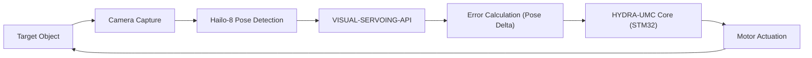

<!-- =============================================================================
HYDRA-UMC-VISUAL-SERVOING-API - Pose-correction law with zone-gated authorisation
Copyright (C) JuanenRac (Electro Hobby 3D) <electrohobby3d@gmail.com>
GPL-3.0-or-later - see LICENSE
============================================================================= -->

<p align="center">
  
</p>

# 🎯 HYDRA-UMC-VISUAL-SERVOING-API

<p align="center"><a href="README.md">🇺🇸 English</a> | <a href="README_spa.md">🇪🇸 Español</a> | <a href="README_fra.md">🇫🇷 Français</a> | <a href="README_ita.md">🇮🇹 Italiano</a> | <a href="README_deu.md">🇩🇪 Deutsch</a> | <a href="README_zho.md">🇨🇳 简体中文</a> | 🇯🇵 <b>日本語</b> | <a href="README_por.md">🇵🇹 Português</a></p>

### 📐 ゾーン連動の承認付き姿勢補正則(v0:カメラによる姿勢推定はまだない)

<p align="center">
  
  
  
  
  
  
</p>

---

> **安全性とセキュリティの現状:** このエコシステムは認証された安全システムではありません。ハードウェアの E-STOP 経路、ファームウェアが強制する制限やインターロック、検証済みの動作コマンドはまだありません。ファームウェアイメージは CRC-32 と Ed25519 署名で検査し、リリースビルドは公開済みの開発用鍵を拒否します(リレーの先のツールヘッドと拡張ボードは引き続き URTC のブートローダーを使い、署名ではなく共有鍵の HMAC-SHA256 を使います)。TLS と相互 TLS は任意で、既定では無効です。独自基板はまだ実装も試験もされていません。ここに書かれた内容を人の安全のために頼る前に、[セキュリティベースライン](https://github.com/JuanenRac/HYDRA-UMC-DOCS/blob/main/docs/SECURITY_BASELINE.md)と[脅威モデル](https://github.com/JuanenRac/HYDRA-UMC-DOCS/blob/main/docs/THREAT_MODEL.md)をお読みください。

---

## 📋 ひと目で

| | |
|---|---|
| バージョン | `0.2.1` |
| 成熟度 | 機能する |
| テスト | 194 (`python -m pytest -q tests`) |
| 技術 | Python / 6-DOF pose estimation |
| 対象 | HYDRA-UMC セルの Raspberry Pi CM5 |
| 実機での確認 | まだです：このバージョンについて実機での動作記録はありません |

**移動：** [概要](#-概要) · [アーキテクチャ](#-アーキテクチャ) · [クイックスタート](#-クイックスタート) · [テスト](#-テスト) · [リポジトリの構成](#-リポジトリの構成) · [関連プロジェクト](#-関連プロジェクト)

## 🚦 プロジェクトの状況

各行はこのリポジトリの一部分で、信号は今日どこまで進んでいるかを示します。計画ではなく、リポジトリが示せるもの（テスト、ビルド、実行）に基づいて書かれています。

🟢 完了・検証済み · 🟡 動作する（既知の制限あり） · 🟠 一部のみ、または未検証 · 🔴 未実装または動作しない

| 領域 | 状態 | ここでの意味 |
|---|---|---|
| ソフトウェア | 🟡 | 主な目的では動作します。足りない点は上の正直さの確認に書かれています |
| テスト | 🟢 | 自動テスト 194 件。変更のたびに実行されます |
| 実機 | 🔴 | まだです：このバージョンについて実機での動作記録はありません |
| ドキュメント | 🟢 | 8 言語の README。変更のたびにマニフェストと照合されます |

## 🎯 概要

**HYDRA-UMC-VISUAL-SERVOING-API** は、知覚とモーションをつなぐ高精度な橋渡し役になることを目指しています。目標姿勢と、与えられた物体の視覚的な姿勢との誤差を計算し、承認で制御された補正値を返します。まだカメラからの入力はなく、ファームウェアへ補正を送るものもありません。

**Eye-in-Hand**(ツール搭載カメラ)と **Eye-to-Hand**(固定カメラ)の両構成に対応するよう設計されており、ピック&プレース、SMD 位置合わせ、動的な軌道調整の土台となります(計画中:これで補正されたロボットはまだありません)。

### 主な機能：
* 🔑 **任意の Bearer トークン：** ループバックでは API にトークンは不要で、ループバック以外ではトークンなしでは起動しません（`--token-file` または `HYDRA_UMC_VISUAL_SERVOING_TOKEN`）。トークンを設定すると、すべてのリクエストが `Authorization: Bearer <token>` を送る必要があります（一定時間での比較）。マニフェストのヘルスパスである `GET /stats` だけは開いたままです。*(実装済み)*
* ✅ **実装済み v0 —— PBVS 補正則：** `pose.py` + `servo.py` が現在の姿勢と目標姿勢の姿勢差分を計算し（角度はジンバルロックを招きやすい遠回りではなく、最短経路でラップされます）、それを比例速度指令に変換します。クランプ処理は方向を歪めません。下記の `correct` サブコマンドから利用可能で、実行にもテストにもカメラや NPU は不要です。
* 🛡️ **実装済み v0 —— セーフティゲート付き認可：** `authorization.py` は、上流の安全状態が `READY` であり、かつ視覚データが十分に新しく信頼できる場合を除き、知覚を運動に変換することを拒否します。下記の新しい `request` サブコマンドから利用可能で、実行にもテストにもカメラ、NPU、SAFETY-ZONES プロセスは不要です。
* 🌐 **JSON/HTTP API（v0）：** 実際の `serve` サブコマンドは、同じ `correct`/`request` ロジックを `POST /correct`/`POST /request`（および `GET /stats`）として公開します。追加の依存関係なしに標準ライブラリの `http.server` を使用し、一度きりの CLI 引数ではなく実際の呼び出し元から到達可能です。[`docs/CLI_REFERENCE.md`](docs/CLI_REFERENCE.md) を参照してください。
* 🔁 **サーボセッション(記憶を持つループ):** `POST /sessions` は、公称周期、ゲイン、計測姿勢のフィルタ、ヒステリシス付き不感帯、加速度の上限、視覚喪失タイムアウトを持つセッションを開きます。`POST /sessions/<id>/correct`(または `POST /request` と同じ安全ゲートを通る `/request`)で 1 ステップ進め、`POST /sessions/<id>/vision-lost` で検出の喪失を伝え、`DELETE /sessions/<id>` で閉じます。`K*T` が 0.5 を超えるゲインはセッションを開くときに拒否されます(ループは積分器なので、オーバーシュートなしに収束するには `K*T` が 1 未満、収束するだけでも 2 未満が必要です)。タイムアウトより長い中断や許可されなかった指令の後は、次の指令が静止状態から始まります。セッションはサービスの上限より小さい値を求められますが、大きい値は求められません。遅れと雑音のある模擬プラントで試験済み(`tests/test_session.py`)、実際の工具では未検証です。
* 🔄 **閉ループ制御：** 上位のオーケストレーターを経由しない連続フィードバックループにより低遅延を実現。*（アーキテクチャ上の目標——HYDRA-UMC コアへの gRPC 送信はまだ将来の作業です。）*
* 📐 **姿勢推定：** 単一または複数カメラビューからの 6 自由度物体姿勢推定。*（将来の作業——この環境にはまだない実際の Hailo-8 NPU が必要です。）*
* ⚡ **ハードウェアアクセラレーション：** Hailo-8 の出力を使用した即時座標計算。*（同じ理由で将来の作業です。）*
* 🔌 **モジュールに先立って準備されたHailoRT統合境界：** `hailo_runtime.py` は、実際の確認済み `hailo_platform` API(`VDevice`、`HEF`、`ConfigureParams`)に対して書かれています —— `hailort` パッケージやHailo-8モジュールが存在しなくてもこのリポジトリがクリーンにインストール/テストできるよう遅延インポートされており、`hailo_output_to_pose()` は実際の推論結果を、`compute_pose_error()` がすでに消費している `Pose6D` に直接変換します。*(実装済み、統合境界のみ —— 実際に推論を実行するには、実際にコンパイルされた姿勢推定用 `.hef` と物理的なHailo-8モジュールがまだ必要です。)*
* 🔐 **検証済みバイト列からのポーズモデル:** Hailo のポーズモデルは、`HYDRA-UMC-DETECTION-HEF` がすでに読んで確認したバイト列から(ここで再度ハッシュを確認して)組み立てられ、パスは二度と開き直されません。空のバイト列や異なるバイト列は拒否されます。*(Hailo チップ上でモデルを実行したことはまだありません。)*

## 🧩 HYDRA-UMC での役割

**HYDRA-UMC-VISUAL-SERVOING-API** は現在の 6 自由度姿勢と目標姿勢の差を、ループを記憶するセッションの中で上限付きの速度指令に変換します。リクエストは、データが十分新しく、信頼度が十分高く、安全状態が動作を許す場合にのみ処理されます。呼び出し側は制限を厳しくできても緩めることはできません。カメラからの姿勢はまだありません。

## 🏛️ アーキテクチャ

<p align="center">
  
</p>

<details>
<summary>図のテキスト版（Mermaid）</summary>



</details>

### アーキテクチャと設計上の決定

* **本 API が独自のハードウェア/ファームウェアを持たない理由。** 統合親プロジェクトである HYDRA-UMC-VISION-NODE が所有する共有 CM5 + Hailo-8 モジュール上で完全に動作します——独自に設計する基板がないため、`hardware/`/`firmware/`/`os/` は空のまま残すのではなく、意図的に省略されています。
* **HYDRA-UMC-VISION-NODE のサブモジュールではなく兄弟プロジェクトである理由。** 姿勢補正は独自のプロセス/デプロイ単位として実行されるため、ここでのクラッシュや遅い推論サイクルが、HYDRA-UMC-SAFETY-ZONES が E-STOP のタイミング判断のために依存している親プロジェクト自身の検知パイプラインを停滞させることはありません。
* **補正則が姿勢推定より先に実装される理由。** 姿勢の「ペア」を制限付き速度指令に変換するのは純粋な制御理論の数学であり、記述にもテストにもカメラや NPU は不要です。そのため v0 ではこの部分（`pose.py`、`servo.py`）が先に実装されます。実際の 6 自由度姿勢*推定*にはこの環境にない Hailo-8 ハードウェアが必要で、後で実装されます。
* **エコシステムの他の部分との関係。** 知覚（HYDRA-UMC-VISION-NODE）の下流、運動（HYDRA-UMC ファームウェア）の上流に位置します——検知されたオフセットを、ロボットアーム自身のジョグ/サーボループが適用する運動学的補正へと変換します。計画中:ファームウェアにはまだそのようなジョグ/サーボループはありません。
* **`authorize_correction()` が信頼度・鮮度より先に `safety_state` を確認する理由。** 安全上の障害は、完全に新しく信頼できる検知結果よりも常に優先されなければなりません——そのため `INHIBITED`（safety_state != "READY"）が最初に確認され、残りのポリシーを短絡させます。アームが安全に動作できることが確認されて初めて、*データ*がそれを動かすのに十分信頼できるかどうかが問題になります（信頼度が低い、またはデータが古い場合は `REJECTED`）。これは HYDRA-UMC-SAFETY-ZONES ですでに使われている `INHIBITED` を `DANGER`/`WARNING` より優先する順序と一致します。
* **`correct` を変更する代わりに `request` を新しいサブコマンドとした理由。** `correct` は既存の低レベルな純粋数学ユーティリティ（安全状態の認識もカメラの鮮度という概念も持たない）であり、独自の呼び出し元とテストを持ちます。これをその場でセーフティゲートで包むと、その契約が暗黙のうちに変わってしまいます。`request` は、エコシステムのコードが実際に呼び出すべき、ゲート付きでカメラを意識した新しいエントリポイントを追加するものであり、`correct` は姿勢数学を直接利用する用途のために変更なく利用可能なままです。

## 🚀 クイックスタート

Python 3.10 以上が必要です。

```bash
./build.sh  # Linux, macOS (build.bat on Windows)
./run.sh correct --current 0.10,0.20,0.30,0.0,0.0,0.0 --target 0.15,0.20,0.25,0.0,0.0,0.10
./run.sh serve --port 8106
```

## 🧪 テスト

`python -m pytest -q tests` で自動テスト 194 件を実行します。 ハードウェアも、このマシンの外にあるものも必要ありません。

CI は `HYDRA_UMC_CI=1 python tools/ci_validate.py` を実行し、マニフェスト、文書、8 つの README、図を検査します。

## 🏗️ ビルドとリリース

Python 3.10+ が必要です。

```bash
# Linux / macOS
./build.sh   # .venv を作成し、
             # パッケージを editable モード（dev エクストラ付き）で
             # インストールし、src/ 下の各ファイルをコンパイルチェックし、
             # 実際の pytest スイートを実行します
./run.sh     # .venv からエントリポイントを実行し、名前 + バージョン + 役割を表示します
```

```bat
:: Windows
build.bat
run.bat
```

`build.sh`/`build.bat` はバージョンを変更せず（上げるのは `python tools/hydra_project_tool.py bump` だけです）、
その後 `python -m compileall` でソースをコンパイルチェックします。

実際の例 —— 現在の姿勢から目標姿勢への補正を計算する：

```bash
./run.sh correct --current "0,0,0.5,0,0,0" --target "0.02,-0.01,0.48,0,0,0.05" \
  --gain 0.8 --max-linear-speed 0.05
# pose error   : dx=0.020000 dy=-0.010000 dz=-0.020000  droll=0.000000 dpitch=0.000000 dyaw=0.050000
# error norm   : linear=0.030000 m  angular=0.050000 rad
# velocity cmd : vx=0.016000 vy=-0.008000 vz=-0.016000  wroll=0.000000 wpitch=0.000000 wyaw=0.040000
# converged    : False
```

実際の例 —— セーフティゲート付き補正をリクエストする（許可・阻止・拒否の 3 パターン）：

```bash
./run.sh request --current "0,0,0,0,0,0" --target "1,0,0,0,0,0" \
  --frame-id cam0-f42 --confidence 0.9 --data-age-ms 30 --safety-state READY
# outcome : ACCEPTED - frame 'cam0-f42' authorized (confidence=0.9, data_age_ms=30.0)
# pose error   : dx=1.000000 dy=0.000000 dz=0.000000  droll=0.000000 dpitch=0.000000 dyaw=0.000000
# velocity cmd : vx=0.250000 vy=0.000000 vz=0.000000  wroll=0.000000 wpitch=0.000000 wyaw=0.000000

./run.sh request --current "0,0,0,0,0,0" --target "1,0,0,0,0,0" \
  --frame-id cam0-f42 --confidence 0.9 --data-age-ms 30 --safety-state FAULT
# outcome : INHIBITED - safety_state is 'FAULT', not 'READY'   （終了コード 2）

./run.sh request --current "0,0,0,0,0,0" --target "1,0,0,0,0,0" \
  --frame-id cam0-f42 --confidence 0.2 --data-age-ms 30 --safety-state READY
# outcome : REJECTED - confidence 0.2 is below the required minimum 0.6 for frame 'cam0-f42'   （終了コード 1）
```

## 📂 リポジトリの構成

<p align="center">
  
</p>

<details>
<summary>ツリーのテキスト版</summary>

```text
HYDRA-UMC-VISUAL-SERVOING-API/
├── tools/                           ソースコード
│   ├── build_test.py                バージョンを増やさないビルドチェック
│   ├── ci_validate.py               CI が使用するマニフェスト/CHANGELOG/ドキュメント検証
│   ├── _doc_policy.py               ファミリー共通のドキュメント規則 (HYDRA-UMC-SDK のコピーで、同期を維持)
│   ├── _readme_parity.py            8つの README が同じ構造であることの検査 (HYDRA-UMC-SDK のコピーで、同期を維持)
│   └── hydra_project_tool.py        すべてのリポジトリで共通のコマンド: validate、test、ci、version、status、bump
├── src/                             ソースコード（hydra_umc_visual_servoing_api パッケージ）
├── tests/                           実際の pytest スイート（pose、servo、authorization、hailo_runtime、api、CLI）
├── docs/                            ドキュメントと運動学理論
├── images/                          メディアと図表
├── systemd/                         サービスユニット
├── .github/                         CI ワークフローと Issue テンプレート
├── pyproject.toml                   パッケージのメタデータ
├── bump_version.py                  明示的なバージョン更新
├── bump_manifest_version.py         hydra-umc.project.json のバージョンをネイティブ版と同期(--sync)
├── build.sh / build.bat             venv + editable インストール + コンパイルチェック + テスト
├── build-test.sh / build-test.bat   バージョンを増やさないビルドチェック
├── run.sh / run.bat                 ローカル venv からエントリポイントを実行
├── CHANGELOG.md                     各バージョンの変更点
├── Dockerfile                       コンテナイメージ
├── hydra-umc.project.json           マニフェスト：バージョン、成熟度、ファミリー
└── test.sh                          テストを実行
```

</details>

## 🗺️ ロードマップと既知の制限

**現時点の既知の制限**

### 現在の状況と次のステップ

**現在実装済み：** PBVS 姿勢誤差・速度指令補正則（`pose.py`、
`servo.py`）——上のループ図の「誤差計算（姿勢差分）」ステップ——実際の
`correct` CLI コマンド付き。加えて、上流の安全状態が `READY` であり
データが十分に信頼できる/新しい場合を除き、視覚検知結果を運動に変換
することを拒否するセーフティゲート付き認可ポリシー（`authorization.py`）を
`request` CLI コマンドとして実装済み。加えて、実際のHailoRT統合境界
(`hailo_runtime.py`)も、実際のHailo-8姿勢推定器が接続され次第使える
ように準備済みです。テストは合計 194 個。

**まだ先で、実際のハードウェアに阻まれている：** `hailo_runtime.py` を通じて
実際に 6 自由度姿勢*推定*を実行するには、実際にコンパイルされた姿勢推定用
`.hef`(まだ具体的なモデルは選定されていません)と、接続された物理的な
Hailo-8 NPU が必要であり、結果として得られる速度指令の HYDRA-UMC コアへの
低遅延 gRPC 送信は別の将来の作業です。

### ロードマップ

* **フェーズ 1：** 8 路の USB 3.0 フィード向けのマルチカメラパイプライン同期とキャリブレーション。
* **フェーズ 2：** YOLOv11 への移行と、産業用部品検出のための Hailo-8L 最適化。
* **フェーズ 3：** ステレオビジョンノードからのリアルタイム 3D 再構成と安全ゾーンの動的マッピング。
* **フェーズ 4：** 9 自由度視覚追跡（姿勢冗長性を含む）とサブマイクロメートル補正のサポート。

## 🌍 言語

この README とリポジトリの文書は、英語・スペイン語・ドイツ語・フランス語・イタリア語・日本語・中国語・ポルトガル語（ポルトガル）の 8 言語で提供されています。8 つのファイルは同時に書かれ、同じ節と同じリンクを持つことを CI が確認します。 このリポジトリには独自の画面もメッセージカタログもないため、翻訳すべきインターフェース文字列はありません。

## 🔗 関連プロジェクト

本プロジェクトは、同じ作者(JuanenRac / Electro Hobby 3D)による HYDRA-UMC ロボティクスエコシステムの一部です。リクエストが実はこの中のどれかについてのものである可能性があるため、知っておく価値があります。

**親プロジェクト**
- **[HYDRA-UMC-VISION-NODE](https://github.com/JuanenRac/HYDRA-UMC-VISION-NODE)** — Hailo-8 ビジョンパイプラインの統合ハブ、段階ごとの実際のハードウェア準備状況チェック付き。本リポジトリは、その自身の知覚パイプライン内における特定の段階・消費者として、この親の一部を成す。

**兄弟プロジェクト** —— HYDRA-UMC-VISION-NODE 自身の Hailo-8 知覚パイプラインにおける他の段階・消費者
- **[HYDRA-UMC-VISION-STREAMER](https://github.com/JuanenRac/HYDRA-UMC-VISION-STREAMER)** — 実際の HailoRT 統合境界を持つ、実際の GStreamer パイプライン + MediaMTX 設定生成器。
- **[HYDRA-UMC-DETECTION-HEF](https://github.com/JuanenRac/HYDRA-UMC-DETECTION-HEF)** — Hailo アーキテクチャ/チェックサムによる安全読み込み検証を備えた、実際のコンパイル済みモデルレジストリ。
- **[HYDRA-UMC-SAFETY-ZONES](https://github.com/JuanenRac/HYDRA-UMC-SAFETY-ZONES)** — ファイルから物体位置を受け取る、ゾーン侵入・キャリブレーション鮮度・E-STOP 要求の v0 ロジック。検出器は接続されておらず、物理 E-STOP もまだ配線されていない。

**直接関連**
- **[HYDRA-UMC](https://github.com/JuanenRac/HYDRA-UMC)** — ロボットアームのマザーボードの設計——CM5 ホスト + デュアルコア STM32H745、CAN-OTA/SPI-OTA 経由で最大 8 本のツールアームを統括することを目指す(ファームウェアは初期段階で、実装済みの基板はまだない)。この API の運動学的な姿勢補正を受け取るファームウェアはまだない。

**エコシステムの他のプロジェクト**

*コアハードウェア&プラットフォーム*
- **[HYDRA-UMC-OS](https://github.com/JuanenRac/HYDRA-UMC-OS)** — CM5 向けの再現可能な Raspberry Pi OS プロダクト層——読み取り専用エージェント、検証済み設定/プロファイル、WiFi 初回接続プロビジョニング。
- **[HYDRA-UMC-SDK](https://github.com/JuanenRac/HYDRA-UMC-SDK)** — すべてのブリッジが自身のコマンドを検証する共有 JSON-Schema 契約とソフトウェアのジョブゲート境界(認証済みの安全機能ではない)。
- **[HYDRA-UMC-CONNECTOR-HUB](https://github.com/JuanenRac/HYDRA-UMC-CONNECTOR-HUB)** — 外部マシン用コネクタのための宣言的アダプターマニフェストのレジストリとバリデーター。SDK 自身の契約という発想を外部マシンにまで拡張し、産業用ゲートウェイ系のプロジェクトを置き換えることはありません。

*コアバックエンド&クライアント*
- **[HYDRA-UMC-SERVER](https://github.com/JuanenRac/HYDRA-UMC-SERVER)** — すべての制御クライアントが実際に通信する、本物のヘッドレスバックエンド(REST/WebSocket)。
- **[HYDRA-UMC-STUDIO](https://github.com/JuanenRac/HYDRA-UMC-STUDIO)** — リアルタイムのマルチロボット 3D 可視化を備えたウェブ制御ダッシュボード。
- **[HYDRA-UMC-SUITE](https://github.com/JuanenRac/HYDRA-UMC-SUITE)** — 複数のサーバーを同時に扱えるデスクトップ(PySide6)スウォームコマンドセンター、スタンドアロン実行ファイルとしてパッケージ化。
- **[HYDRA-UMC-ANDROID-CONTROL](https://github.com/JuanenRac/HYDRA-UMC-ANDROID-CONTROL)** — 生体認証ログインとペアリングされた Wear OS コンパニオンを備えたネイティブ Android 制御アプリ。
- **[HYDRA-UMC-IOS-CONTROL](https://github.com/JuanenRac/HYDRA-UMC-IOS-CONTROL)** — リアルタイム WebSocket 同期を備えた iOS/iPadOS 制御アプリ(Flutter)。
- **[HYDRA-UMC-DSI](https://github.com/JuanenRac/HYDRA-UMC-DSI)** — 本体搭載の 7 インチ DSI タッチスクリーン向けネイティブタッチ UI、CM5 自体に組み込み。
- **[HYDRA-UMC-EDITOR-URDF](https://github.com/JuanenRac/HYDRA-UMC-EDITOR-URDF)** — 完成したモデルを STUDIO 自身のカタログへ送信するデスクトップ用グラフィカル URDF 作成/編集ツール。
- **[HYDRA-UMC-EDITOR-STL](https://github.com/JuanenRac/HYDRA-UMC-EDITOR-STL)** — HYDRA-UMC-EDITOR-URDF も編集する同じモデルカタログ内で、実在するパーツを変換/置換/削除/追加するデスクトップ STL モデルエディタ。
- **[HYDRA-UMC-BRIDGE-AMR](https://github.com/JuanenRac/HYDRA-UMC-BRIDGE-AMR)** — VDA 5050 MQTT パブリッシャーによる AGV/AMR フリートの調整境界(エミュレートしたフリートに対してのみテスト済み)。
- **[HYDRA-UMC-BRIDGE-CNC](https://github.com/JuanenRac/HYDRA-UMC-BRIDGE-CNC)** — GRBL ステータス/制御バイトへのアクセスを持つ、CNC セルの高レベルコーディネーター(エミュレーターに対してのみテスト済み)。
- **[HYDRA-UMC-BRIDGE-DROIDS](https://github.com/JuanenRac/HYDRA-UMC-BRIDGE-DROIDS)** — Boston Dynamics Spot コマンド送信機能を持つ、脚型/ヒューマノイドドロイドの調整境界(エミュレーターに対してのみテスト済み)。
- **[HYDRA-UMC-BRIDGE-LASER](https://github.com/JuanenRac/HYDRA-UMC-BRIDGE-LASER)** — キー/筐体/インターロックの GPIO 信号 3 系統を読み取るレーザーセルのコーディネーター(模擬チップに対してのみテスト済み。レーザーの武装や発射はできない)。
- **[HYDRA-UMC-BRIDGE-OPENPNP](https://github.com/JuanenRac/HYDRA-UMC-BRIDGE-OPENPNP)** — OpenPnP ピックアンドプレースの基板フローを安全に統括する高レベルコーディネーター。
- **[HYDRA-UMC-BRIDGE-PRINTER3D](https://github.com/JuanenRac/HYDRA-UMC-BRIDGE-PRINTER3D)** — 実際にゲート制御されたジョブコマンドを持つ、Moonraker/Klipper 3D プリンター向けの安全な調整境界。
- **[HYDRA-UMC-BRIDGE-ROS2](https://github.com/JuanenRac/HYDRA-UMC-BRIDGE-ROS2)** — 遅延インポートの rclpy ROS 2 トランスポートを持つコーディネーター(ROS 2 環境ではまだ実行していない)。
- **[HYDRA-UMC-BRIDGE-UAV](https://github.com/JuanenRac/HYDRA-UMC-BRIDGE-UAV)** — MAVLink コマンド送信機能を持つ、カメラ搭載 UAV の調整境界(エミュレーターに対してのみテスト済み)。

*URTC ツールプラットフォーム*
- **[URTC](https://github.com/JuanenRac/URTC)** — 物理的な Universal Robot Tool Controller 基板向けファームウェア、CAN バス経由の 25 以上のツールプロファイル。
- **[URTC-FLASHER](https://github.com/JuanenRac/URTC-FLASHER)** — URTC 基板用のデスクトップ GUI 書き込みツール、CAN-OTA およびフルチップ SWD/JTAG。
- **[URTC-TESTER](https://github.com/JuanenRac/URTC-TESTER)** — URTC 基板向けのデスクトップ CAN バスライブ診断ツール、ツールプロファイルごとに 1 パネル。
- **[URTC-WEB-STUDIO](https://github.com/JuanenRac/URTC-WEB-STUDIO)** — Web Serial API を使ったブラウザベースの URTC-TESTER の代替、ローカルインストール不要。
- **[URTC-GATEWAY](https://github.com/JuanenRac/URTC-GATEWAY)** — URTC の CAN バスの前に置くゲートウェイ：許可する識別子のリスト、レート制限、セッション鍵。コンピューター上でテスト済みで、実際のバスではまだ試していません。

*コグニティブ AI ノード(Hailo-10)*
- **[HYDRA-UMC-COGNITIVE-NODE](https://github.com/JuanenRac/HYDRA-UMC-COGNITIVE-NODE)** — Hailo-10 コグニティブパイプライン(LLM/VLA/音声オーケストレーション)の統合ハブ。
- **[HYDRA-UMC-VLA-ENGINE](https://github.com/JuanenRac/HYDRA-UMC-VLA-ENGINE)** — Vision-Language-Action モデル向けの、実際のアクショントークンのエンコード/デコードと軌道生成。
- **[HYDRA-UMC-VOICE-UI](https://github.com/JuanenRac/HYDRA-UMC-VOICE-UI)** — 確認ゲート付きの限定的な Watch リレーを備えた、実際の音声フロントエンド(VAD + 意図解析)。
- **[HYDRA-UMC-SEMANTIC-PLANNER](https://github.com/JuanenRac/HYDRA-UMC-SEMANTIC-PLANNER)** — MCU エラーコードに対する、実際のルールベースのタスク分解と意味的エラー復旧。
- **[HYDRA-UMC-DOCS-QA](https://github.com/JuanenRac/HYDRA-UMC-DOCS-QA)** — このエコシステム自身の Markdown ドキュメントに対する、標準ライブラリのみの実際の TF-IDF 文書検索。
- **[HYDRA-UMC-LOCAL-TECHNICIAN](https://github.com/JuanenRac/HYDRA-UMC-LOCAL-TECHNICIAN)** — エコシステム自身のための、ローカルでポリシーゲート付きのAIメンテナンス技術者 — 観察、診断し、修正を提案する;最上位の2つのリスクレベルは意図的にまだ実装されていない。

*オーケストレーション&スウォーム*
- **[HYDRA-UMC-ORCHESTRATOR](https://github.com/JuanenRac/HYDRA-UMC-ORCHESTRATOR)** — 実際の gRPC/Protobuf ヘルスレポート契約とミッションステートマシンを持つ統合ハブ。
- **[HYDRA-UMC-JOB-DISPATCHER](https://github.com/JuanenRac/HYDRA-UMC-JOB-DISPATCHER)** — 実際の HTTP API 上に構築された、優先度ベースの実際のジョブキュー(重複排除付き)。
- **[HYDRA-UMC-NODE-HEALING](https://github.com/JuanenRac/HYDRA-UMC-NODE-HEALING)** — リトライ/バックオフとアイデンティティ不一致検出を備えた、実際の gRPC ベースのフリートヘルスウォッチドッグ。
- **[HYDRA-UMC-PATH-PLANNER-3D](https://github.com/JuanenRac/HYDRA-UMC-PATH-PLANNER-3D)** — 実際の障害物/ワークスペース衝突検証を備えた、実際の RRT ベースの 3D 経路プランナー。
- **[HYDRA-UMC-SWARM-SYNC](https://github.com/JuanenRac/HYDRA-UMC-SWARM-SYNC)** — 複数セルの収束についてプロパティテストされた、実際の CRDT LWW-Element-Map 状態同期。

*デジタルツイン&シミュレーション*
- **[HYDRA-UMC-TWIN](https://github.com/JuanenRac/HYDRA-UMC-TWIN)** — 実際のバージョン互換性同期契約を持つ、デジタルツインエンジンの統合ハブ。
- **[HYDRA-UMC-HIL-BRIDGE](https://github.com/JuanenRac/HYDRA-UMC-HIL-BRIDGE)** — シミュレーションと実機の間にソフトウェアの衝突インターロックを備えたハードウェア・イン・ザ・ループのルーター(実機なしでテスト済み)。
- **[HYDRA-UMC-PHYSICS-REPLICA](https://github.com/JuanenRac/HYDRA-UMC-PHYSICS-REPLICA)** — 実際の URDF サブセットに対する、実際の順運動学と関節限界検証。
- **[HYDRA-UMC-SYNTHETIC-DATA-GEN](https://github.com/JuanenRac/HYDRA-UMC-SYNTHETIC-DATA-GEN)** — YOLO/COCO アノテーションのエクスポート機能を持つ、実際のプロシージャル 2D シーンジェネレーター。

*データ&分析*
- **[HYDRA-UMC-DATALAKE](https://github.com/JuanenRac/HYDRA-UMC-DATALAKE)** — 実際の取り込み/クエリ HTTP API を備えた、実際の sqlite3 ベースの時系列ストア。
- **[HYDRA-UMC-ANOMALY-DETECTOR](https://github.com/JuanenRac/HYDRA-UMC-ANOMALY-DETECTOR)** — ドリフト監視を備えた、実際の FFT + 統計ベースラインによる異常検知器。
- **[HYDRA-UMC-PRODUCTION-REPORTS](https://github.com/JuanenRac/HYDRA-UMC-PRODUCTION-REPORTS)** — DATALAKE の履歴に対する実際の OEE/稼働率計算、再現可能な CSV エクスポート付き。
- **[HYDRA-UMC-TELEMETRY-COLLECTOR](https://github.com/JuanenRac/HYDRA-UMC-TELEMETRY-COLLECTOR)** — シーケンス重複排除機能を備えた、DATALAKE への実際の CAN/WebSocket 取り込みパイプライン。

*産業用ゲートウェイ*
- **[HYDRA-UMC-GATEWAY-INDUSTRIAL](https://github.com/JuanenRac/HYDRA-UMC-GATEWAY-INDUSTRIAL)** — 実際のコマンド許可リスト/バックプレッシャー層を持つ、産業用プロトコルへ中継する統合ハブ。
- **[HYDRA-UMC-OPCUA-SERVER](https://github.com/JuanenRac/HYDRA-UMC-OPCUA-SERVER)** — 実際のバイナリプロトコルクライアントセッションで検証された、実際の OPC-UA アドレス空間。
- **[HYDRA-UMC-MQTT-BROKER](https://github.com/JuanenRac/HYDRA-UMC-MQTT-BROKER)** — クライアント単位のオプション認証とトピック ACL を備えた、実際の MQTT ブローカー。
- **[HYDRA-UMC-MTCONNECT-ADAPTER](https://github.com/JuanenRac/HYDRA-UMC-MTCONNECT-ADAPTER)** — 縮退モード出力を備えた、実際の MTConnect `/probe` および `/current` XML エンドポイント。

*補完ツール&エコシステム運用*
- **[HYDRA-UMC-DASHBOARD-AI](https://github.com/JuanenRac/HYDRA-UMC-DASHBOARD-AI)** — 誠実な統計フォールバックを備えた、DATALAKE/ANOMALY-DETECTOR 上のスマートサマリーと異常ハイライトパネル。
- **[HYDRA-UMC-TOOL-CLI](https://github.com/JuanenRac/HYDRA-UMC-TOOL-CLI)** — 実際の安定した終了コード契約を持つフリート CLI、HYDRA-UMC-SERVER 自身の API の本物のライブクライアント。
- **[HYDRA-UMC-WATCH](https://github.com/JuanenRac/HYDRA-UMC-WATCH)** — 触覚アラートのパターンとペアリング済みスマートフォンへの音声リレーを備えた WearOS コンパニオンアプリ(物理的なウォッチではまだ実行していない)。
- **[URTC-SMART-RACK](https://github.com/JuanenRac/URTC-SMART-RACK)** — 実際の工具 ID デコードと Smart Idle 予熱ロジックを備えた、基板搭載ラック用ファームウェア。
- **[URTC-VISION-TOOL](https://github.com/JuanenRac/URTC-VISION-TOOL)** — サーマル/RGB 検査ツールヘッド向けの、ファームウェアと実際の Python ビジョンコンパニオン。
- **[HYDRA-UMC-UPDATER](https://github.com/JuanenRac/HYDRA-UMC-UPDATER)** — このエコシステム内のすべてのリポジトリを検出・クローン・更新する、管理用デスクトップツール。
- **[HYDRA-UMC-OS-REBUILDER](https://github.com/JuanenRac/HYDRA-UMC-OS-REBUILDER)** — エコシステムの最新バージョンをプリロードした、書き込み可能なCM5イメージを構築するWindows/Linuxデスクトップツール。Raspberry Pi Imager方式の初回起動Wi-Fi/ユーザー/SSH設定を備える。
- **[HYDRA-UMC-OPS-AGENT](https://github.com/JuanenRac/HYDRA-UMC-OPS-AGENT)** — 保守インシデントコーディネーター: 低権限のエッジ役割がサニタイズされたインベントリ/ヘルスのスナップショットを収集し、コントロールプレーン役割がそれを読み取り専用でレンダリングして AI プロバイダーに診断の提案を依頼します - パッチを適用することも、何かをデプロイすることも決してありません。
- **[HYDRA-UMC-DEV-SERVER](https://github.com/JuanenRac/HYDRA-UMC-DEV-SERVER)** — 再現可能な開発ホスト（Raspberry Pi 5 / CM5）。エコシステムのソースコードを保管し、永続キューのもとで境界の明確なビルド/テストタスクを実行する。運用中の CM5 とは明確に異なる、開発専用の役割。

## 📚 ドキュメント

さらに読むには：

* **[docs/CLI_REFERENCE.md](docs/CLI_REFERENCE.md)** — `correct`/`request`/`serve` のすべての呼び出し、インストール済み CLI の実行から取得した実際の出力、終了コード表、そして `POST /correct`/`POST /request`/`GET /stats` の HTTP JSON 契約。
* [エコシステムのセキュリティ基準](https://github.com/JuanenRac/HYDRA-UMC-DOCS/blob/main/docs/SECURITY_BASELINE.md)
* [エコシステムの脅威モデル](https://github.com/JuanenRac/HYDRA-UMC-DOCS/blob/main/docs/THREAT_MODEL.md)
* [このリポジトリの変更履歴](CHANGELOG.md)
* [このリポジトリのライセンス](LICENSE.md)

## 🤝 コントリビュートとコミュニティ

* プルリクエストの前に `HYDRA_UMC_CI=1 py -3 tools/ci_validate.py`（または `HYDRA_UMC_CI=1 python3 tools/ci_validate.py`）を実行してください。`CI_VALIDATION=PASS` と表示される必要があります。この確認に `build.sh` や `build.bat` は使わないでください。ビルドは検査ではありません。
* 8 つの README は HYDRA-UMC-DOCS の 1 つのソースから書かれます。手で編集しないでください。ソースを変更し、`tools/make_readmes.py` で書き直します。
* 実行していないことを README に書かないでください。事実であれば「シミュレーションのみ」「実機では未確認」と書きます。
* [CONTRIBUTING.md](CONTRIBUTING.md)、[行動規範](CODE_OF_CONDUCT.md)、[SECURITY.md](SECURITY.md)、[SUPPORT.md](SUPPORT.md) を参照してください。

## 👤 作者

**JuanenRac (Electro Hobby 3D)** · electrohobby3d@gmail.com

## 📜 ライセンス

GPL-3.0-or-later - [LICENSE](LICENSE).
