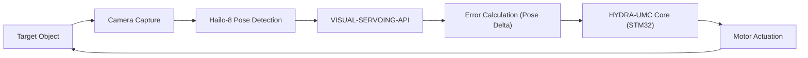

<p align="center">
  
</p>

# 🎯 HYDRA-UMC-VISUAL-SERVOING-API

<p align="center"><a href="README.md">🇺🇸 English</a> | <a href="README_spa.md">🇪🇸 Español</a> | <a href="README_fra.md">🇫🇷 Français</a> | <a href="README_ita.md">🇮🇹 Italiano</a> | <a href="README_deu.md">🇩🇪 Deutsch</a> | <a href="README_zho.md">🇨🇳 简体中文</a> | <a href="README_jpn.md">🇯🇵 日本語</a> | 🇵🇹 <b>Português</b></p>

### 📐 Correção cinemática em malha fechada por realimentação de imagem

<p align="center">
  
  
  
</p>

**Verificação de honestidade - o que realmente funciona hoje:** a lei de correção PBVS (`pose.py`, `servo.py`), a política de autorização protegida pela segurança (`authorization.py`), a API JSON/HTTP (`api.py`) e a fronteira de integração com o HailoRT (`hailo_runtime.py`) são reais e testadas - 128 testes a passar (`pytest tests/`), incluindo um teste real de integração de ponta a ponta contra o HYDRA-UMC-SAFETY-ZONES e uma ida e volta real contra um servidor `api.py` em execução, e não apenas testes unitários isolados. Nada disto precisa de uma câmara nem de uma NPU para ser executado ou testado - `correct`/`request`/`serve` funcionam hoje com poses sintéticas. A *estimação* real de pose 6-DOF a partir de um fluxo de câmara, o fluxo gRPC para o núcleo HYDRA-UMC e a execução efetiva de inferência através do `hailo_runtime.py` continuam a ser trabalho futuro: este ambiente não tem nenhum módulo Hailo-8 físico nem um `.hef` compilado de estimação de pose, pelo que essa fronteira de integração nunca foi exercitada contra hardware real. Veja o `CHANGELOG.md` para saber exatamente o que foi entregue até agora e a lista de funcionalidades da própria secção 1, mais abaixo, para o detalhe real/futuro de cada uma.

**Quem define os limites de segurança:** os limites (confiança mínima, idade máxima do dado, ganho máximo, velocidades linear e angular máximas, validade do comando) são fixados no arranque do serviço (`serve --max-linear-speed ...`, valores seguros por omissão: 0,25 m/s, 0,5 rad/s, ganho 2). Um pedido só os pode apertar: pedir algo mais folgado é um `400`, e `safety_state`, `confidence` e `data_age_ms` continuam a ser autodeclarados por quem chama, pelo que é preciso uma fonte real de SAFETY-ZONES antes de ligar um robô. Cada resposta traz um comando: um pedido recusado ou uma pose convergida recebe um comando zero explícito com `"hold": true`, além de `issued_at_ms`, `valid_for_ms` e `seq`; **o consumidor tem de parar se não chegar um comando válido mais recente dentro de `valid_for_ms`**. O mesmo `frame_id` não pode produzir dois comandos. Por fazer: o erro angular é a diferença de ângulos de Euler (não um erro eixo-ângulo), pelo que é pouco fiável perto de um pitch de 90 graus; não se aplica calibração mão-olho, logo Eye-in-Hand e Eye-to-Hand ainda não se distinguem; o ciclo não tem memória (sem limitador de taxa, filtro nem temporizador de perda de visão).

---

## 1. 🛠️ VISÃO TÉCNICA GERAL

O **HYDRA-UMC-VISUAL-SERVOING-API** é a ponte de precisão entre a perceção e o movimento. Calcula o delta de erro entre uma pose desejada e a pose visual real de um objeto, fornecendo correções cinemáticas em tempo real ao núcleo HYDRA-UMC.

Suporta as configurações **Eye-in-Hand** (câmara na ferramenta) e **Eye-to-Hand** (câmara fixa), permitindo Pick-and-Place ultra-preciso, alinhamento de SMD e ajuste dinâmico de trajetórias.

### Funcionalidades principais:
* ✅ **Real v0 - lei de correção PBVS:** o `pose.py` + `servo.py` calculam o delta de pose entre uma pose 6-DOF atual e uma pose de destino (enrolamento do ângulo pelo caminho mais curto, sem o caminho longo propenso a bloqueio de cardã) e convertem-no num comando de velocidade proporcional, limitado sem distorcer a sua direção. Exposto através do subcomando `correct` abaixo - não precisa de câmara nem de NPU para ser executado ou testado.
* 🛡️ **Real v0 - autorização protegida pela segurança:** o `authorization.py` recusa transformar perceção em movimento a menos que o estado de segurança a montante seja `READY` e os dados visuais sejam suficientemente recentes/confiáveis. Exposto através do novo subcomando `request` abaixo - não precisa de câmara, NPU nem de um processo SAFETY-ZONES para ser executado ou testado.
* 🌐 **API JSON/HTTP (v0):** o subcomando real `serve` expõe a mesma lógica de `correct`/`request` como `POST /correct`/`POST /request` (mais `GET /stats`), sobre o `http.server` da biblioteca padrão sem dependências extra - acessível a partir de um chamador real em vez de argumentos de uma CLI de uma só execução. Veja [`docs/CLI_REFERENCE.md`](docs/CLI_REFERENCE.md).
* 🔄 **Controlo em malha fechada:** malha de realimentação contínua que contorna o orquestrador de alto nível para obter baixa latência. *(objetivo de arquitetura - o fluxo gRPC para o núcleo HYDRA-UMC continua a ser trabalho futuro.)*
* 📐 **Estimação de pose:** estimação de pose 6-DOF de objetos a partir de vistas de uma ou várias câmaras. *(trabalho futuro - precisa da NPU Hailo-8 real a que este repositório ainda não tem acesso.)*
* ⚡ **Acelerado por hardware:** usa a saída do Hailo-8 para um cálculo instantâneo de coordenadas. *(trabalho futuro, pelo mesmo motivo.)*
* 🔌 **Fronteira de integração com o HailoRT, preparada antes do módulo:** o `hailo_runtime.py` está escrito contra a API real e confirmada do `hailo_platform` (`VDevice`, `HEF`, `ConfigureParams`) - importada sob demanda para que este repositório instale/teste de forma limpa sem o pacote `hailort` nem um módulo Hailo-8 - e o `hailo_output_to_pose()` adapta um resultado de inferência real diretamente para o `Pose6D` que o `compute_pose_error()` já consome. *(implementado, apenas a fronteira de integração - executar inferência a sério ainda precisa de um `.hef` compilado de estimação de pose e de um módulo Hailo-8 físico.)*

---

## 2. 🔄 CICLO DE SERVO VISUAL



---

## 3. 🧱 ARQUITETURA E DECISÕES DE DESENHO

* **Porque esta API não tem hardware/firmware próprios.** Corre inteiramente no módulo CM5 + Hailo-8 partilhado, pertencente ao pai de integração, o HYDRA-UMC-VISION-NODE - não há placa própria para desenhar, pelo que as pastas `hardware/`/`firmware/`/`os/` foram retiradas em vez de deixadas vazias.
* **Porque é irmã, e não um submódulo, do HYDRA-UMC-VISION-NODE.** A correção de pose corre como processo/implementação próprios, para que uma falha ou um ciclo de inferência lento aqui não possa bloquear o pipeline de deteção do próprio pai, de que o HYDRA-UMC-SAFETY-ZONES depende para o tempo de E-STOP.
* **Porque a lei de correção chega antes da estimação de pose.** Transformar um *par* de poses num comando de velocidade limitado é matemática de teoria de controlo pura - não precisa de câmara nem de NPU para ser escrita ou testada, pelo que a v0 entrega primeiro essa peça (`pose.py`, `servo.py`). A *estimação* real de pose 6-DOF precisa do hardware Hailo-8 que este ambiente não tem, e chega mais tarde.
* **Como isto se encaixa no resto do ecossistema.** Fica a jusante da perceção (HYDRA-UMC-VISION-NODE) e a montante do movimento (firmware do HYDRA-UMC) - transforma os desvios detetados nas correções cinemáticas que o próprio ciclo de jog/servo do braço robótico aplica.
* **Porque o `authorize_correction()` verifica o `safety_state` antes da confiança/atualidade.** Uma falha de segurança tem de vencer tudo o resto, mesmo uma deteção perfeitamente recente e confiável - por isso `INHIBITED` (safety_state != "READY") é verificado primeiro e interrompe o resto da política. Só depois de confirmar que o braço é seguro de mover é que importa saber se os *dados* são suficientemente fiáveis para o mover (`REJECTED` por baixa confiança ou dados antigos). Isto espelha a precedência de `INHIBITED` antes de `DANGER`/`WARNING` já usada no HYDRA-UMC-SAFETY-ZONES.
* **Porque o `request` é um subcomando novo em vez de alterar o `correct`.** O `correct` é o utilitário matemático de baixo nível já existente (sem noção de segurança nem de atualidade da câmara), com os seus próprios chamadores e testes; envolvê-lo numa porta de segurança no próprio sítio mudaria em silêncio o seu contrato. O `request` acrescenta o ponto de entrada protegido e voltado para a câmara que o código do ecossistema deve realmente chamar, enquanto o `correct` continua disponível sem alterações para o uso direto da matemática de pose.

---

## 📂 ESTRUTURA DE DIRETÓRIOS

O CM5 + Hailo-8 é hardware comercial sem placa própria, pelo que este projeto
não leva pasta `hardware/` nem `firmware/`. O `os/` e o `models/`
vivem apenas no pai de integração, `HYDRA-UMC-VISION-NODE`.

```text
HYDRA-UMC-VISUAL-SERVOING-API/
├── src/                 # Código-fonte (pacote hydra_umc_visual_servoing_api)
│   └── hydra_umc_visual_servoing_api/
│       ├── pose.py           # Pose6D - pose 6-DOF (x, y, z, roll, pitch, yaw)
│       ├── servo.py          # Lei de correção PBVS: erro de pose + comando de velocidade
│       ├── authorization.py  # Política de pedidos protegida pela segurança (INHIBITED/REJECTED/ACCEPTED)
│       ├── hailo_runtime.py  # Fronteira real de integração do estimador de pose HailoRT (hailo_platform), importada sob demanda
│       ├── api.py            # Superfície JSON/HTTP simples (http.server da biblioteca padrão) sobre correct/request
│       └── main.py           # Ponto de entrada da CLI (invocação simples + `correct` + `request`)
├── tests/               # Suite pytest real (pose, servo, autorização, hailo_runtime, api, CLI)
├── docs/                # Documentação e teoria cinemática
├── build/               # Saída da compilação (o .venv local também vive aqui)
├── images/              # Multimédia e diagramas
├── systemd/
│   └── hydra-umc-visual-servoing-api.service # Unidade systemd da API local de correção PBVS do CM5
├── tools/
│   ├── build_test.py    # Verificação de compilação sem subir a versão (sem subida de versão/CHANGELOG)
│   └── ci_validate.py   # Validação de manifesto/CHANGELOG/documentação usada pelo CI
├── pyproject.toml       # Metadados do pacote, dependências, versão ao estilo conta-quilómetros
├── bump_version.py      # Subida de versão nativa ao estilo conta-quilómetros (executada pelo build.sh/.bat)
├── bump_manifest_version.py # Sincroniza a versão do hydra-umc.project.json com a nativa (--sync)
├── build.sh / build.bat # venv + instalação editável + verificação de compilação + testes
├── build-test.sh / build-test.bat # Verificação de compilação sem subir a versão (sem CHANGELOG/subida de versão)
└── run.sh / run.bat     # Executa o ponto de entrada a partir do venv local
```

---

## 🏗️ GUIA DE COMPILAÇÃO E EXECUÇÃO

Requer o Python 3.10+.

```bash
# Linux / macOS
./build.sh   # sobe a versão ao estilo conta-quilómetros, cria o .venv, instala o
             # pacote em modo editável (com extras de desenvolvimento), verifica a compilação de cada
             # ficheiro em src/ e executa a suite pytest real
./run.sh     # executa o ponto de entrada a partir do .venv, imprime nome + versão + papel
```

```bat
:: Windows
build.bat
run.bat
```

O `build.sh`/`build.bat` sobe a versão do `pyproject.toml` deste projeto
com a regra "conta-quilómetros" de todo o ecossistema (PATCH+1, transitando para o MINOR depois de
9) antes de cada compilação real e depois verifica a compilação do código-fonte com
`python -m compileall`.

Exemplo real - calcular a correção de uma pose atual para uma de destino:

```bash
./run.sh correct --current "0,0,0.5,0,0,0" --target "0.02,-0.01,0.48,0,0,0.05" \
  --gain 0.8 --max-linear-speed 0.05
# pose error   : dx=0.020000 dy=-0.010000 dz=-0.020000  droll=0.000000 dpitch=0.000000 dyaw=0.050000
# error norm   : linear=0.030000 m  angular=0.050000 rad
# velocity cmd : vx=0.016000 vy=-0.008000 vz=-0.016000  wroll=0.000000 wpitch=0.000000 wyaw=0.040000
# converged    : False
```

Exemplo real - pedir uma correção protegida pela segurança (aceite, inibida e rejeitada):

```bash
./run.sh request --current "0,0,0,0,0,0" --target "1,0,0,0,0,0" \
  --frame-id cam0-f42 --confidence 0.9 --data-age-ms 30 --safety-state READY
# outcome : ACCEPTED - frame 'cam0-f42' authorized (confidence=0.9, data_age_ms=30.0)
# pose error   : dx=1.000000 dy=0.000000 dz=0.000000  droll=0.000000 dpitch=0.000000 dyaw=0.000000
# velocity cmd : vx=0.250000 vy=0.000000 vz=0.000000  wroll=0.000000 wpitch=0.000000 wyaw=0.000000

./run.sh request --current "0,0,0,0,0,0" --target "1,0,0,0,0,0" \
  --frame-id cam0-f42 --confidence 0.9 --data-age-ms 30 --safety-state FAULT
# outcome : INHIBITED - safety_state is 'FAULT', not 'READY'   (exit code 2)

./run.sh request --current "0,0,0,0,0,0" --target "1,0,0,0,0,0" \
  --frame-id cam0-f42 --confidence 0.2 --data-age-ms 30 --safety-state READY
# outcome : REJECTED - confidence 0.2 is below the required minimum 0.6 for frame 'cam0-f42'   (exit code 1)
```

---

## ✅ Estado atual e próximos passos

**Real hoje:** a lei de correção PBVS de erro de pose e comando de velocidade
(`pose.py`, `servo.py`) - o passo "Error Calculation (Pose Delta)" do
diagrama do ciclo acima - com um comando real `correct` da CLI; a
política de autorização protegida pela segurança (`authorization.py`) que recusa
transformar uma deteção visual em movimento a menos que o estado de segurança
a montante seja `READY` e os dados sejam confiáveis/recentes, exposta através do
comando `request` da CLI; e uma fronteira real de integração com o HailoRT (`hailo_runtime.py`)
pronta para um estimador de pose Hailo-8 real no momento em que se ligue. 128 testes
no total.

**Ainda por fazer, e dependente de hardware real:** executar de facto a *estimação* de pose 6-DOF
através do `hailo_runtime.py` precisa de um `.hef` real compilado de estimação de pose (ainda sem
modelo escolhido) e de uma NPU Hailo-8 física ligada, e o fluxo gRPC de baixa latência do
comando de velocidade resultante para o núcleo HYDRA-UMC é trabalho futuro à parte.

## 🚀 ROTEIRO
* **Fase 1:** sincronização e calibração do pipeline multicâmara para 8 fluxos USB 3.0.
* **Fase 2:** migração para o YOLOv11 e otimização para o Hailo-8L na deteção de componentes industriais.
* **Fase 3:** reconstrução 3D em tempo real a partir de nós de visão estéreo e mapeamento dinâmico de zonas de segurança.
* **Fase 4:** suporte de seguimento visual 9-DOF (incluindo redundância de orientação) e correção sub-micrométrica.

---

## 🔗 Projetos relacionados

Este projeto faz parte do ecossistema de robótica HYDRA-UMC do mesmo autor (JuanenRac / Electro Hobby 3D). Vale a pena conhecê-los, porque um pedido pode ser, na verdade, sobre um destes e não sobre este repositório.

**Projeto-mãe**
- **[HYDRA-UMC-VISION-NODE](https://github.com/JuanenRac/HYDRA-UMC-VISION-NODE)** — centro de integração do pipeline de visão Hailo-8, com uma verificação real de prontidão de hardware por etapa; o projeto-mãe de que este repositório é uma etapa ou consumidor específico, dentro do seu próprio pipeline de perceção.

**Projetos irmãos** — as outras etapas/consumidores do próprio pipeline de perceção Hailo-8 do HYDRA-UMC-VISION-NODE
- **[HYDRA-UMC-VISION-STREAMER](https://github.com/JuanenRac/HYDRA-UMC-VISION-STREAMER)** — pipeline GStreamer real e gerador de configuração MediaMTX com uma fronteira de integração HailoRT real.
- **[HYDRA-UMC-DETECTION-HEF](https://github.com/JuanenRac/HYDRA-UMC-DETECTION-HEF)** — registo real de modelos compilados com verificação segura de carga por arquitetura Hailo e soma de verificação.
- **[HYDRA-UMC-SAFETY-ZONES](https://github.com/JuanenRac/HYDRA-UMC-SAFETY-ZONES)** — verificação real de violação de zonas e pedido de E-STOP, com exigência de calibração recente.

**Diretamente relacionados**
- **[HYDRA-UMC](https://github.com/JuanenRac/HYDRA-UMC)** — a placa-mãe física do braço robótico: anfitrião CM5 + STM32H745 de dois núcleos, que orquestra até 8 braços de ferramenta por CAN-OTA/SPI-OTA; o firmware do núcleo STM32 que recebe as correções cinemáticas de pose desta própria API.

**Também fazem parte do ecossistema**

*Hardware e plataforma centrais*
- **[HYDRA-UMC-OS](https://github.com/JuanenRac/HYDRA-UMC-OS)** — camada de produto reproduzível do Raspberry Pi OS para o CM5: agente só de leitura, configuração/perfis validados, aprovisionamento Wi-Fi de primeiro contacto.
- **[HYDRA-UMC-SDK](https://github.com/JuanenRac/HYDRA-UMC-SDK)** — o contrato JSON-Schema partilhado e a fronteira de portas de segurança contra a qual cada bridge valida os seus comandos.
- **[HYDRA-UMC-CONNECTOR-HUB](https://github.com/JuanenRac/HYDRA-UMC-CONNECTOR-HUB)** — registo declarativo de manifestos de adaptador e validador para conectores de máquinas externas; estende a ideia de contrato do SDK a máquinas externas sem substituir os projetos de gateway industrial.

*Backend central e clientes*
- **[HYDRA-UMC-SERVER](https://github.com/JuanenRac/HYDRA-UMC-SERVER)** — o back-end headless real (REST/WebSocket) com que todos os clientes de controlo realmente comunicam.
- **[HYDRA-UMC-STUDIO](https://github.com/JuanenRac/HYDRA-UMC-STUDIO)** — painel web de controlo com visualização 3D em tempo real de vários robôs.
- **[HYDRA-UMC-SUITE](https://github.com/JuanenRac/HYDRA-UMC-SUITE)** — centro de comando de enxame para desktop (PySide6) para vários servidores ao mesmo tempo, empacotado como executável independente.
- **[HYDRA-UMC-ANDROID-CONTROL](https://github.com/JuanenRac/HYDRA-UMC-ANDROID-CONTROL)** — aplicação Android nativa de controlo, com início de sessão biométrico e um companheiro Wear OS emparelhado.
- **[HYDRA-UMC-IOS-CONTROL](https://github.com/JuanenRac/HYDRA-UMC-IOS-CONTROL)** — aplicação de controlo para iOS/iPadOS (Flutter) com sincronização WebSocket em tempo real.
- **[HYDRA-UMC-DSI](https://github.com/JuanenRac/HYDRA-UMC-DSI)** — interface tátil nativa para o ecrã tátil DSI de 7" integrado, executada no próprio CM5.
- **[HYDRA-UMC-EDITOR-URDF](https://github.com/JuanenRac/HYDRA-UMC-EDITOR-URDF)** — criador/editor gráfico de URDF para desktop que envia os modelos concluídos para o catálogo do STUDIO.
- **[HYDRA-UMC-EDITOR-STL](https://github.com/JuanenRac/HYDRA-UMC-EDITOR-STL)** — editor de modelos STL para desktop que transforma/substitui/remove/adiciona peças reais no mesmo catálogo de modelos que o HYDRA-UMC-EDITOR-URDF também edita.
- **[HYDRA-UMC-BRIDGE-AMR](https://github.com/JuanenRac/HYDRA-UMC-BRIDGE-AMR)** — fronteira de coordenação para frotas AGV/AMR através de um publicador MQTT VDA 5050 real.
- **[HYDRA-UMC-BRIDGE-CNC](https://github.com/JuanenRac/HYDRA-UMC-BRIDGE-CNC)** — coordenador de células CNC de alto nível com acesso real ao estado GRBL e aos bytes de controlo.
- **[HYDRA-UMC-BRIDGE-DROIDS](https://github.com/JuanenRac/HYDRA-UMC-BRIDGE-DROIDS)** — fronteira de coordenação para droides com patas/humanoides, com um emissor real de comandos para o Boston Dynamics Spot.
- **[HYDRA-UMC-BRIDGE-LASER](https://github.com/JuanenRac/HYDRA-UMC-BRIDGE-LASER)** — coordenador de segurança de células laser que lê 3 proteções reais por GPIO (chave, caixa e interlock).
- **[HYDRA-UMC-BRIDGE-OPENPNP](https://github.com/JuanenRac/HYDRA-UMC-BRIDGE-OPENPNP)** — coordenador seguro de fluxo de placa de alto nível para pick-and-place com OpenPnP.
- **[HYDRA-UMC-BRIDGE-PRINTER3D](https://github.com/JuanenRac/HYDRA-UMC-BRIDGE-PRINTER3D)** — fronteira de coordenação segura para impressoras 3D Moonraker/Klipper, com comandos de trabalho reais protegidos por portas.
- **[HYDRA-UMC-BRIDGE-ROS2](https://github.com/JuanenRac/HYDRA-UMC-BRIDGE-ROS2)** — coordenador de segurança com um transporte ROS 2 real baseado em rclpy importado sob demanda.
- **[HYDRA-UMC-BRIDGE-UAV](https://github.com/JuanenRac/HYDRA-UMC-BRIDGE-UAV)** — fronteira de coordenação para UAV com câmara, com um emissor real de comandos MAVLink.

*Plataforma de ferramentas URTC*
- **[URTC](https://github.com/JuanenRac/URTC)** — firmware da placa física Universal Robot Tool Controller, mais de 25 perfis de ferramenta por barramento CAN.
- **[URTC-FLASHER](https://github.com/JuanenRac/URTC-FLASHER)** — ferramenta gráfica de gravação para desktop das placas URTC, por CAN-OTA e também SWD/JTAG de chip completo.
- **[URTC-TESTER](https://github.com/JuanenRac/URTC-TESTER)** — ferramenta de diagnóstico CAN em tempo real para desktop das placas URTC, com um painel por perfil de ferramenta.
- **[URTC-WEB-STUDIO](https://github.com/JuanenRac/URTC-WEB-STUDIO)** — alternativa no navegador ao URTC-TESTER através da Web Serial API, sem instalação local.

*Nó de IA cognitiva (Hailo-10)*
- **[HYDRA-UMC-COGNITIVE-NODE](https://github.com/JuanenRac/HYDRA-UMC-COGNITIVE-NODE)** — centro de integração do pipeline cognitivo do Hailo-10 (orquestração de LLM/VLA/voz).
- **[HYDRA-UMC-VLA-ENGINE](https://github.com/JuanenRac/HYDRA-UMC-VLA-ENGINE)** — codificação/descodificação real de tokens de ação e geração de trajetórias para um modelo Visão-Linguagem-Ação.
- **[HYDRA-UMC-VOICE-UI](https://github.com/JuanenRac/HYDRA-UMC-VOICE-UI)** — front-end de voz real (VAD + analisador de intenções) com um relé para o relógio limitado e protegido por confirmação.
- **[HYDRA-UMC-SEMANTIC-PLANNER](https://github.com/JuanenRac/HYDRA-UMC-SEMANTIC-PLANNER)** — decomposição real de tarefas baseada em regras e recuperação semântica de erros sobre os códigos de erro do MCU.
- **[HYDRA-UMC-DOCS-QA](https://github.com/JuanenRac/HYDRA-UMC-DOCS-QA)** — pesquisa real de documentos TF-IDF só com a biblioteca padrão sobre a documentação Markdown deste ecossistema.
- **[HYDRA-UMC-LOCAL-TECHNICIAN](https://github.com/JuanenRac/HYDRA-UMC-LOCAL-TECHNICIAN)** — técnico de manutenção de IA local, protegido por políticas, para o próprio ecossistema: observa, diagnostica e propõe correções; os dois níveis de maior risco não estão implementados de propósito.

*Orquestração e enxame*
- **[HYDRA-UMC-ORCHESTRATOR](https://github.com/JuanenRac/HYDRA-UMC-ORCHESTRATOR)** — centro de integração com um contrato real de relatório de saúde gRPC/Protobuf e uma máquina de estados de missões.
- **[HYDRA-UMC-JOB-DISPATCHER](https://github.com/JuanenRac/HYDRA-UMC-JOB-DISPATCHER)** — fila real de trabalhos por prioridade com deduplicação, sobre uma API HTTP real.
- **[HYDRA-UMC-NODE-HEALING](https://github.com/JuanenRac/HYDRA-UMC-NODE-HEALING)** — vigilante real de saúde da frota por gRPC com repetição/recuo e deteção de identidade incoerente.
- **[HYDRA-UMC-PATH-PLANNER-3D](https://github.com/JuanenRac/HYDRA-UMC-PATH-PLANNER-3D)** — planeador real de trajetórias 3D baseado em RRT com validação real de colisões com obstáculos e espaço de trabalho.
- **[HYDRA-UMC-SWARM-SYNC](https://github.com/JuanenRac/HYDRA-UMC-SWARM-SYNC)** — sincronização real de estado CRDT LWW-Element-Map, testada por propriedades para a convergência de várias células.

*Gémeo digital e simulação*
- **[HYDRA-UMC-TWIN](https://github.com/JuanenRac/HYDRA-UMC-TWIN)** — centro de integração do motor de gémeo digital, com um contrato real de sincronização de compatibilidade de versões.
- **[HYDRA-UMC-HIL-BRIDGE](https://github.com/JuanenRac/HYDRA-UMC-HIL-BRIDGE)** — interlock de segurança real de hardware-in-the-loop que encaminha comandos entre a simulação e o hardware real.
- **[HYDRA-UMC-PHYSICS-REPLICA](https://github.com/JuanenRac/HYDRA-UMC-PHYSICS-REPLICA)** — cinemática direta real e validação de limites de juntas sobre um subconjunto real de URDF.
- **[HYDRA-UMC-SYNTHETIC-DATA-GEN](https://github.com/JuanenRac/HYDRA-UMC-SYNTHETIC-DATA-GEN)** — gerador procedural real de cenas 2D com exportação de anotações YOLO/COCO.

*Dados e análise*
- **[HYDRA-UMC-DATALAKE](https://github.com/JuanenRac/HYDRA-UMC-DATALAKE)** — armazém real de séries temporais sobre sqlite3 com uma API HTTP real de ingestão/consulta.
- **[HYDRA-UMC-ANOMALY-DETECTOR](https://github.com/JuanenRac/HYDRA-UMC-ANOMALY-DETECTOR)** — detetor real de anomalias por FFT e linha de base estatística, com monitorização de deriva.
- **[HYDRA-UMC-PRODUCTION-REPORTS](https://github.com/JuanenRac/HYDRA-UMC-PRODUCTION-REPORTS)** — cálculo real de OEE/disponibilidade sobre o histórico do DATALAKE, com exportação CSV reprodutível.
- **[HYDRA-UMC-TELEMETRY-COLLECTOR](https://github.com/JuanenRac/HYDRA-UMC-TELEMETRY-COLLECTOR)** — pipeline real de ingestão CAN/WebSocket para o DATALAKE, com deduplicação por sequência.

*Gateway industrial*
- **[HYDRA-UMC-GATEWAY-INDUSTRIAL](https://github.com/JuanenRac/HYDRA-UMC-GATEWAY-INDUSTRIAL)** — centro de integração que retransmite para protocolos industriais, com uma camada real de lista de comandos permitidos e contrapressão.
- **[HYDRA-UMC-OPCUA-SERVER](https://github.com/JuanenRac/HYDRA-UMC-OPCUA-SERVER)** — espaço de endereços OPC-UA real, verificado com uma sessão de cliente real do protocolo binário.
- **[HYDRA-UMC-MQTT-BROKER](https://github.com/JuanenRac/HYDRA-UMC-MQTT-BROKER)** — broker MQTT real com autenticação opcional por cliente e ACL de tópicos.
- **[HYDRA-UMC-MTCONNECT-ADAPTER](https://github.com/JuanenRac/HYDRA-UMC-MTCONNECT-ADAPTER)** — endpoints XML MTConnect `/probe` e `/current` reais com saída em modo degradado.

*Ferramentas complementares e operações do ecossistema*
- **[HYDRA-UMC-DASHBOARD-AI](https://github.com/JuanenRac/HYDRA-UMC-DASHBOARD-AI)** — painéis de Resumos Inteligentes e Realce de Anomalias sobre o DATALAKE/ANOMALY-DETECTOR, com um recurso estatístico honesto.
- **[HYDRA-UMC-TOOL-CLI](https://github.com/JuanenRac/HYDRA-UMC-TOOL-CLI)** — CLI da frota com um contrato de códigos de saída real e estável, um cliente vivo genuíno da API do HYDRA-UMC-SERVER.
- **[HYDRA-UMC-WATCH](https://github.com/JuanenRac/HYDRA-UMC-WATCH)** — aplicação companheira WearOS com alertas hápticos reais e um relé de voz para o telemóvel emparelhado.
- **[URTC-SMART-RACK](https://github.com/JuanenRac/URTC-SMART-RACK)** — firmware de um rack de montagem de placas com descodificação real do ID da ferramenta e lógica de pré-aquecimento Smart Idle.
- **[URTC-VISION-TOOL](https://github.com/JuanenRac/URTC-VISION-TOOL)** — firmware mais um companheiro de visão em Python real para uma cabeça de ferramenta de inspeção térmica/RGB.
- **[HYDRA-UMC-UPDATER](https://github.com/JuanenRac/HYDRA-UMC-UPDATER)** — ferramenta administrativa de desktop que descobre, clona e atualiza todos os repositórios deste ecossistema.
- **[HYDRA-UMC-OS-REBUILDER](https://github.com/JuanenRac/HYDRA-UMC-OS-REBUILDER)** — ferramenta de desktop para Windows/Linux que constrói uma imagem do CM5 pronta a gravar com as versões mais recentes do ecossistema, com configuração de primeiro arranque de Wi-Fi/utilizador/SSH ao estilo do Raspberry Pi Imager.
- **[HYDRA-UMC-OPS-AGENT](https://github.com/JuanenRac/HYDRA-UMC-OPS-AGENT)** — coordenador de incidentes de manutenção: um papel de borda de poucos privilégios recolhe um inventário/estado higienizado, um papel de plano de controlo mostra-o só de leitura e pede a um fornecedor de IA que sugira um diagnóstico; nunca aplica um patch nem implanta nada.
- **[HYDRA-UMC-DEV-SERVER](https://github.com/JuanenRac/HYDRA-UMC-DEV-SERVER)** — anfitrião de desenvolvimento reproduzível (Raspberry Pi 5 / CM5) que guarda o código-fonte do ecossistema e executa tarefas limitadas de compilação/teste numa fila durável; um papel de desenvolvimento dedicado, explicitamente não um CM5 operacional.

---

## 📚 Documentação e comunidade

- **[docs/CLI_REFERENCE.md](docs/CLI_REFERENCE.md)** — cada invocação de `correct`/`request`/`serve`, saída real capturada de uma execução da CLI instalada, a tabela de códigos de saída e o contrato JSON/HTTP `POST /correct`/`POST /request`/`GET /stats`.
- **[CONTRIBUTING.md](CONTRIBUTING.md)** — pilha tecnológica e diretrizes de código para um pull request.
- **[CODE_OF_CONDUCT.md](CODE_OF_CONDUCT.md)** — as normas de comportamento esperadas nesta comunidade.
- **[SECURITY.md](SECURITY.md)** — como comunicar uma vulnerabilidade e as áreas de segurança em que este projeto se concentra.
- **[SUPPORT.md](SUPPORT.md)** — onde fazer perguntas e comunicar erros.
- **[LICENSE.md](LICENSE.md)** — a licença deste projeto.

## 👤 AUTOR
**JuanenRac** (Electro Hobby 3D)
📧 electrohobby3d@gmail.com
📺 [youtube.com/@electrohobby3d](https://youtube.com/@electrohobby3d)

## 📜 LICENÇA
GPL-3.0-or-later - consulte LICENSE para mais detalhes.

